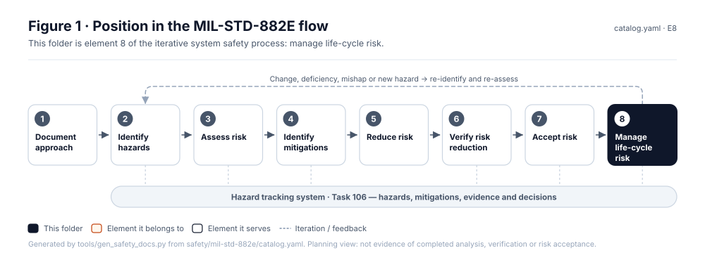
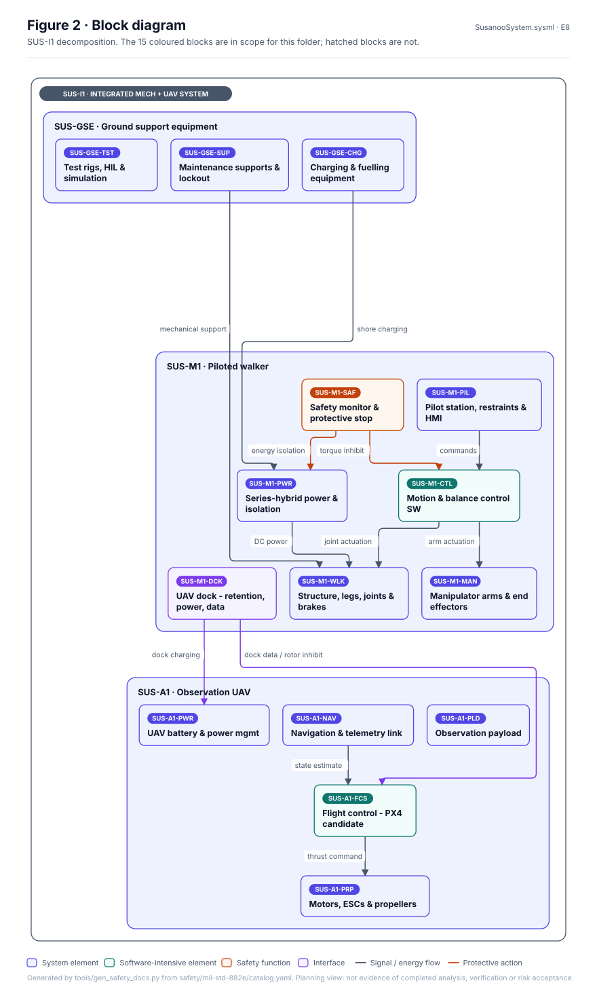
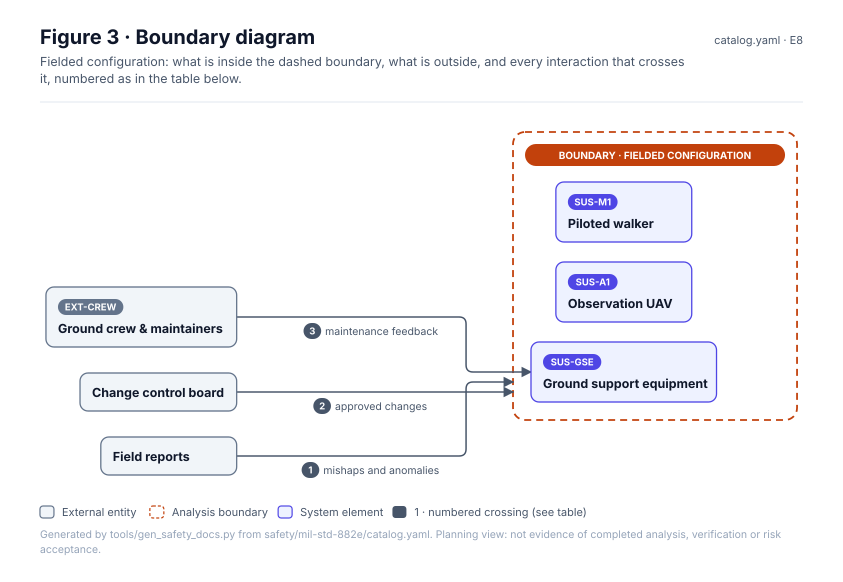
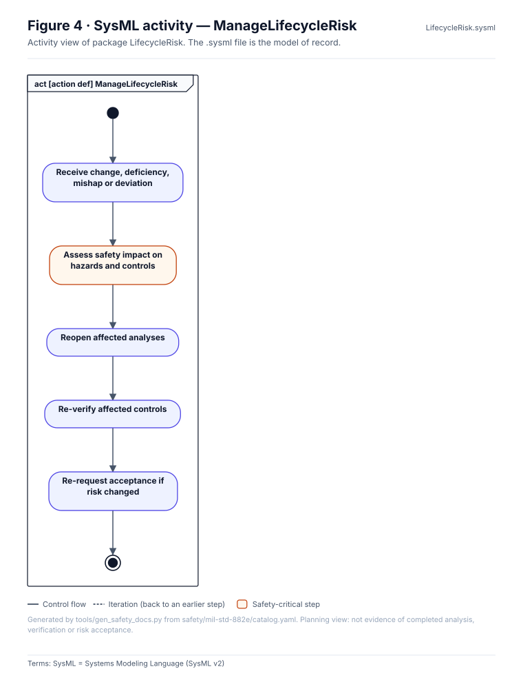
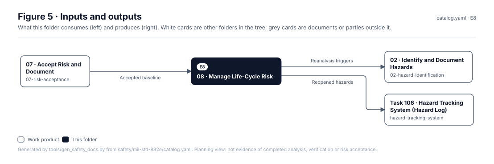

# 08 · Manage Life-Cycle Risk

> **Status:** Scaffold v0.1 — structure, diagrams and model views only
>
> Planning artifact. No completed hazard analysis, verified mitigation, risk acceptance, certification or MIL-STD-882E compliance is claimed. Category names follow MIL-STD-882E; confirm definitions against the controlled standard and the approved SSPP before formal use.

| Field | Value |
|---|---|
| MIL-STD-882E element | 8 — Manage life-cycle risk |
| Lifecycle gate | G7 |
| Applicability | Selected |
| Accountable role | Safety lead with configuration manager |
| Parent folder | [MIL-STD-882E System Safety Work Products](../README.md) |

## Purpose

Keeps the safety baseline valid after release: change impact, deficiencies, mishaps and
near-misses, deviations and periodic progress reporting. Any change reopens affected analyses.

## Position in the MIL-STD-882E flow



## Block diagram



Elements and interfaces: [`architecture/item-definition.yaml`](../../../architecture/item-definition.yaml); SysML: [`Architecture.sysml`](../../../models/sysml/model/Architecture.sysml).

## Boundary diagram



| # | From | To | Crossing / interaction | Interface (item definition) |
|---|---|---|---|---|
| 1 | Field reports | _Fielded configuration (boundary)_ | mishaps and anomalies | — |
| 2 | Change control board | _Fielded configuration (boundary)_ | approved changes | — |
| 3 | EXT-CREW: Ground crew and maintainers | SUS-GSE: Ground support, maintenance supports, charging and test equipment | maintenance feedback | — |

## SysML model

SysML v2 textual view: [`LifecycleRisk.sysml`](LifecycleRisk.sysml), generated from the catalog. It imports the project model in [`models/sysml/model`](../../../models/sysml/model): `SusanooArchitecture` (elements and usage paths) and `SusanooLibrary` (882E vocabulary). The figures are drawn from the same data; the `.sysml` file is the model of record.



<details><summary>SysML v2 source</summary>

```sysml
// LifecycleRisk — generated by tools/gen_safety_docs.py from safety/mil-std-882e/catalog.yaml.
// Do not edit by hand: change the catalog and regenerate.
// Status: planning view only; not evidence of completed analysis or verification.

package LifecycleRisk {
    private import ScalarValues::*;
    private import SusanooLibrary::*;
    private import SusanooArchitecture::*;
    action def ManageLifecycleRisk {
        action receive { doc /* Receive change, deficiency, mishap or deviation */ }
        action impact { doc /* Assess safety impact on hazards and controls */ }
        action reanalyse { doc /* Reopen affected analyses */ }
        action reverify { doc /* Re-verify affected controls */ }
        action redecide { doc /* Re-request acceptance if risk changed */ }
        first start then receive;
        first receive then impact;
        first impact then reanalyse;
        first reanalyse then reverify;
        first reverify then redecide;
        first redecide then done;
    }
}
```

</details>

## Inputs and outputs



| Input | Source |
|---|---|
| Accepted baseline | [07 · Accept Risk and Document](../07-risk-acceptance/README.md) |

| Output | Destination |
|---|---|
| Reanalysis triggers | [02 · Identify and Document Hazards](../02-hazard-identification/README.md) |
| Reopened hazards | [Task 106 · Hazard Tracking System (Hazard Log)](../hazard-tracking-system/README.md) |

## Folder contents

| Item | Description | State |
|---|---|---|
| [`task-107-hazard-management-progress-report/`](task-107-hazard-management-progress-report/README.md) | Task 107 · Hazard Management Progress Report | folder |
| [`task-304-review-changes-deficiencies-mishaps-deviations/`](task-304-review-changes-deficiencies-mishaps-deviations/README.md) | Task 304 · Review of Changes, Deficiencies, Mishaps and Deviations | folder |
| [`figures/`](figures/) | Generated SVG figures (do not edit) | generated |
| [`LifecycleRisk.sysml`](LifecycleRisk.sysml) | Generated SysML v2 view | generated |

<!-- END GENERATED: content below this line is human-authored and preserved -->

## Working content

_No analysis content yet. Add authored material below this heading._
