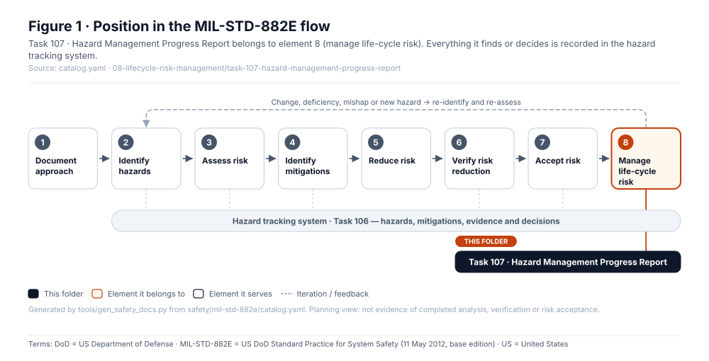
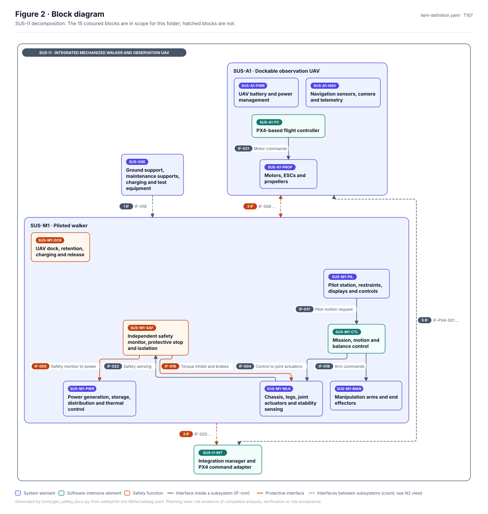
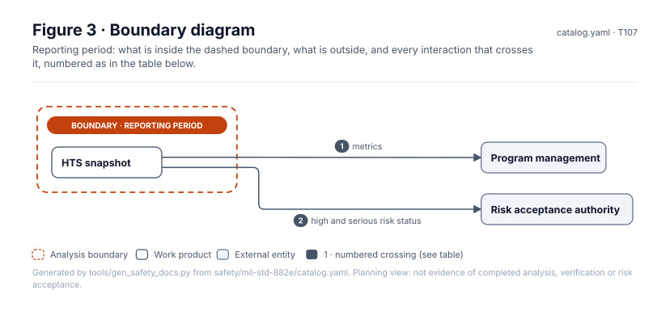
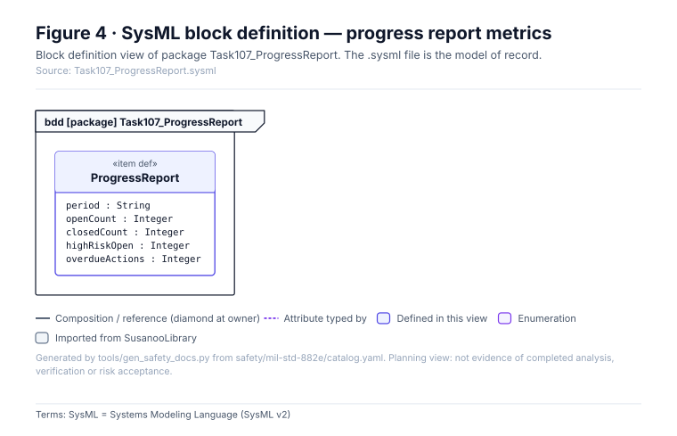
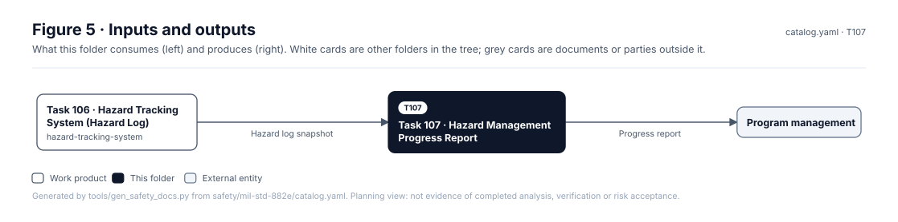

# Task 107 · Hazard Management Progress Report

> **Status:** Scaffold v0.1 — structure, diagrams and model views only
>
> Planning artifact. No completed hazard analysis, verified mitigation, risk acceptance, certification or MIL-STD-882E compliance is claimed. Category names follow MIL-STD-882E; confirm definitions against the controlled standard and the approved SSPP before formal use.

| Field | Value |
|---|---|
| MIL-STD-882E element | 8 — Manage life-cycle risk |
| Tasks | [Task 107 — Hazard Management Progress Report](../../../../docs/wiki/MIL-STD-882E-Task-107.md) |
| Lifecycle gate | Periodic |
| Applicability | Selected |
| Accountable role | Safety lead |
| Parent folder | [08 · Manage Life-Cycle Risk](../README.md) |

## Purpose

Periodic report of hazard counts by status and risk level, overdue actions, and changes since
the last report — generated from the hazard tracking system where possible.

## Position in the MIL-STD-882E flow



## Block diagram



Elements and interfaces: [`architecture/item-definition.yaml`](../../../../architecture/item-definition.yaml); SysML: [`Architecture.sysml`](../../../../models/sysml/model/Architecture.sysml).

## Boundary diagram



| # | From | To | Crossing / interaction | Interface (item definition) |
|---|---|---|---|---|
| 1 | HTS snapshot | Program management | metrics | — |
| 2 | HTS snapshot | Risk acceptance authority | high and serious risk status | — |

## SysML model

SysML v2 textual view: [`Task107_ProgressReport.sysml`](Task107_ProgressReport.sysml), generated from the catalog. It imports the project model in [`models/sysml/model`](../../../../models/sysml/model): `SusanooArchitecture` (elements and usage paths) and `SusanooLibrary` (882E vocabulary). The figures are drawn from the same data; the `.sysml` file is the model of record.



<details><summary>SysML v2 source</summary>

```sysml
// Task107_ProgressReport — generated by tools/gen_safety_docs.py from safety/mil-std-882e/catalog.yaml.
// Do not edit by hand: change the catalog and regenerate.
// Status: planning view only; not evidence of completed analysis or verification.

package Task107_ProgressReport {
    private import ScalarValues::*;
    private import SusanooLibrary::*;
    private import SusanooArchitecture::*;
    item def ProgressReport {
        attribute period : String;
        attribute openCount : Integer;
        attribute closedCount : Integer;
        attribute highRiskOpen : Integer;
        attribute overdueActions : Integer;
    }
}
```

</details>

## Inputs and outputs



| Input | Source |
|---|---|
| Hazard log snapshot | [Task 106 · Hazard Tracking System (Hazard Log)](../../hazard-tracking-system/README.md) |

| Output | Destination |
|---|---|
| Progress report | Program management |

## Folder contents

| Item | Description | State |
|---|---|---|
| `reports/` | Dated reports (YYYY-MM.md) | planned |
| [`figures/`](figures/) | Generated SVG figures (do not edit) | generated |
| [`Task107_ProgressReport.sysml`](Task107_ProgressReport.sysml) | Generated SysML v2 view | generated |

<!-- END GENERATED: content below this line is human-authored and preserved -->

## Working content

_No analysis content yet. Add authored material below this heading._
