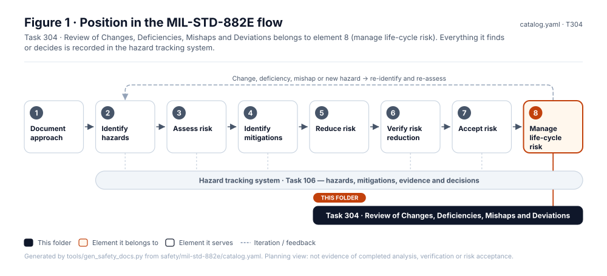
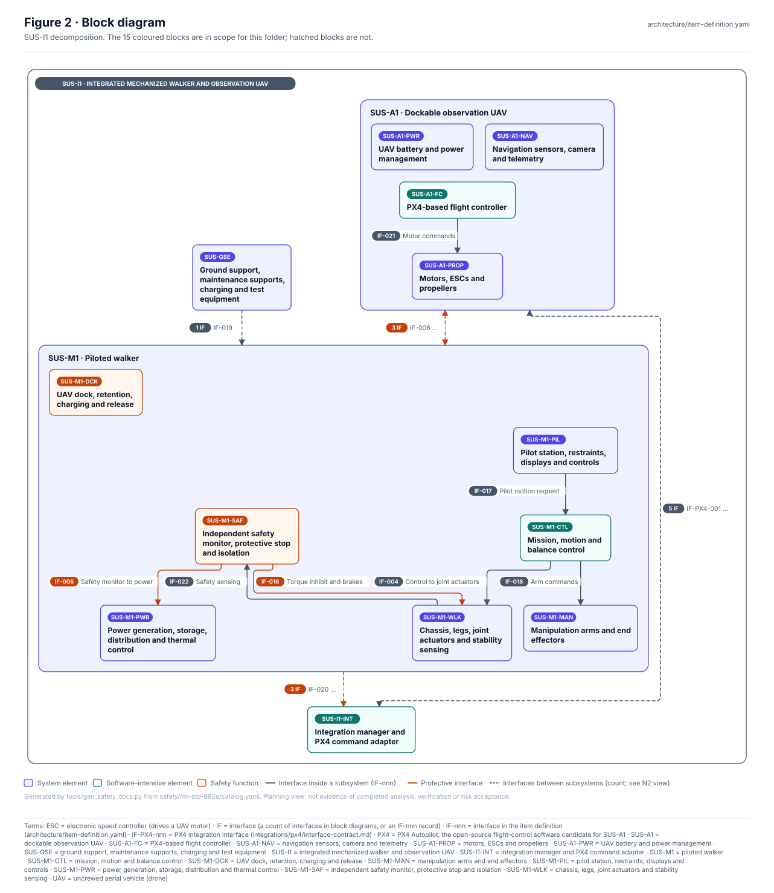
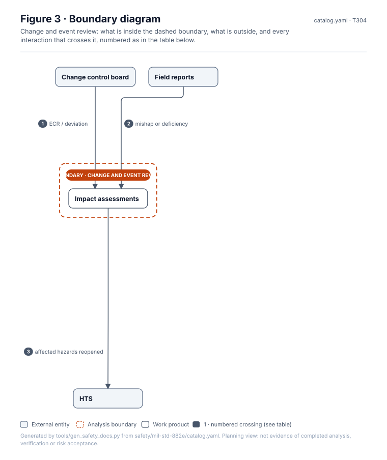
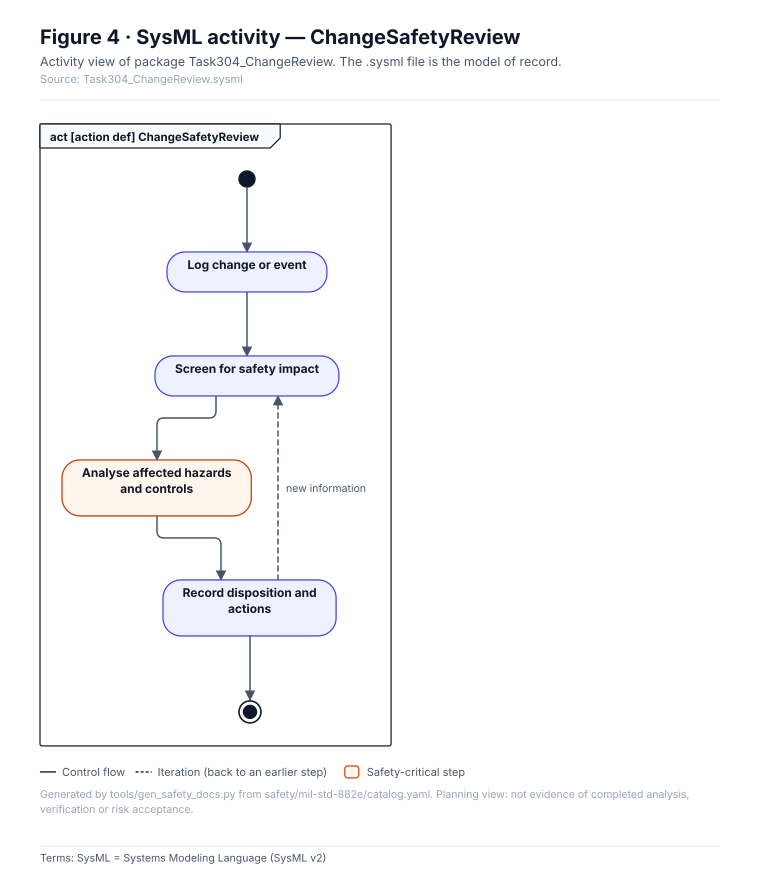
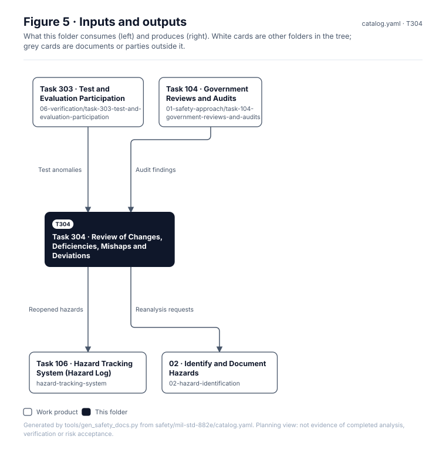

# Task 304 · Review of Changes, Deficiencies, Mishaps and Deviations

> **Status:** Scaffold v0.1 — structure, diagrams and model views only
>
> Planning artifact. No completed hazard analysis, verified mitigation, risk acceptance, certification or MIL-STD-882E compliance is claimed. Category names follow MIL-STD-882E; confirm definitions against the controlled standard and the approved SSPP before formal use.

<!-- terms:start (generated by tools/terms/terms.py; do not edit by hand) -->
<details><summary><b>Terms on this page (9)</b>: abbreviations and codes explained</summary>

| Term | Meaning |
|---|---|
| DoD | US Department of Defense |
| ECR | engineering change request |
| G0–G7 | lifecycle gate (G0 concept to G7 change and sustainment) |
| HTS | hazard tracking system (MIL-STD-882E Task 106; here safety/hazards/) |
| MIL-STD-882E | US DoD Standard Practice for System Safety (11 May 2012, base edition) |
| SSPP | system safety program plan (MIL-STD-882E Task 102) |
| SVG | Scalable Vector Graphics, the figure file format |
| SysML | Systems Modeling Language (SysML v2) |
| US | United States |

All terms: [abbreviations and record codes](https://github.com/jherrodthomas/Project-Susanoo/blob/main/docs/terms.md).

</details>
<!-- terms:end -->

| Field | Value |
|---|---|
| MIL-STD-882E element | 8 — Manage life-cycle risk |
| Tasks | [Task 304 — Review of Changes, Deficiencies, Mishaps and Deviations](../../../../docs/wiki/MIL-STD-882E-Task-304.md) |
| Lifecycle gate | G7 (and any change) |
| Applicability | Selected |
| Accountable role | Safety lead with configuration manager |
| Parent folder | [08 · Manage Life-Cycle Risk](../README.md) |

## Purpose

Safety review of engineering changes, deficiency reports, mishaps, near-misses and deviations;
records the impact decision and links to reopened hazards.

## Position in the MIL-STD-882E flow



## Block diagram



Elements and interfaces: [`architecture/item-definition.yaml`](../../../../architecture/item-definition.yaml); SysML: [`Architecture.sysml`](../../../../models/sysml/model/Architecture.sysml).

## Boundary diagram



| # | From | To | Crossing / interaction | Interface (item definition) |
|---|---|---|---|---|
| 1 | Change control board | Impact assessments | ECR / deviation | — |
| 2 | Field reports | Impact assessments | mishap or deficiency | — |
| 3 | Impact assessments | HTS | affected hazards reopened | — |

## SysML model

SysML v2 textual view: [`Task304_ChangeReview.sysml`](Task304_ChangeReview.sysml), generated from the catalog. It imports the project model in [`models/sysml/model`](../../../../models/sysml/model): `SusanooArchitecture` (elements and usage paths) and `SusanooLibrary` (882E vocabulary). The figures are drawn from the same data; the `.sysml` file is the model of record.



<details><summary>SysML v2 source</summary>

```sysml
// Task304_ChangeReview — generated by tools/gen_safety_docs.py from safety/mil-std-882e/catalog.yaml.
// Do not edit by hand: change the catalog and regenerate.
// Status: planning view only; not evidence of completed analysis or verification.

package Task304_ChangeReview {
    private import ScalarValues::*;
    private import SusanooLibrary::*;
    private import SusanooArchitecture::*;
    action def ChangeSafetyReview {
        action intake { doc /* Log change or event */ }
        action screen { doc /* Screen for safety impact */ }
        action analyse { doc /* Analyse affected hazards and controls */ }
        action recordDisposition { doc /* Record disposition and actions */ }
        first start then intake;
        first intake then screen;
        first screen then analyse;
        first analyse then recordDisposition;
        first recordDisposition then done;
        // iteration: recordDisposition -> screen when new information (informal; merge node omitted)
    }
}
```

</details>

## Inputs and outputs



| Input | Source |
|---|---|
| Test anomalies | [Task 303 · Test and Evaluation Participation](../../06-verification/task-303-test-and-evaluation-participation/README.md) |
| Audit findings | [Task 104 · Government Reviews and Audits](../../01-safety-approach/task-104-government-reviews-and-audits/README.md) |

| Output | Destination |
|---|---|
| Reopened hazards | [Task 106 · Hazard Tracking System (Hazard Log)](../../hazard-tracking-system/README.md) |
| Reanalysis requests | [02 · Identify and Document Hazards](../../02-hazard-identification/README.md) |

## Folder contents

| Item | Description | State |
|---|---|---|
| `reviews/` | One impact assessment per change or event | planned |
| [`figures/`](figures/) | Generated SVG figures (do not edit) | generated |
| [`Task304_ChangeReview.sysml`](Task304_ChangeReview.sysml) | Generated SysML v2 view | generated |

<!-- END GENERATED: content below this line is human-authored and preserved -->

## Working content

_No analysis content yet. Add authored material below this heading._
