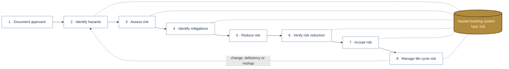
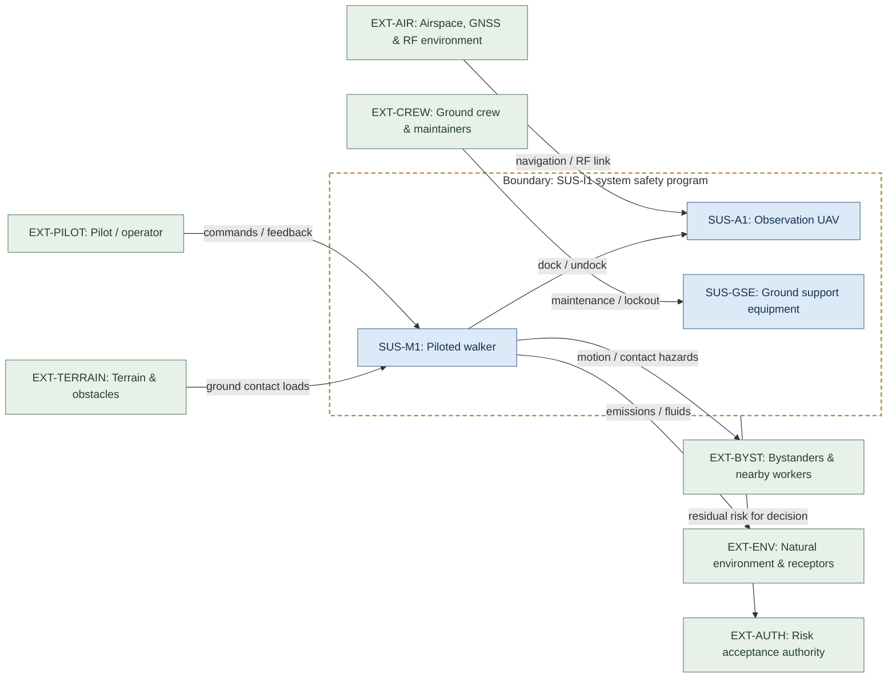
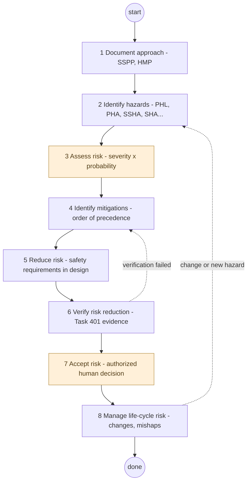
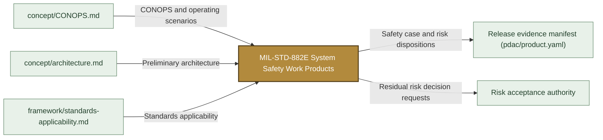

# MIL-STD-882E System Safety Work Products

> **Status:** Scaffold v0.1 — structure, diagrams and model views only
>
> Planning artifact. No completed hazard analysis, verified mitigation, risk acceptance, certification or MIL-STD-882E compliance is claimed. Category names follow MIL-STD-882E; confirm definitions against the controlled standard and the approved SSPP before formal use.

| Field | Value |
|---|---|
| Accountable role | Safety lead |
| Procedure | [`docs/wiki/MIL-STD-882E-Handbook.md`](../../docs/wiki/MIL-STD-882E-Handbook.md) |

## Purpose

Controlled work-product tree for the SUS-I1 system safety program, organised by the
eight MIL-STD-882E process elements (folders `01`–`08`) with the 25 tasks nested under the
element they primarily serve. `00-system-definition` holds the analysis baseline and canonical
SysML models; `hazard-tracking-system` (Task 106) and `software-safety` (Section 4.4) cut
across all elements. Procedures live in the [Wiki handbook](../../docs/wiki/MIL-STD-882E-Handbook.md);
this tree holds the actual records and evidence.

## Position in the MIL-STD-882E flow

Highlighted node(s) show where this folder sits in the eight-element iterative flow. Dotted links are feedback and hazard-tracking-system interactions.



## Block diagram

System elements of SUS-I1 in scope for this folder are coloured (blue = system, amber = safety function, purple = interface); greyed blocks are out of scope. Source of truth: [`SusanooSystem.sysml`](00-system-definition/sysml/SusanooSystem.sysml).

```mermaid
flowchart TB
  subgraph SUS_I1["SUS-I1: Integrated mech + UAV system"]
    direction TB
    subgraph SUS_M1["SUS-M1: Piloted walker"]
      direction TB
      SUS_M1_WLK["SUS-M1-WLK: Structure, legs, joints & brakes"]
      SUS_M1_MAN["SUS-M1-MAN: Manipulator arms & end effectors"]
      SUS_M1_PIL["SUS-M1-PIL: Pilot station, restraints & HMI"]
      SUS_M1_PWR["SUS-M1-PWR: Series-hybrid power & isolation"]
      SUS_M1_CTL["SUS-M1-CTL: Motion & balance control SW"]
      SUS_M1_SAF["SUS-M1-SAF: Safety monitor & protective stop"]
      SUS_M1_DCK["SUS-M1-DCK: UAV dock - retention, power, data"]
    end
    subgraph SUS_A1["SUS-A1: Observation UAV"]
      direction TB
      SUS_A1_FCS["SUS-A1-FCS: Flight control - PX4 candidate"]
      SUS_A1_PRP["SUS-A1-PRP: Motors, ESCs & propellers"]
      SUS_A1_PWR["SUS-A1-PWR: UAV battery & power mgmt"]
      SUS_A1_NAV["SUS-A1-NAV: Navigation & telemetry link"]
      SUS_A1_PLD["SUS-A1-PLD: Observation payload"]
    end
    subgraph SUS_GSE["SUS-GSE: Ground support equipment"]
      direction TB
      SUS_GSE_SUP["SUS-GSE-SUP: Maintenance supports & lockout"]
      SUS_GSE_CHG["SUS-GSE-CHG: Charging & fuelling equipment"]
      SUS_GSE_TST["SUS-GSE-TST: Test rigs, HIL & simulation"]
    end
  end
  SUS_M1_PIL -->|"commands"| SUS_M1_CTL
  SUS_M1_CTL -->|"joint actuation"| SUS_M1_WLK
  SUS_M1_CTL -->|"arm actuation"| SUS_M1_MAN
  SUS_M1_PWR -->|"DC power"| SUS_M1_WLK
  SUS_M1_SAF -->|"torque inhibit"| SUS_M1_CTL
  SUS_M1_SAF -->|"energy isolation"| SUS_M1_PWR
  SUS_M1_DCK -->|"dock charging"| SUS_A1_PWR
  SUS_M1_DCK -->|"dock data / rotor inhibit"| SUS_A1_FCS
  SUS_A1_NAV -->|"state estimate"| SUS_A1_FCS
  SUS_A1_FCS -->|"thrust command"| SUS_A1_PRP
  SUS_GSE_SUP -->|"mechanical support"| SUS_M1_WLK
  SUS_GSE_CHG -->|"shore charging"| SUS_M1_PWR
  class SUS_M1_WLK system
  class SUS_M1_MAN system
  class SUS_M1_PIL system
  class SUS_M1_PWR system
  class SUS_M1_CTL system
  class SUS_M1_SAF safety
  class SUS_M1_DCK interface
  class SUS_A1_FCS system
  class SUS_A1_PRP system
  class SUS_A1_PWR system
  class SUS_A1_NAV system
  class SUS_A1_PLD system
  class SUS_GSE_SUP system
  class SUS_GSE_CHG system
  class SUS_GSE_TST system
  classDef system fill:#dceaf7,stroke:#55758f,color:#17324d
  classDef safety fill:#fff0d9,stroke:#b28a3d,color:#513c16
  classDef external fill:#e8f1e9,stroke:#63886a,color:#23412c
  classDef interface fill:#eae7f5,stroke:#8370a3,color:#30254a
  classDef muted fill:#f4f4f4,stroke:#b5b5b5,color:#8a8a8a,stroke-dasharray: 4 3
  classDef current fill:#b28a3d,stroke:#513c16,color:#ffffff,stroke-width:2px
  classDef work fill:#ffffff,stroke:#55758f,color:#17324d
```



## Boundary diagram

Dashed frame = **SUS-I1 system safety program** boundary. Everything outside it is an external entity or another folder's scope.



| From | To | Crossing / interaction |
|---|---|---|
| EXT-PILOT: Pilot / operator | SUS-M1: Piloted walker | commands / feedback |
| EXT-CREW: Ground crew & maintainers | SUS-GSE: Ground support equipment | maintenance / lockout |
| SUS-M1: Piloted walker | EXT-BYST: Bystanders & nearby workers | motion / contact hazards |
| EXT-TERRAIN: Terrain & obstacles | SUS-M1: Piloted walker | ground contact loads |
| EXT-AIR: Airspace, GNSS & RF environment | SUS-A1: Observation UAV | navigation / RF link |
| SUS-M1: Piloted walker | EXT-ENV: Natural environment & receptors | emissions / fluids |
| SUS-M1: Piloted walker | SUS-A1: Observation UAV | dock / undock |
| _SUS-I1 system safety program (boundary)_ | EXT-AUTH: Risk acceptance authority | residual risk for decision |

## SysML model

SysML v2 textual view: [`SafetyProgramFlow.sysml`](SafetyProgramFlow.sysml) (generated from the catalog; imports [`SusanooSystem`](00-system-definition/sysml/SusanooSystem.sysml) and [`SusanooSafety`](00-system-definition/sysml/SusanooSafety.sysml)). The Mermaid rendering below is a reading aid; the `.sysml` file is the model of record.

### Activity (act) — eight-element iterative process



<details><summary>SysML v2 source</summary>

```sysml
// SafetyProgramFlow — generated by tools/gen_safety_docs.py from safety/mil-std-882e/catalog.yaml.
// Do not edit by hand: change the catalog and regenerate.
// Status: planning view only; not evidence of completed analysis or verification.

package SafetyProgramFlow {
    private import ScalarValues::*;
    private import SusanooSystem::*;
    private import SusanooSafety::*;
    action def SystemSafetyProcess {
        doc /* Iterative MIL-STD-882E process applied to SUS-I1 configurations. */
        action documentApproach { doc /* 1 Document approach - SSPP, HMP */ }
        action identifyHazards { doc /* 2 Identify hazards - PHL, PHA, SSHA, SHA... */ }
        action assessRisk { doc /* 3 Assess risk - severity x probability */ }
        action identifyMitigations { doc /* 4 Identify mitigations - order of precedence */ }
        action reduceRisk { doc /* 5 Reduce risk - safety requirements in design */ }
        action verifyRiskReduction { doc /* 6 Verify risk reduction - Task 401 evidence */ }
        action acceptRisk { doc /* 7 Accept risk - authorized human decision */ }
        action manageLifecycleRisk { doc /* 8 Manage life-cycle risk - changes, mishaps */ }
        first start;
        then documentApproach;
        first documentApproach then identifyHazards;
        first identifyHazards then assessRisk;
        first assessRisk then identifyMitigations;
        first identifyMitigations then reduceRisk;
        first reduceRisk then verifyRiskReduction;
        first verifyRiskReduction then acceptRisk;
        first acceptRisk then manageLifecycleRisk;
        first manageLifecycleRisk then done;
        // iteration: manageLifecycleRisk -> identifyHazards when change or new hazard (informal; merge node omitted)
        // iteration: verifyRiskReduction -> identifyMitigations when verification failed (informal; merge node omitted)
    }
}
```

</details>

## Inputs and outputs



| Input | Source |
|---|---|
| CONOPS and operating scenarios | [`concept/CONOPS.md`](../../concept/CONOPS.md) |
| Preliminary architecture | [`concept/architecture.md`](../../concept/architecture.md) |
| Standards applicability | [`framework/standards-applicability.md`](../../framework/standards-applicability.md) |

| Output | Destination |
|---|---|
| Safety case and risk dispositions | Release evidence manifest (pdac/product.yaml) |
| Residual risk decision requests | Risk acceptance authority |

## Folder contents

| Item | Description | State |
|---|---|---|
| [`00-system-definition/`](00-system-definition/README.md) | 00 · System Definition and Analysis Baseline | folder |
| [`01-safety-approach/`](01-safety-approach/README.md) | 01 · Document the System Safety Approach | folder |
| [`02-hazard-identification/`](02-hazard-identification/README.md) | 02 · Identify and Document Hazards | folder |
| [`03-risk-assessment/`](03-risk-assessment/README.md) | 03 · Assess and Document Risk | folder |
| [`04-mitigation-identification/`](04-mitigation-identification/README.md) | 04 · Identify and Document Risk Mitigation Measures | folder |
| [`05-risk-reduction/`](05-risk-reduction/README.md) | 05 · Reduce Risk | folder |
| [`06-verification/`](06-verification/README.md) | 06 · Verify, Validate and Document Risk Reduction | folder |
| [`07-risk-acceptance/`](07-risk-acceptance/README.md) | 07 · Accept Risk and Document | folder |
| [`08-lifecycle-risk-management/`](08-lifecycle-risk-management/README.md) | 08 · Manage Life-Cycle Risk | folder |
| [`hazard-tracking-system/`](hazard-tracking-system/README.md) | Task 106 · Hazard Tracking System (Hazard Log) | folder |
| [`software-safety/`](software-safety/README.md) | Software Contribution to System Risk (Section 4.4) | folder |
| [`templates/`](templates/README.md) | Work-Product Templates | folder |
| [`catalog.yaml`](catalog.yaml) | Source of truth for this tree; regenerate READMEs after editing | present |
| [`SafetyProgramFlow.sysml`](SafetyProgramFlow.sysml) | Generated SysML v2 view | generated |

## Folder map

| Folder | 882E element | Tasks |
|---|---|---|
| `00-system-definition/` | Prerequisite to all | System baseline, canonical SysML |
| `01-safety-approach/` | 1 | 101, 102, 103, 104, 105, 108 |
| `02-hazard-identification/` | 2 | 201–210 |
| `03-risk-assessment/` | 3 | Risk matrix (Table I–III usage) |
| `04-mitigation-identification/` | 4 | Design order of precedence |
| `05-risk-reduction/` | 5 | Safety requirements |
| `06-verification/` | 6 | 303, 401, 402, 403 |
| `07-risk-acceptance/` | 7 | 301, 302, acceptance records |
| `08-lifecycle-risk-management/` | 8 | 107, 304 |
| `hazard-tracking-system/` | Cross-cutting | 106 |
| `software-safety/` | Cross-cutting | Section 4.4 |
| `templates/` | — | Record templates |

## Documentation rule

Every folder README in this tree must carry the diagram set defined in
[`framework/documentation-standard.md`](../../framework/documentation-standard.md). Generate with
`python3 tools/gen_safety_docs.py`; CI runs `python3 tools/check_readme_diagrams.py`.

<!-- END GENERATED: content below this line is human-authored and preserved -->

## Working content

_No analysis content yet. Add authored material below this heading._
