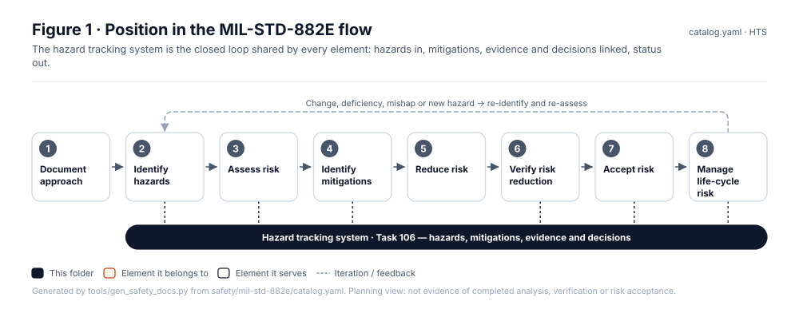
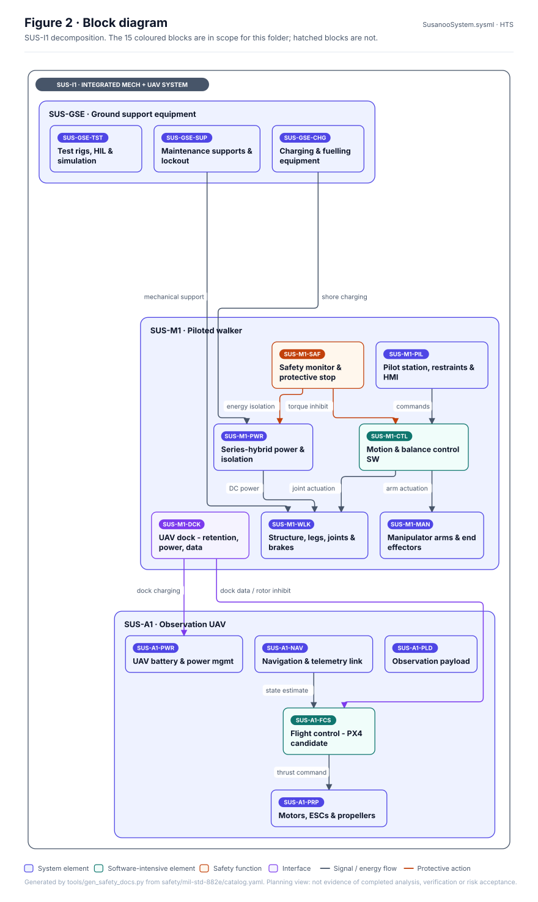
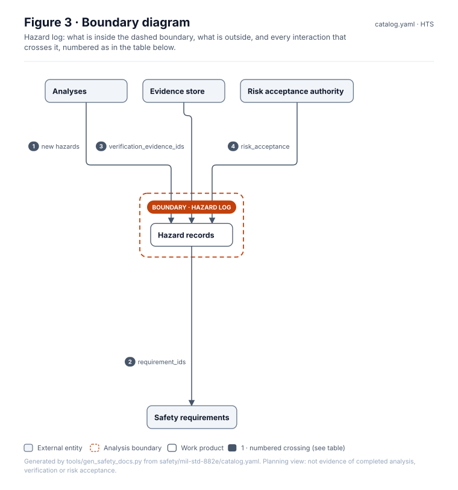
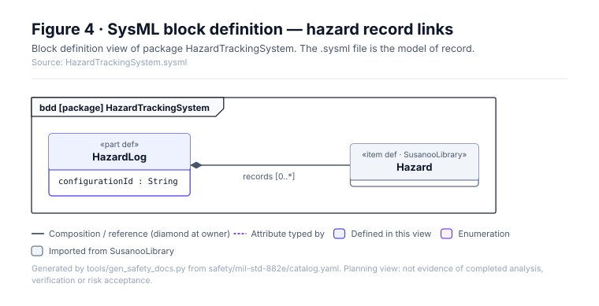
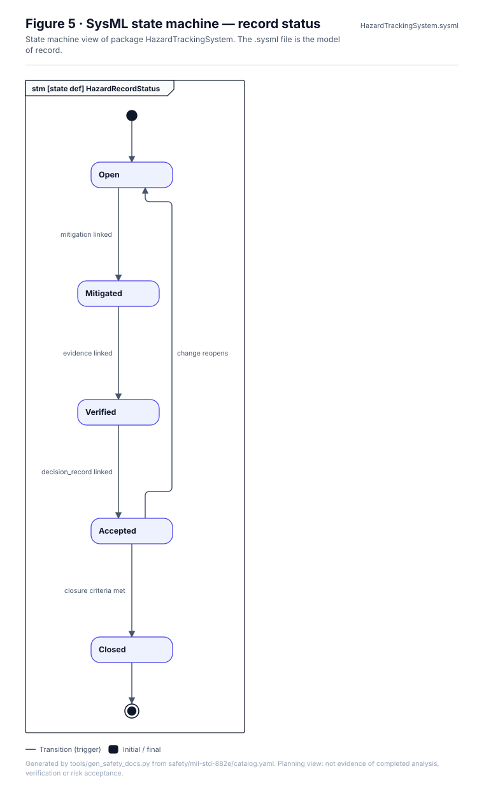
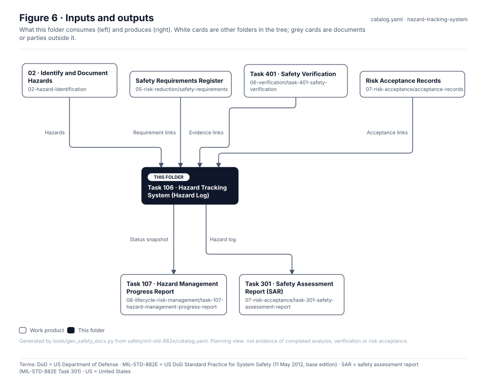

# Task 106 · Hazard Tracking System (Hazard Log)

> **Status:** Scaffold v0.1 — structure, diagrams and model views only
>
> Planning artifact. No completed hazard analysis, verified mitigation, risk acceptance, certification or MIL-STD-882E compliance is claimed. Category names follow MIL-STD-882E; confirm definitions against the controlled standard and the approved SSPP before formal use.

<!-- terms:start (generated by tools/terms/terms.py; do not edit by hand) -->
<details><summary><b>Terms on this page (9)</b>: abbreviations and codes explained</summary>

| Term | Meaning |
|---|---|
| DoD | US Department of Defense |
| G0–G7 | lifecycle gate (G0 concept to G7 change and sustainment) |
| MIL-STD-882E | US DoD Standard Practice for System Safety (11 May 2012, base edition) |
| SAR | safety assessment report (MIL-STD-882E Task 301) |
| SSPP | system safety program plan (MIL-STD-882E Task 102) |
| SVG | Scalable Vector Graphics, the figure file format |
| SysML | Systems Modeling Language (SysML v2) |
| US | United States |
| YAML | a plain-text data format used for the records |

All terms: [abbreviations and record codes](https://github.com/jherrodthomas/Project-Susanoo/blob/main/docs/terms.md).

</details>
<!-- terms:end -->

| Field | Value |
|---|---|
| Tasks | [Task 106 — Hazard Tracking System](../../../docs/wiki/MIL-STD-882E-Task-106.md) |
| Lifecycle gate | G0 onward |
| Applicability | Selected |
| Accountable role | Safety lead |
| Parent folder | [MIL-STD-882E System Safety Work Products](../README.md) |

## Purpose

Closed-loop hazard log used by every element. The records live in
[`safety/hazards/`](../../hazards/) (one YAML per hazard, `templates/hazard-record.yaml`) and are validated by
`tools/pdac`; the generated export is [`safety/generated/hts.csv`](../../generated/hts.csv). This folder
describes the system; it holds no records of its own.

## Position in the MIL-STD-882E flow



## Block diagram



Elements and interfaces: [`architecture/item-definition.yaml`](../../../architecture/item-definition.yaml); SysML: [`Architecture.sysml`](../../../models/sysml/model/Architecture.sysml).

## Boundary diagram



| # | From | To | Crossing / interaction | Interface (item definition) |
|---|---|---|---|---|
| 1 | Analyses | Hazard records | new hazards | — |
| 2 | Hazard records | Safety requirements | requirement_ids | — |
| 3 | Evidence store | Hazard records | verification_evidence_ids | — |
| 4 | Risk acceptance authority | Hazard records | risk_acceptance | — |

## SysML model

SysML v2 textual view: [`HazardTrackingSystem.sysml`](HazardTrackingSystem.sysml), generated from the catalog. It imports the project model in [`models/sysml/model`](../../../models/sysml/model): `SusanooArchitecture` (elements and usage paths) and `SusanooLibrary` (882E vocabulary). The figures are drawn from the same data; the `.sysml` file is the model of record.





<details><summary>SysML v2 source</summary>

```sysml
// HazardTrackingSystem — generated by tools/gen_safety_docs.py from safety/mil-std-882e/catalog.yaml.
// Do not edit by hand: change the catalog and regenerate.
// Status: planning view only; not evidence of completed analysis or verification.

package HazardTrackingSystem {
    private import ScalarValues::*;
    private import SusanooLibrary::*;
    private import SusanooArchitecture::*;
    part def HazardLog {
        attribute configurationId : String;
        ref item records : Hazard[0..*];
    }

    attribute def ChangeReopens;
    attribute def ClosureCriteriaMet;
    attribute def DecisionRecordLinked;
    attribute def EvidenceLinked;
    attribute def MitigationLinked;
    state def HazardRecordStatus {
        entry; then Open;
        state Open;
        state Mitigated;
        state Verified;
        state Accepted;
        state Closed;
        transition t1 first Open accept MitigationLinked then Mitigated;
        transition t2 first Mitigated accept EvidenceLinked then Verified;
        transition t3 first Verified accept DecisionRecordLinked then Accepted;
        transition t4 first Accepted accept ClosureCriteriaMet then Closed;
        transition t5 first Accepted accept ChangeReopens then Open;
    }
}
```

</details>

## Inputs and outputs



| Input | Source |
|---|---|
| Hazards | [02 · Identify and Document Hazards](../02-hazard-identification/README.md) |
| Requirement links | [Safety Requirements Register](../05-risk-reduction/safety-requirements/README.md) |
| Evidence links | [Task 401 · Safety Verification](../06-verification/task-401-safety-verification/README.md) |
| Acceptance links | [Risk Acceptance Records](../07-risk-acceptance/acceptance-records/README.md) |

| Output | Destination |
|---|---|
| Status snapshot | [Task 107 · Hazard Management Progress Report](../08-lifecycle-risk-management/task-107-hazard-management-progress-report/README.md) |
| Hazard log | [Task 301 · Safety Assessment Report (SAR)](../07-risk-acceptance/task-301-safety-assessment-report/README.md) |

## Folder contents

| Item | Description | State |
|---|---|---|
| [`figures/`](figures/) | Generated SVG figures (do not edit) | generated |
| [`HazardTrackingSystem.sysml`](HazardTrackingSystem.sysml) | Generated SysML v2 view | generated |

<!-- END GENERATED: content below this line is human-authored and preserved -->

## Working content

_No analysis content yet. Add authored material below this heading._
