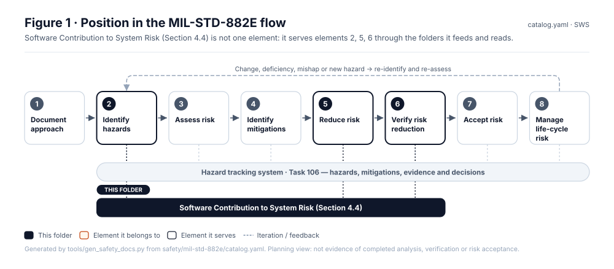
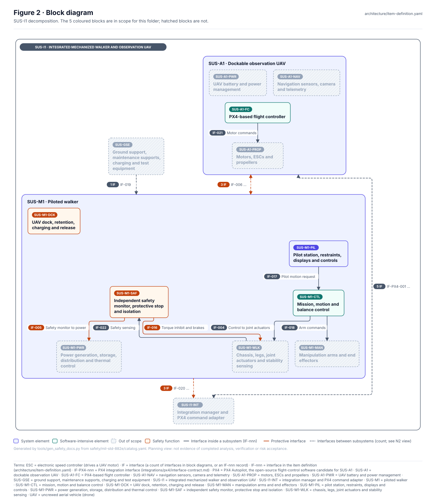
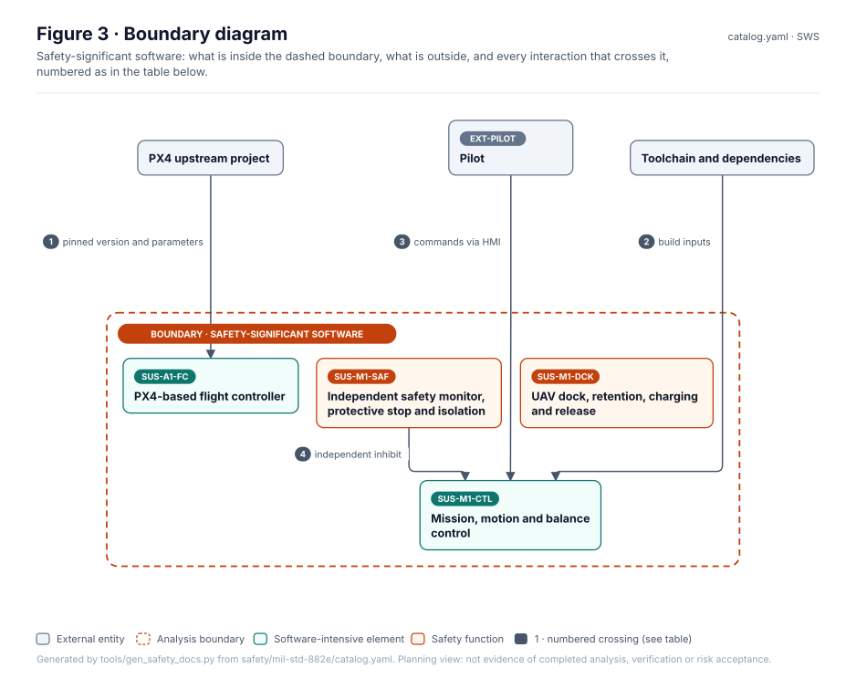
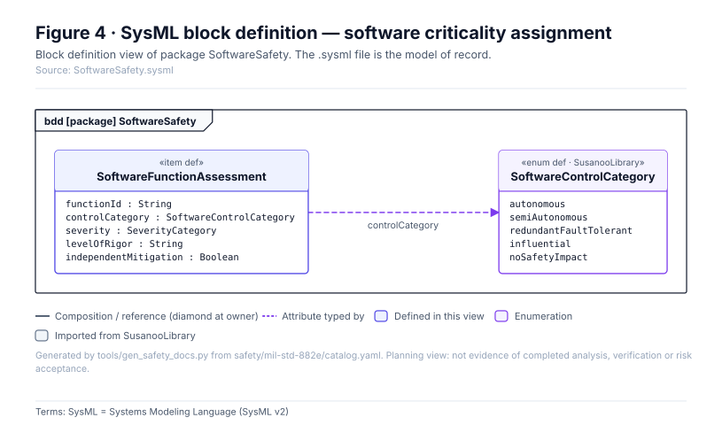
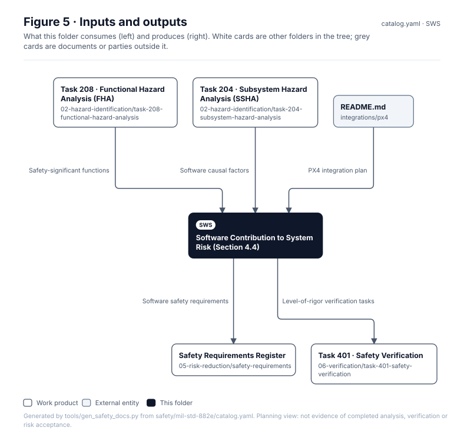

# Software Contribution to System Risk (Section 4.4)

> **Status:** Scaffold v0.1 — structure, diagrams and model views only
>
> Planning artifact. No completed hazard analysis, verified mitigation, risk acceptance, certification or MIL-STD-882E compliance is claimed. Category names follow MIL-STD-882E; confirm definitions against the controlled standard and the approved SSPP before formal use.

| Field | Value |
|---|---|
| Lifecycle gate | G1–G5 |
| Applicability | Selected |
| Accountable role | Software safety lead |
| Procedure | [`docs/wiki/MIL-STD-882E-Software-Safety.md`](../../../docs/wiki/MIL-STD-882E-Software-Safety.md) |
| Parent folder | [MIL-STD-882E System Safety Work Products](../README.md) |

## Purpose

Software control category, software safety criticality and level-of-rigor assignments for
walker motion control, protective stop, pilot HMI, dock interlocks and PX4. The safety-significant
software function records live in [`safety/software/`](../../software/) (SSF-001 ...). MIL-STD-882E
criticality is kept distinct from any DO-178C assurance level.

## Position in the MIL-STD-882E flow



## Block diagram



Source of truth: [`SusanooSystem.sysml`](../00-system-definition/sysml/SusanooSystem.sysml).

## Boundary diagram



| # | From | To | Crossing / interaction |
|---|---|---|---|
| 1 | PX4 upstream project | SUS-A1-FCS: Flight control - PX4 candidate | pinned version and parameters |
| 2 | Toolchain and dependencies | SUS-M1-CTL: Motion & balance control SW | build inputs |
| 3 | EXT-PILOT: Pilot / operator | SUS-M1-CTL: Motion & balance control SW | commands via HMI |
| 4 | SUS-M1-SAF: Safety monitor & protective stop | SUS-M1-CTL: Motion & balance control SW | independent inhibit |

## SysML model

SysML v2 textual view: [`SoftwareSafety.sysml`](SoftwareSafety.sysml), generated from the catalog. It imports [`SusanooSystem`](../00-system-definition/sysml/SusanooSystem.sysml) and [`SusanooSafety`](../00-system-definition/sysml/SusanooSafety.sysml). The figures are drawn from the same data; the `.sysml` file is the model of record.



<details><summary>SysML v2 source</summary>

```sysml
// SoftwareSafety — generated by tools/gen_safety_docs.py from safety/mil-std-882e/catalog.yaml.
// Do not edit by hand: change the catalog and regenerate.
// Status: planning view only; not evidence of completed analysis or verification.

package SoftwareSafety {
    private import ScalarValues::*;
    private import SusanooSystem::*;
    private import SusanooSafety::*;
    item def SoftwareFunctionAssessment {
        attribute functionId : String;
        attribute controlCategory : SoftwareControlCategory;
        attribute severity : SeverityCategory;
        attribute levelOfRigor : String;
        attribute independentMitigation : Boolean;
    }
    enum def SoftwareControlCategory {
        enum Autonomous;
        enum SemiAutonomous;
        enum RedundantFaultTolerant;
        enum Influential;
        enum NoSafetyImpact;
    }
}
```

</details>

## Inputs and outputs



| Input | Source |
|---|---|
| Safety-significant functions | [Task 208 · Functional Hazard Analysis (FHA)](../02-hazard-identification/task-208-functional-hazard-analysis/README.md) |
| Software causal factors | [Task 204 · Subsystem Hazard Analysis (SSHA)](../02-hazard-identification/task-204-subsystem-hazard-analysis/README.md) |
| PX4 integration plan | [`integrations/px4/README.md`](../../../integrations/px4/README.md) |

| Output | Destination |
|---|---|
| Software safety requirements | [Safety Requirements Register](../05-risk-reduction/safety-requirements/README.md) |
| Level-of-rigor verification tasks | [Task 401 · Safety Verification](../06-verification/task-401-safety-verification/README.md) |

## Folder contents

| Item | Description | State |
|---|---|---|
| `swci-assessment.csv` | Function x control category x severity x LOR | planned |
| [`figures/`](figures/) | Generated SVG figures (do not edit) | generated |
| [`SoftwareSafety.sysml`](SoftwareSafety.sysml) | Generated SysML v2 view | generated |

<!-- END GENERATED: content below this line is human-authored and preserved -->

## Working content

_No analysis content yet. Add authored material below this heading._
