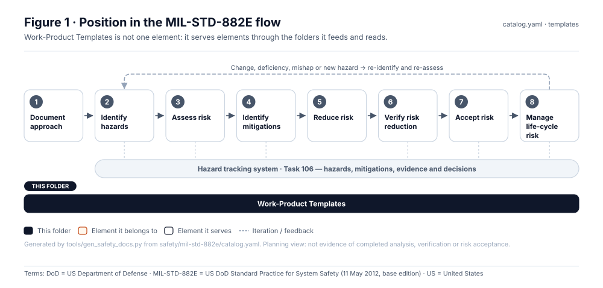
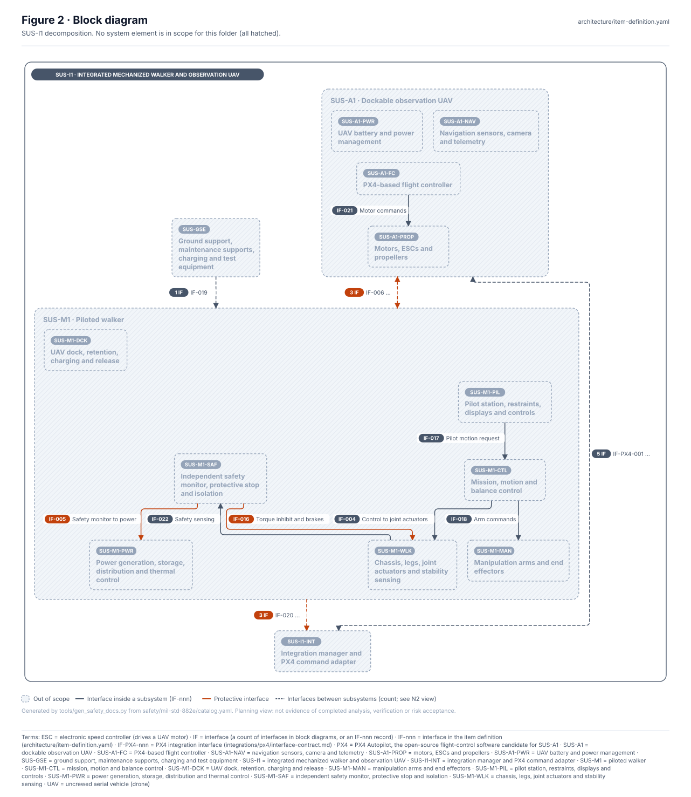
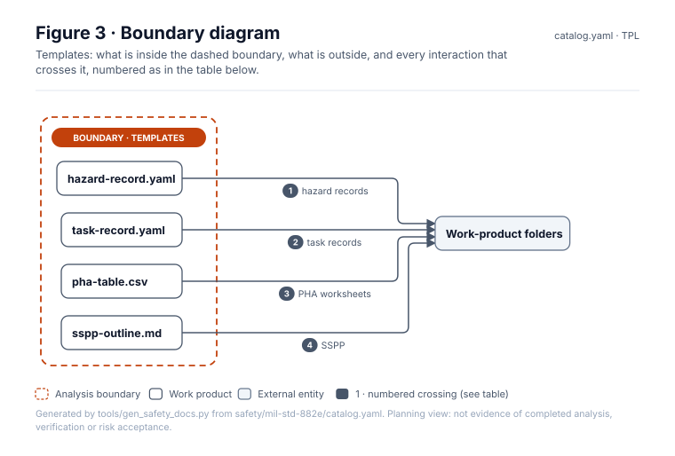
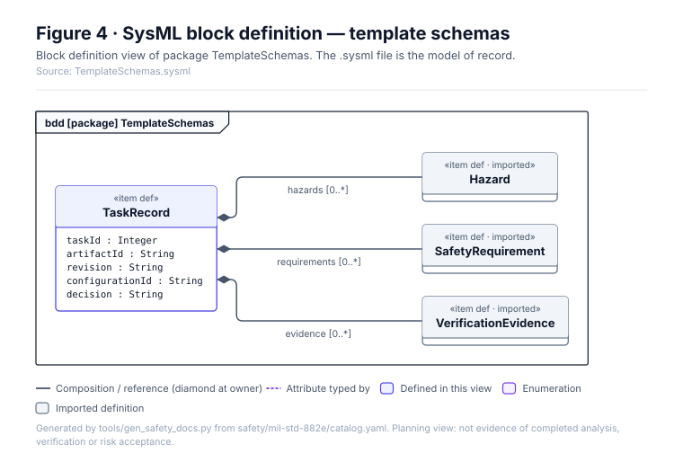
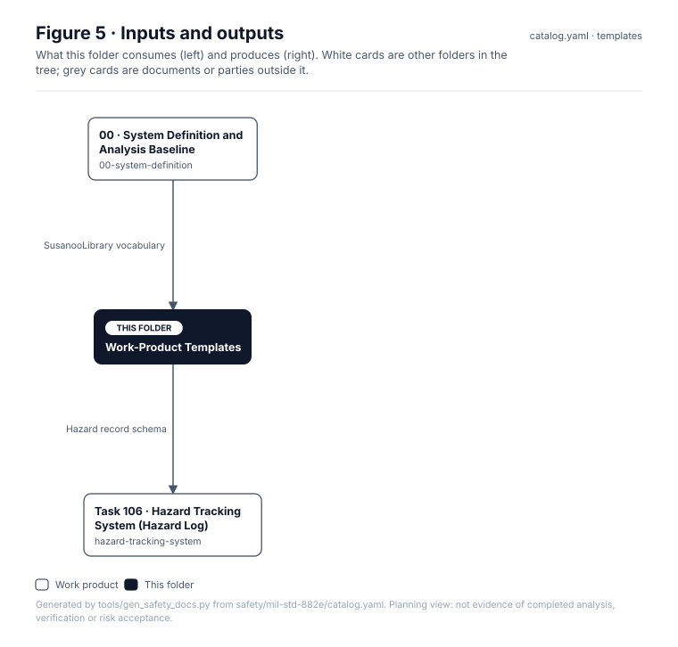

# Work-Product Templates

> **Status:** Scaffold v0.1 — structure, diagrams and model views only
>
> Planning artifact. No completed hazard analysis, verified mitigation, risk acceptance, certification or MIL-STD-882E compliance is claimed. Category names follow MIL-STD-882E; confirm definitions against the controlled standard and the approved SSPP before formal use.

| Field | Value |
|---|---|
| Lifecycle gate | All |
| Accountable role | Safety lead |
| Parent folder | [MIL-STD-882E System Safety Work Products](../README.md) |

## Purpose

Record templates used across the tree. Templates mirror `SusanooSafety.sysml` so records,
models and checks share one vocabulary.

## Position in the MIL-STD-882E flow



## Block diagram



Source of truth: [`SusanooSystem.sysml`](../00-system-definition/sysml/SusanooSystem.sysml).

## Boundary diagram



| # | From | To | Crossing / interaction |
|---|---|---|---|
| 1 | hazard-record.yaml | Work-product folders | hazard records |
| 2 | task-record.yaml | Work-product folders | task records |
| 3 | pha-table.csv | Work-product folders | PHA worksheets |
| 4 | sspp-outline.md | Work-product folders | SSPP |

## SysML model

SysML v2 textual view: [`TemplateSchemas.sysml`](TemplateSchemas.sysml), generated from the catalog. It imports [`SusanooSystem`](../00-system-definition/sysml/SusanooSystem.sysml) and [`SusanooSafety`](../00-system-definition/sysml/SusanooSafety.sysml). The figures are drawn from the same data; the `.sysml` file is the model of record.



<details><summary>SysML v2 source</summary>

```sysml
// TemplateSchemas — generated by tools/gen_safety_docs.py from safety/mil-std-882e/catalog.yaml.
// Do not edit by hand: change the catalog and regenerate.
// Status: planning view only; not evidence of completed analysis or verification.

package TemplateSchemas {
    private import ScalarValues::*;
    private import SusanooSystem::*;
    private import SusanooSafety::*;
    item def TaskRecord {
        attribute taskId : Integer;
        attribute artifactId : String;
        attribute revision : String;
        attribute configurationId : String;
        attribute decision : String;
        ref item hazards : Hazard[0..*];
        ref item requirements : SafetyRequirement[0..*];
        ref item evidence : VerificationEvidence[0..*];
    }
}
```

</details>

## Inputs and outputs



| Input | Source |
|---|---|
| SusanooSafety vocabulary | [00 · System Definition and Analysis Baseline](../00-system-definition/README.md) |

| Output | Destination |
|---|---|
| Hazard record schema | [Task 106 · Hazard Tracking System (Hazard Log)](../hazard-tracking-system/README.md) |

## Folder contents

| Item | Description | State |
|---|---|---|
| [`hazard-record.yaml`](hazard-record.yaml) | Hazard record template | present |
| [`task-record.yaml`](task-record.yaml) | Task record template | present |
| [`pha-table.csv`](pha-table.csv) | PHA worksheet columns | present |
| [`sspp-outline.md`](sspp-outline.md) | SSPP outline | present |
| [`figures/`](figures/) | Generated SVG figures (do not edit) | generated |
| [`TemplateSchemas.sysml`](TemplateSchemas.sysml) | Generated SysML v2 view | generated |

<!-- END GENERATED: content below this line is human-authored and preserved -->

## Working content

_No analysis content yet. Add authored material below this heading._
