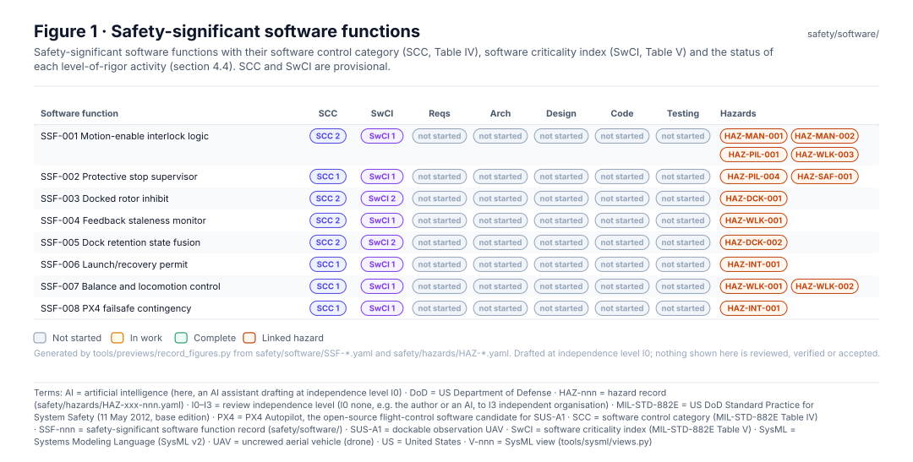
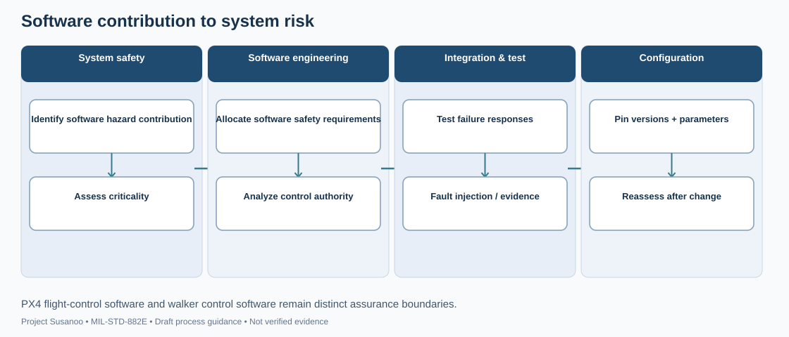
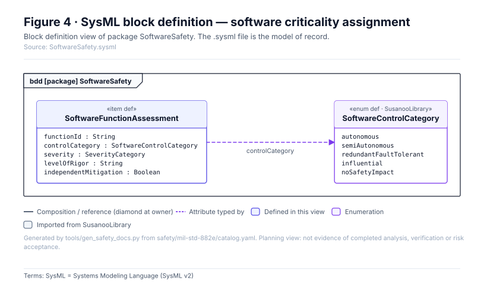

<!-- GENERATED by tools/previews/build_previews.py from docs/previews.yaml; do not edit. Edit the entry there and re-run. -->

# Safety-significant software functions

One `SSF-nnn.yaml` per safety-significant software function, with its software control category, criticality index and level-of-rigor status (MIL-STD-882E section 4.4).

<!-- terms:start (generated by tools/terms/terms.py; do not edit by hand) -->

<b>Terms on this page (9)</b>: abbreviations and codes explained

| Term | Meaning |
|---|---|
| DoD | US Department of Defense |
| MIL-STD-882E | US DoD Standard Practice for System Safety (11 May 2012, base edition) |
| PX4 | PX4 Autopilot, the open-source flight-control software candidate for SUS-A1 |
| SCC | software control category (MIL-STD-882E Table IV) |
| SSF-nnn | safety-significant software function record (safety/software/) |
| SUS-A1 | dockable observation UAV |
| SwCI | software criticality index (MIL-STD-882E Table V) |
| UAV | uncrewed aerial vehicle (drone) |
| US | United States |

All terms: [abbreviations and record codes](https://github.com/jherrodthomas/Project-Susanoo/blob/main/docs/terms.md).

<!-- terms:end -->

<!-- preview:start (generated by tools/previews/build_previews.py from docs/previews.yaml; do not edit by hand) -->

SCC, SwCI and level-of-rigor status of every SSF

<table>
<tr><td width="33%" valign="top"> Software safety process map (illustrative)</td><td width="33%" valign="top"> SSF record structure</td></tr>
</table>

<!-- preview:end -->

## Folder contents

| Item | Title |
|---|---|
| [`SSF-001.yaml`](SSF-001.yaml) | Motion-enable interlock logic |
| [`SSF-002.yaml`](SSF-002.yaml) | Protective stop supervisor |
| [`SSF-003.yaml`](SSF-003.yaml) | Docked rotor inhibit |
| [`SSF-004.yaml`](SSF-004.yaml) | Feedback staleness monitor |
| [`SSF-005.yaml`](SSF-005.yaml) | Dock retention state fusion |
| [`SSF-006.yaml`](SSF-006.yaml) | Launch/recovery permit |
| [`SSF-007.yaml`](SSF-007.yaml) | Balance and locomotion control |
| [`SSF-008.yaml`](SSF-008.yaml) | PX4 failsafe contingency |
