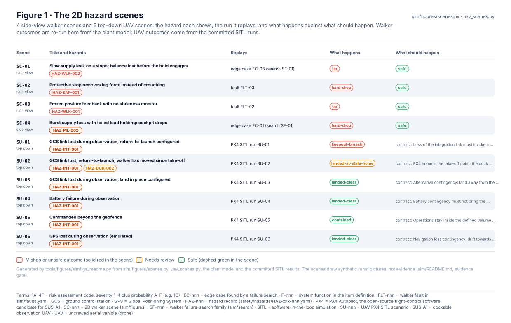
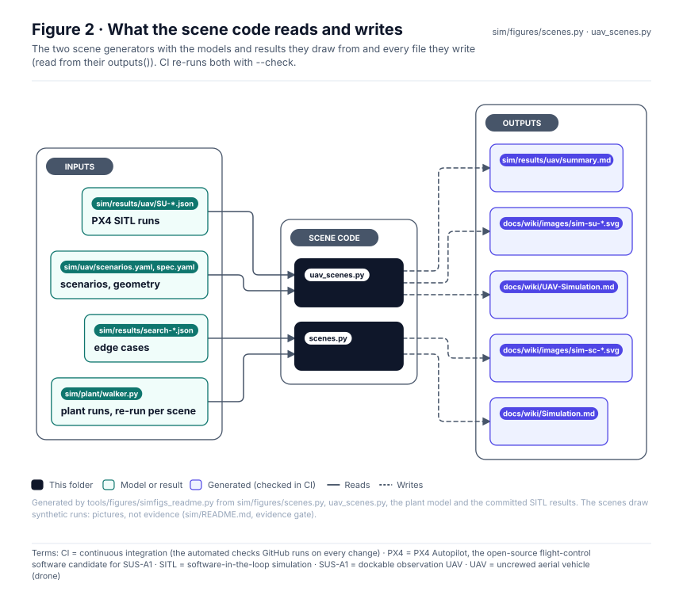
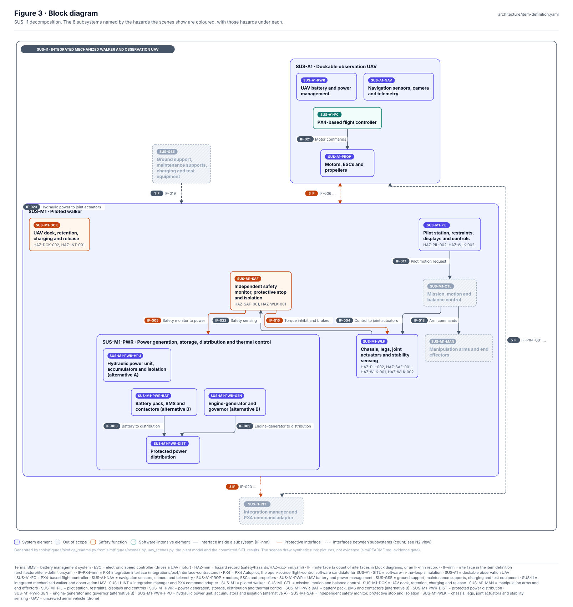
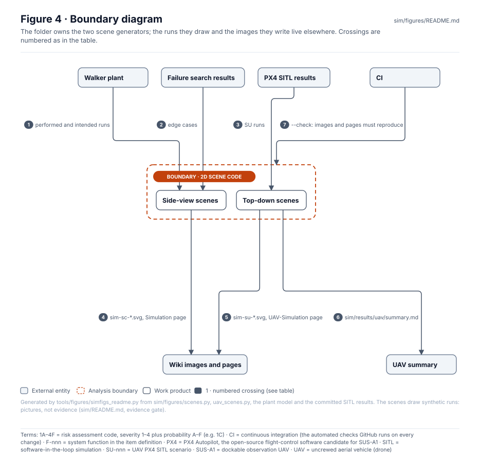
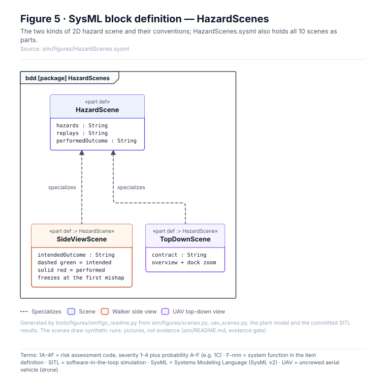
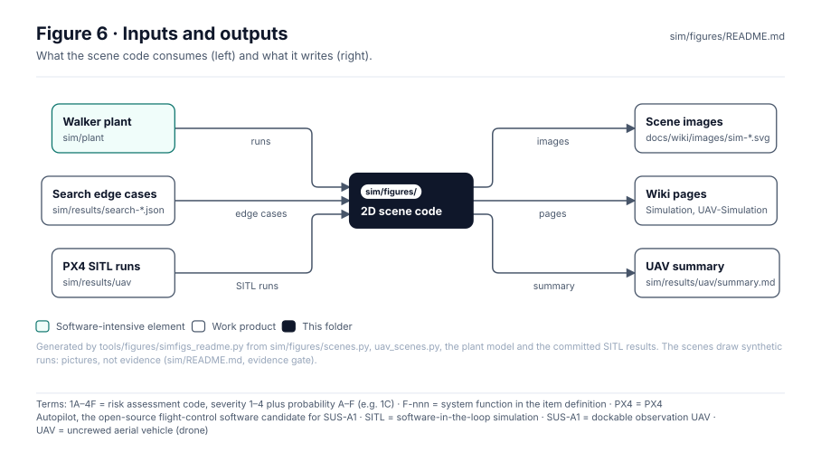

<!-- GENERATED by tools/figures/simfigs_readme.py from sim/figures/scenes.py, uav_scenes.py, the plant model and the committed SITL results; edit those and regenerate. -->

# 2D hazard scenes

> **Status:** 4 walker scenes and 6 UAV scenes, every one drawn from a committed or re-run synthetic result and checked in CI. Pictures, **not evidence**.

<!-- terms:start (generated by tools/terms/terms.py; do not edit by hand) -->

<b>Terms on this page (19)</b>: abbreviations and codes explained

| Term | Meaning |
|---|---|
| 1A–4F | risk assessment code, severity 1–4 plus probability A–F (e.g. 1C) |
| 3D | three-dimensional |
| CI | continuous integration (the automated checks GitHub runs on every change) |
| EC-nnn | edge case found by a failure search |
| EXT-AIRSPACE | external element: airspace, people and property under the UAV |
| F-nnn | system function in the item definition |
| FLT-nnn | walker fault in sim/faults.yaml |
| HAZ-nnn | hazard record (safety/hazards/HAZ-xxx-nnn.yaml) |
| OMG | Object Management Group, publisher of SysML |
| PX4 | PX4 Autopilot, the open-source flight-control software candidate for SUS-A1 |
| SC-nnn | 2D walker scene (sim/figures) |
| SF-nnn | walker failure-search family (sim/search) |
| SITL | software-in-the-loop simulation |
| SMIL | Synchronized Multimedia Integration Language, the SVG animation markup the 2D scenes loop with |
| SU-nnn | UAV PX4 SITL scenario |
| SUS-A1 | dockable observation UAV |
| SVG | Scalable Vector Graphics, the figure file format |
| SysML | Systems Modeling Language (SysML v2) |
| UAV | uncrewed aerial vehicle (drone) |

All terms: [abbreviations and record codes](https://github.com/jherrodthomas/Project-Susanoo/blob/main/docs/terms.md).

<!-- terms:end -->

| Field | Value |
|---|---|
| Run | `python -m sim.figures.scenes`, `python -m sim.figures.uav_scenes` (`--check` in CI) |
| Wiki | [Simulation](../../docs/wiki/Simulation.md), [UAV simulation](../../docs/wiki/UAV-Simulation.md) |
| SysML | [`HazardScenes.sysml`](HazardScenes.sysml) (generated) |

## Purpose

Draws the animated 2D hazard scenes: a side view of the walker for each plant hazard, replaying what happens against what should happen, and a top-down view of each PX4 SITL run with the dock, the pilot keep-out and the geofence. Nothing is hand-animated; every frame comes from a run. The folder also holds the simulation page's figures (`*.svg` here, written by `tools/figures/sim_readme.py`).

Scene conventions (from [`scenes.py`](scenes.py)):

- one walker; dashed green = what should happen (the intended or mitigated run), solid red = what does
- both are plant runs from sim/plant/walker.py; nothing is hand-animated
- the animation loops (SMIL); the static pose, shown where animation does not run, is the end state
- the scene freezes at the first mishap: contact and rotation after tipping are not modelled
- a timeline under the scene marks fault onset, alarm, stop, hold and mishap

## Scenes

| Scene | View | Hazards | Replays | What happens | What should happen | Image |
|---|---|---|---|---|---|---|
| SC-01 | side view (walker) | HAZ-WLK-002 | edge case EC-08 (search SF-01) | tip | safe | [`sim-sc-01.svg`](../../docs/wiki/images/sim-sc-01.svg) |
| SC-02 | side view (walker) | HAZ-SAF-001 | fault FLT-03 | hard-drop | safe | [`sim-sc-02.svg`](../../docs/wiki/images/sim-sc-02.svg) |
| SC-03 | side view (walker) | HAZ-WLK-001 | fault FLT-02 | tip | safe | [`sim-sc-03.svg`](../../docs/wiki/images/sim-sc-03.svg) |
| SC-04 | side view (walker) | HAZ-PIL-002 | edge case EC-01 (search SF-01) | hard-drop | safe | [`sim-sc-04.svg`](../../docs/wiki/images/sim-sc-04.svg) |
| SU-01 | top down (UAV) | HAZ-INT-001 | PX4 SITL run SU-01 | keepout-breach | contract: Loss of the integration link must invoke a defined, analysed | [`sim-su-01.svg`](../../docs/wiki/images/sim-su-01.svg) |
| SU-02 | top down (UAV) | HAZ-INT-001, HAZ-DCK-002 | PX4 SITL run SU-02 | landed-at-stale-home | contract: PX4 home is the take-off point; the dock has moved with the  | [`sim-su-02.svg`](../../docs/wiki/images/sim-su-02.svg) |
| SU-03 | top down (UAV) | HAZ-INT-001 | PX4 SITL run SU-03 | landed-clear | contract: Alternative contingency: land away from the walker | [`sim-su-03.svg`](../../docs/wiki/images/sim-su-03.svg) |
| SU-04 | top down (UAV) | HAZ-INT-001 | PX4 SITL run SU-04 | landed-clear | contract: Battery contingency must not bring the aircraft into the pil | [`sim-su-04.svg`](../../docs/wiki/images/sim-su-04.svg) |
| SU-05 | top down (UAV) | HAZ-INT-001 | PX4 SITL run SU-05 | contained | contract: Operations stay inside the defined volume (EXT-AIRSPACE) | [`sim-su-05.svg`](../../docs/wiki/images/sim-su-05.svg) |
| SU-06 | top down (UAV) | HAZ-INT-001 | PX4 SITL run SU-06 | landed-clear | contract: Navigation loss contingency; drift towards people or the wal | [`sim-su-06.svg`](../../docs/wiki/images/sim-su-06.svg) |

## What the scene code reads and writes

| Generator | Writes |
|---|---|
| `sim/figures/scenes.py` | `docs/wiki/Simulation.md`, `docs/wiki/images/sim-sc-*.svg` |
| `sim/figures/uav_scenes.py` | `docs/wiki/UAV-Simulation.md`, `docs/wiki/images/sim-su-*.svg`, `sim/results/uav/summary.md` |

## Block diagram

## Boundary diagram

| # | From | To | Crossing / interaction |
|---|---|---|---|
| 1 | Walker plant | Side-view scenes | performed and intended runs |
| 2 | Failure search results | Side-view scenes | edge cases |
| 3 | PX4 SITL results | Top-down scenes | SU runs |
| 4 | Side-view scenes | Wiki images and pages | sim-sc-*.svg, Simulation page |
| 5 | Top-down scenes | Wiki images and pages | sim-su-*.svg, UAV-Simulation page |
| 6 | Top-down scenes | UAV summary | sim/results/uav/summary.md |
| 7 | CI | 2D scene code | --check: images and pages must reproduce |

**Explicitly excluded:** the 3D scenes ([`sim/scenes3d`](../scenes3d/README.md)), any new analysis, and motion after a mishap (the scene freezes).

## SysML model

[`HazardScenes.sysml`](HazardScenes.sysml) is generated and validated with the project model by the OMG pilot in CI.

## Inputs and outputs

| Input | Source |
|---|---|
| Walker plant | [`sim/plant/`](../plant/README.md) |
| Search edge cases, SITL runs | [`sim/results/`](../results/README.md) |

| Output | Destination |
|---|---|
| Scene images | `docs/wiki/images/sim-*.svg` |
| Wiki pages | [Simulation](../../docs/wiki/Simulation.md), [UAV simulation](../../docs/wiki/UAV-Simulation.md) |
| UAV summary | [`sim/results/uav/summary.md`](../results/uav/summary.md) |

## Folder contents

| Item | Description | State |
|---|---|---|
| [`scenes.py`](scenes.py) | Side-view walker scenes and the Simulation page | code |
| [`uav_scenes.py`](uav_scenes.py) | Top-down UAV scenes, UAV summary and page | code |
| [`fig-1-result-sets.svg`](fig-1-result-sets.svg) | Simulation page figure (`tools/figures/sim_readme.py`) | generated |
| [`fig-2-hazard-trace.svg`](fig-2-hazard-trace.svg) | Simulation page figure (`tools/figures/sim_readme.py`) | generated |
| [`fig-3-block-diagram.svg`](fig-3-block-diagram.svg) | Simulation page figure (`tools/figures/sim_readme.py`) | generated |
| [`fig-4-boundary-diagram.svg`](fig-4-boundary-diagram.svg) | Simulation page figure (`tools/figures/sim_readme.py`) | generated |
| [`fig-5-sysml-state-machine.svg`](fig-5-sysml-state-machine.svg) | Simulation page figure (`tools/figures/sim_readme.py`) | generated |
| [`fig-6-inputs-and-outputs.svg`](fig-6-inputs-and-outputs.svg) | Simulation page figure (`tools/figures/sim_readme.py`) | generated |
| [`HazardScenes.sysml`](HazardScenes.sysml) | The scenes as SysML | generated |
| [`readme/`](readme/) | This page's figures (do not edit) | generated |
| `README.md` | This page | generated |

<!-- END GENERATED: content below this line is human-authored and preserved -->
