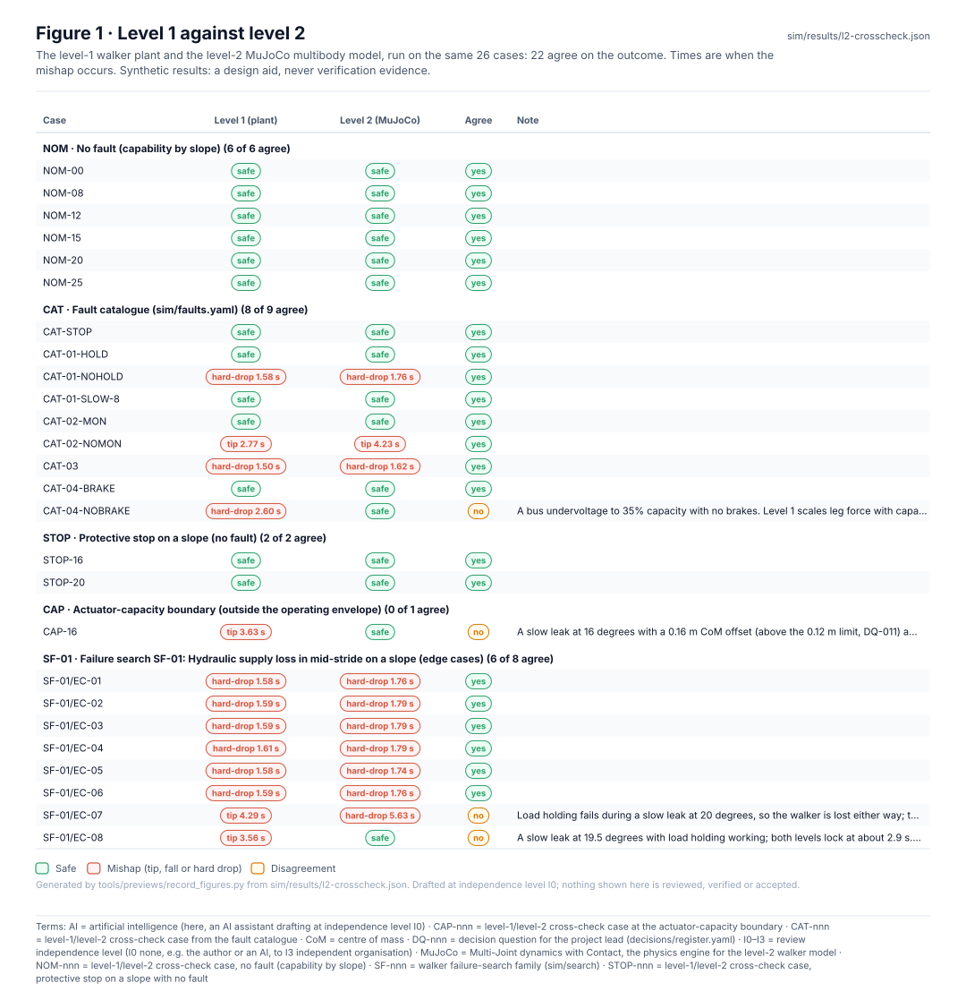

<!-- GENERATED by tools/previews/build_previews.py from docs/previews.yaml; do not edit. Edit the entry there and re-run. -->

# Level-2 multibody simulation (MuJoCo)

The level-2 walker model in MuJoCo and the cross-check that compares it case by case with the level-1 plant. Results are synthetic.

<!-- terms:start (generated by tools/terms/terms.py; do not edit by hand) -->

<b>Terms on this page (1)</b>: abbreviations and codes explained

| Term | Meaning |
|---|---|
| MuJoCo | Multi-Joint dynamics with Contact, the physics engine for the level-2 walker model |

All terms: [abbreviations and record codes](https://github.com/jherrodthomas/Project-Susanoo/blob/main/docs/terms.md).

<!-- terms:end -->

<!-- preview:start (generated by tools/previews/build_previews.py from docs/previews.yaml; do not edit by hand) -->

Level 1 against level 2, case by case (synthetic)

**Open:** [Cross-check results](../results/l2-crosscheck.md)

<!-- preview:end -->

## Folder contents

| Item | Title |
|---|---|
| [`crosscheck.py`](crosscheck.py) |  |
| [`crosscheck.yaml`](crosscheck.yaml) | Level-1 (sim/plant/walker.py) vs level-2 (sim/mujoco/l2.py) cross-check. Every case runs on both models; the |
| [`l2.py`](l2.py) |  |
| [`model.py`](model.py) |  |
| [`requirements.txt`](requirements.txt) |  |
| [`sizing.py`](sizing.py) |  |
| [`sizing.yaml`](sizing.yaml) | Ankle and knee torque against supply loss on a slope |
