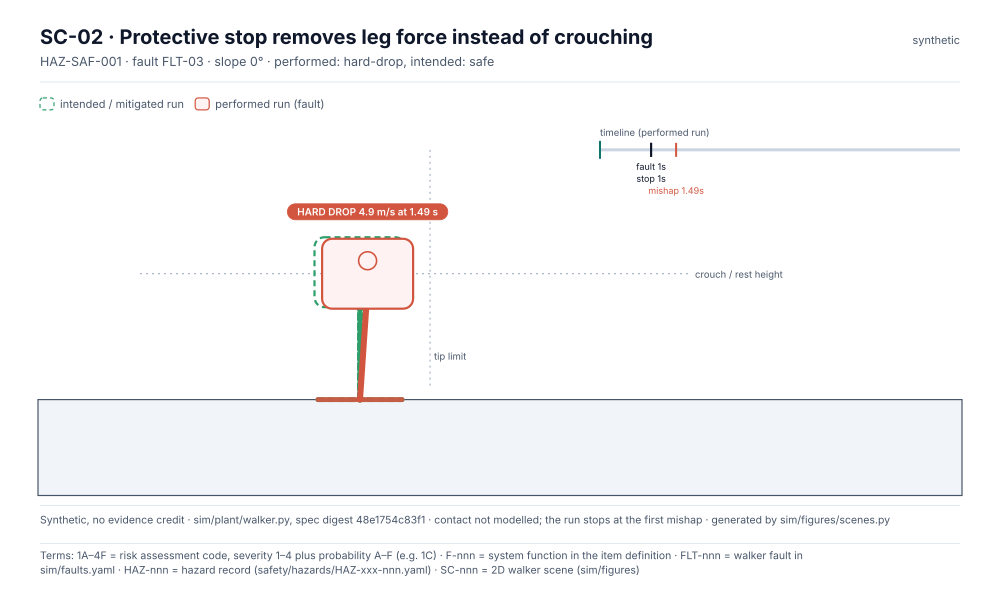
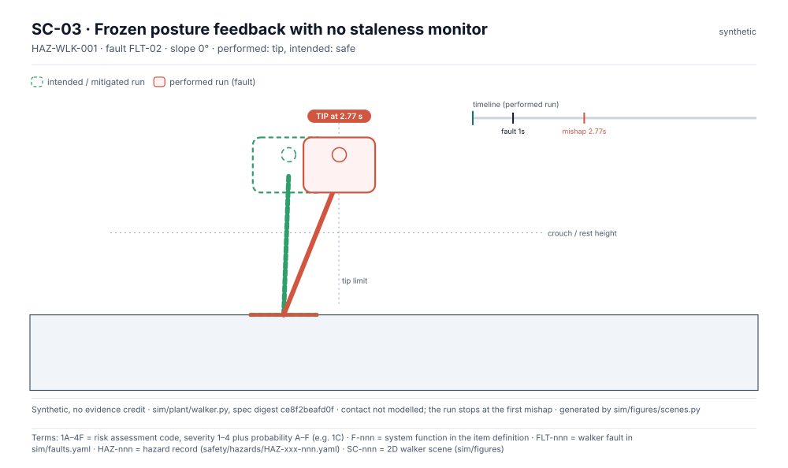
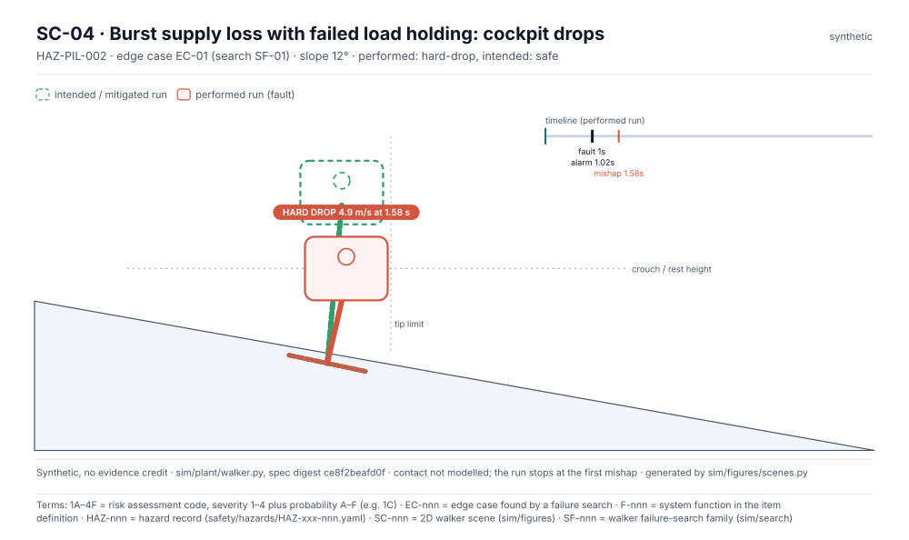

<!-- GENERATED by tools/previews/build_previews.py from docs/previews.yaml; do not edit. Edit the entry there and re-run. -->

# Level-1 walker plant

The level-1 walker plant model and the scenario report it writes. Results are synthetic.

<!-- terms:start (generated by tools/terms/terms.py; do not edit by hand) -->

<b>Terms on this page (3)</b>: abbreviations and codes explained

| Term | Meaning |
|---|---|
| 1A–4F | risk assessment code, severity 1–4 plus probability A–F (e.g. 1C) |
| F-nnn | system function in the item definition |
| SC-nnn | 2D walker scene (sim/figures) |

All terms: [abbreviations and record codes](https://github.com/jherrodthomas/Project-Susanoo/blob/main/docs/terms.md).

<!-- terms:end -->

<!-- preview:start (generated by tools/previews/build_previews.py from docs/previews.yaml; do not edit by hand) -->

SC-01 (synthetic)

<table>
<tr><td width="33%" valign="top"> SC-02 (synthetic)</td><td width="33%" valign="top"> SC-03 (synthetic)</td><td width="33%" valign="top"> SC-04 (synthetic)</td></tr>
</table>

**Open:** [Plant results](../results/plant-results.md)

<!-- preview:end -->

## Folder contents

| Item | Title |
|---|---|
| [`report.py`](report.py) |  |
| [`spec.py`](spec.py) |  |
| [`walker.py`](walker.py) |  |
