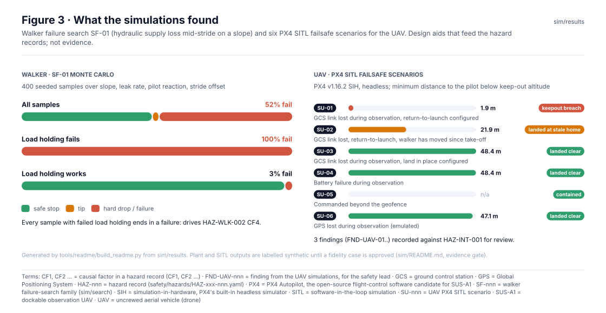
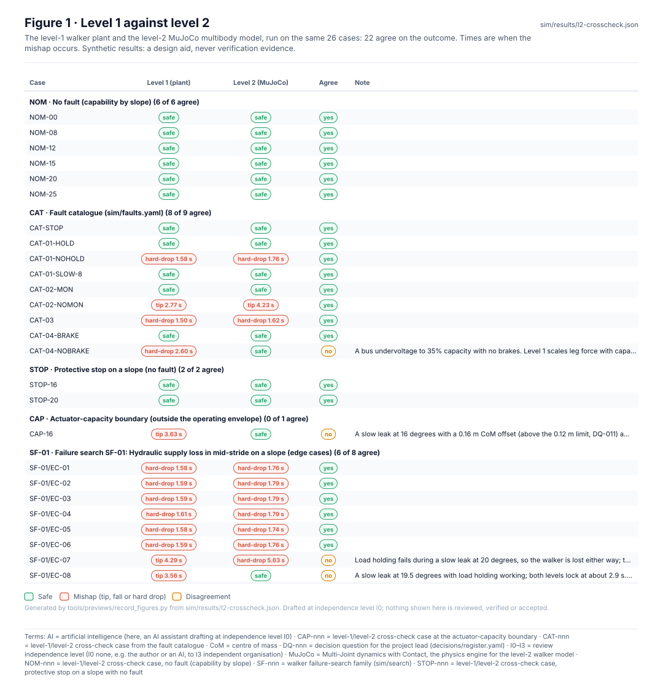
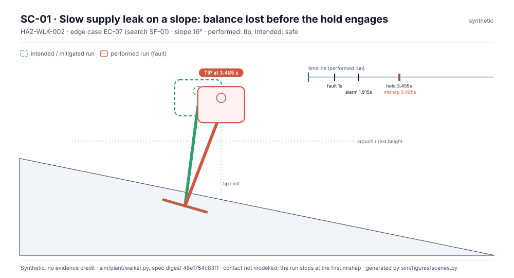
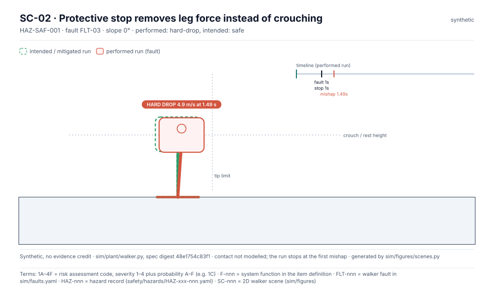
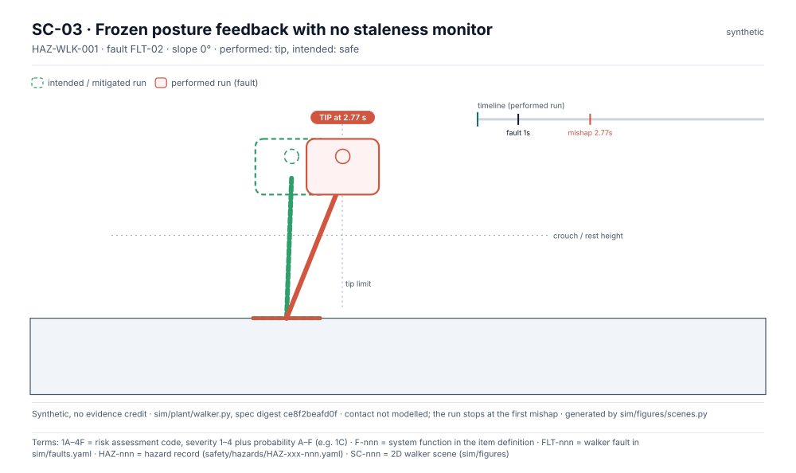
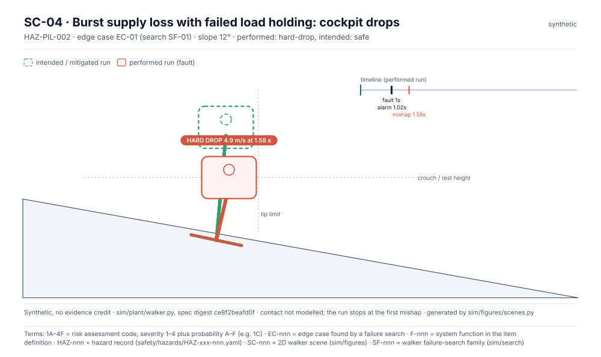

<!-- GENERATED by tools/previews/build_previews.py from docs/previews.yaml; do not edit. Edit the entry there and re-run. -->

# Simulation results

Results written by the simulation track and checked in CI. They are synthetic: they inform the hazard analysis and are never verification evidence.

<!-- terms:start (generated by tools/terms/terms.py; do not edit by hand) -->

<b>Terms on this page (10)</b>: abbreviations and codes explained

| Term | Meaning |
|---|---|
| 1A–4F | risk assessment code, severity 1–4 plus probability A–F (e.g. 1C) |
| CI | continuous integration (the automated checks GitHub runs on every change) |
| F-nnn | system function in the item definition |
| PX4 | PX4 Autopilot, the open-source flight-control software candidate for SUS-A1 |
| SC-nnn | 2D walker scene (sim/figures) |
| SF-nnn | walker failure-search family (sim/search) |
| SITL | software-in-the-loop simulation |
| SUS-A1 | dockable observation UAV |
| SZ-nnn | actuator sizing study at level 2 (sim/mujoco/sizing.yaml) |
| UAV | uncrewed aerial vehicle (drone) |

All terms: [abbreviations and record codes](https://github.com/jherrodthomas/Project-Susanoo/blob/main/docs/terms.md).

<!-- terms:end -->

<!-- preview:start (generated by tools/previews/build_previews.py from docs/previews.yaml; do not edit by hand) -->

Simulation results summary (synthetic)

<table>
<tr><td width="33%" valign="top"> Level 1 against level 2</td><td width="33%" valign="top"> SC-01</td><td width="33%" valign="top"> SC-02</td></tr>
<tr><td width="33%" valign="top"> SC-03</td><td width="33%" valign="top"> SC-04</td></tr>
</table>

**Open:** [UAV results](uav/README.md)

<!-- preview:end -->

## Folder contents

| Item | Title |
|---|---|
| [`uav/`](uav/) | UAV simulation results (PX4 SITL) |
| [`edge-cases.md`](edge-cases.md) | Edge cases |
| [`l2-crosscheck.json`](l2-crosscheck.json) |  |
| [`l2-crosscheck.md`](l2-crosscheck.md) | Level-1 vs level-2 cross-check |
| [`plant-results.json`](plant-results.json) |  |
| [`plant-results.md`](plant-results.md) | Plant results: fault catalogue |
| [`search-SF-01.json`](search-SF-01.json) |  |
| [`search-SF-01.md`](search-SF-01.md) | Failure search SF-01 · Hydraulic supply loss in mid-stride on a slope |
| [`sizing-cf4.json`](sizing-cf4.json) | Ankle and knee torque against supply loss on a slope |
| [`sizing-cf4.md`](sizing-cf4.md) | SZ-01 · Ankle and knee torque against supply loss on a slope |
