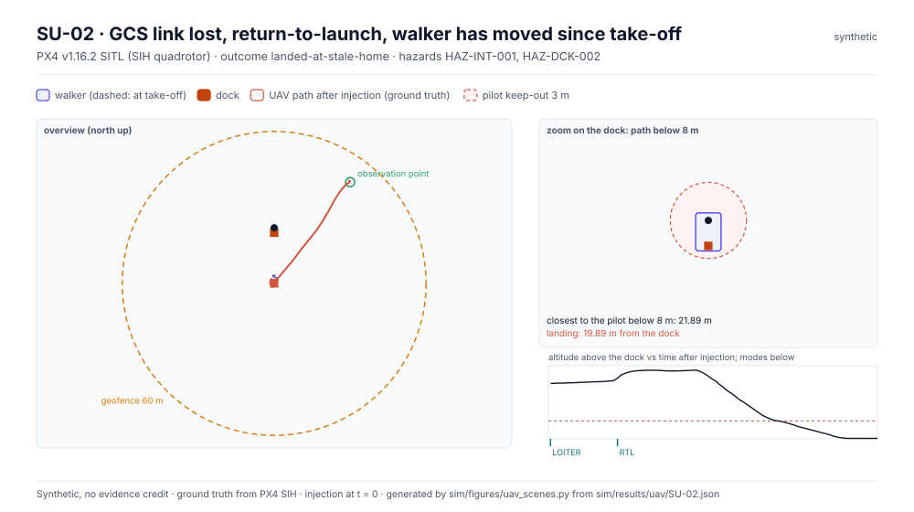
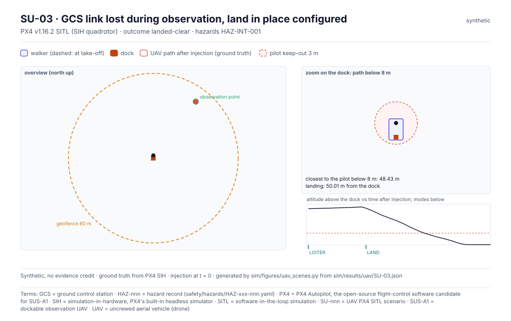
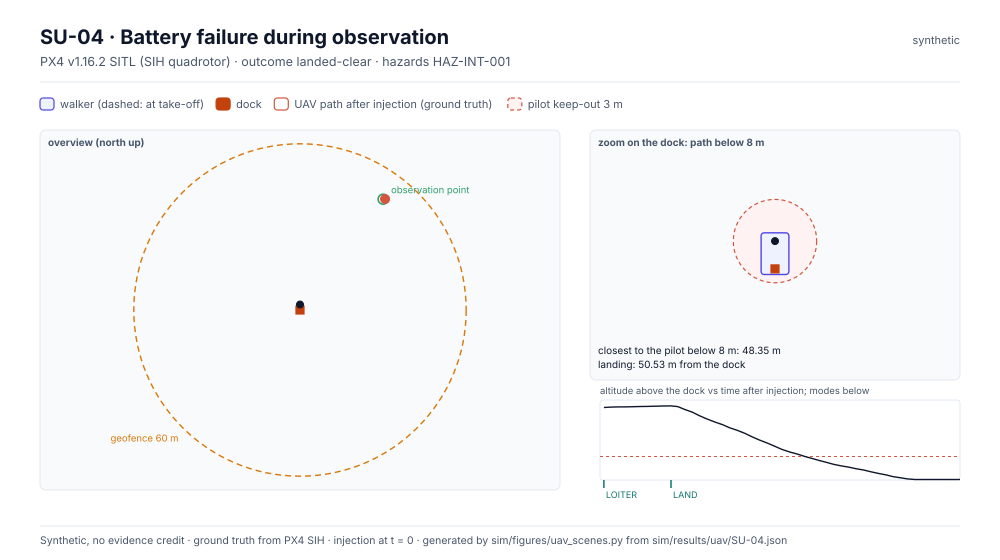
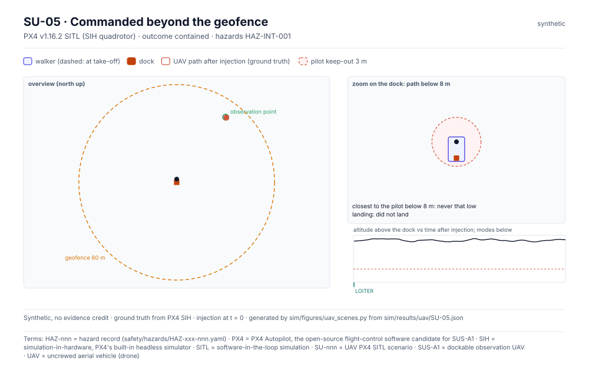
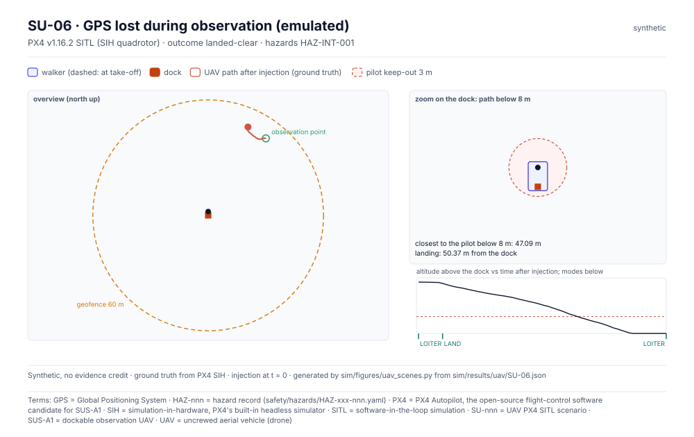

<!-- GENERATED by tools/previews/build_previews.py from docs/previews.yaml; do not edit. Edit the entry there and re-run. -->

# UAV simulation results (PX4 SITL)

PX4 SITL failsafe runs written by `sim/uav/harness.py`, one JSON per scenario plus the summary. Synthetic; never verification evidence.

<!-- terms:start (generated by tools/terms/terms.py; do not edit by hand) -->

<b>Terms on this page (6)</b>: abbreviations and codes explained

| Term | Meaning |
|---|---|
| JSON | JavaScript Object Notation, a data file format |
| PX4 | PX4 Autopilot, the open-source flight-control software candidate for SUS-A1 |
| SITL | software-in-the-loop simulation |
| SU-nnn | UAV PX4 SITL scenario |
| SUS-A1 | dockable observation UAV |
| UAV | uncrewed aerial vehicle (drone) |

All terms: [abbreviations and record codes](https://github.com/jherrodthomas/Project-Susanoo/blob/main/docs/terms.md).

<!-- terms:end -->

<!-- preview:start (generated by tools/previews/build_previews.py from docs/previews.yaml; do not edit by hand) -->

SU-01

<table>
<tr><td width="33%" valign="top"> SU-02</td><td width="33%" valign="top"> SU-03</td><td width="33%" valign="top"> SU-04</td></tr>
<tr><td width="33%" valign="top"> SU-05</td><td width="33%" valign="top"> SU-06</td></tr>
</table>

**Open:** [UAV Simulation (wiki page)](../../../docs/wiki/UAV-Simulation.md)

<!-- preview:end -->

## Folder contents

| Item | Title |
|---|---|
| [`SU-01.json`](SU-01.json) |  |
| [`SU-02.json`](SU-02.json) |  |
| [`SU-03.json`](SU-03.json) |  |
| [`SU-04.json`](SU-04.json) |  |
| [`SU-05.json`](SU-05.json) |  |
| [`SU-06.json`](SU-06.json) |  |
| [`summary.md`](summary.md) | UAV failsafe scenarios (PX4 SITL) |
