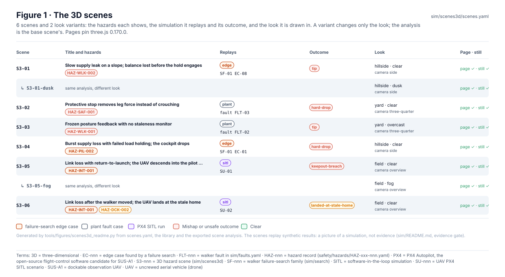
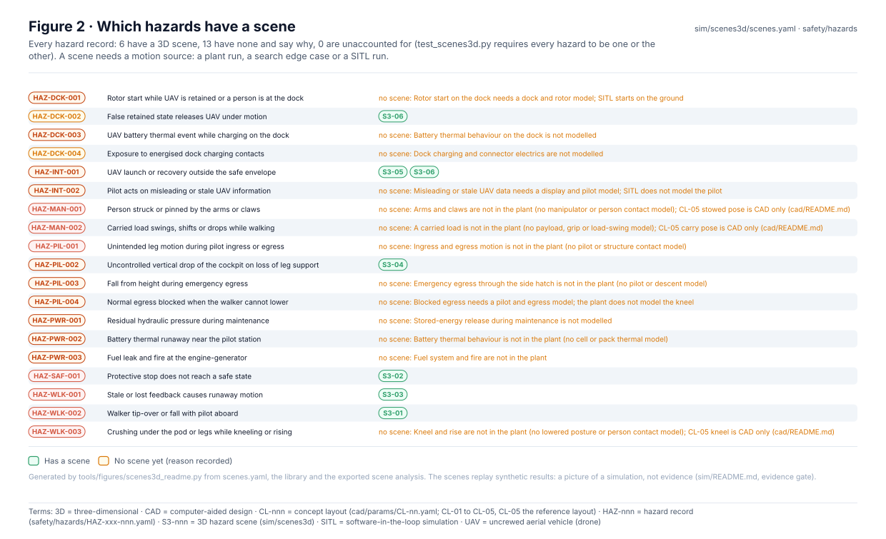
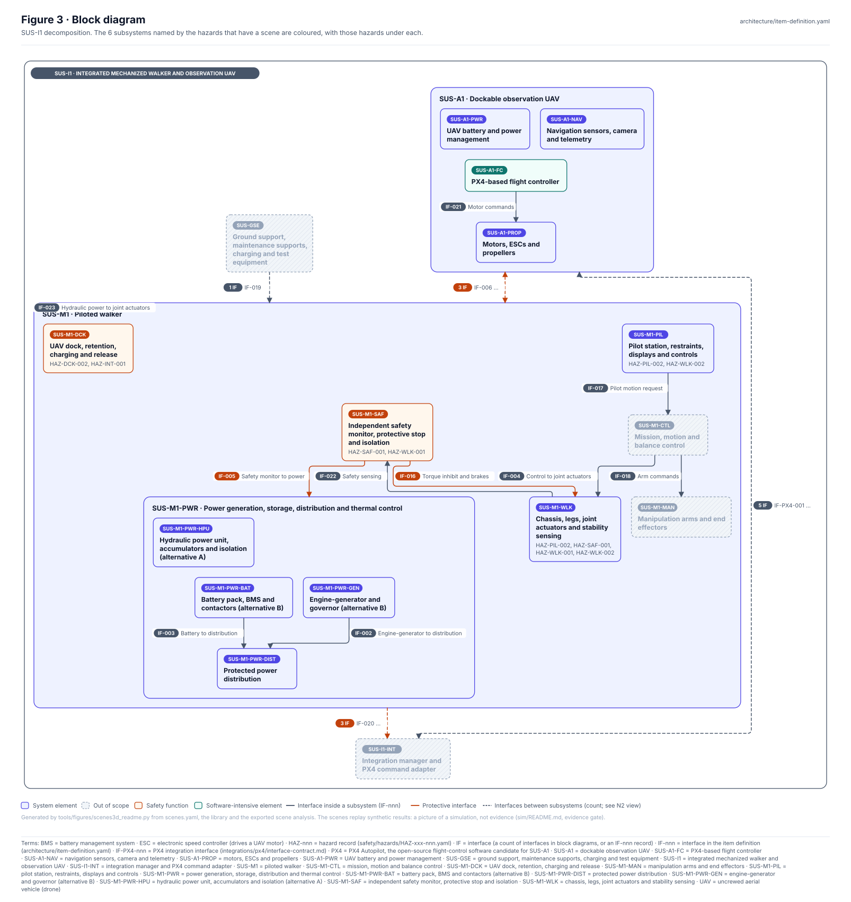
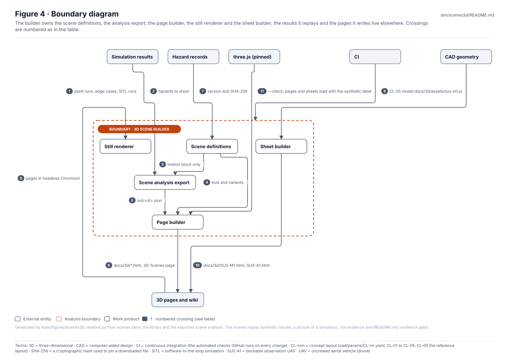
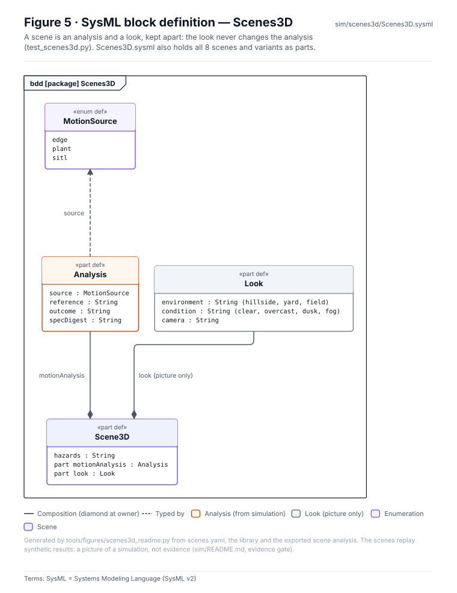
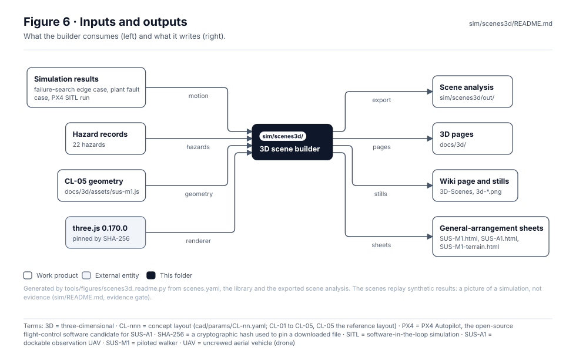

<!-- GENERATED by tools/figures/scenes3d_readme.py from scenes.yaml, the library and the exported scene analysis; edit those and regenerate. -->

# 3D scene builder

> **Status:** 6 scenes and 2 variants covering 6 of 19 hazards; the others record why they have no scene. Pictures of synthetic results, **no evidence credit**.

<!-- terms:start (generated by tools/terms/terms.py; do not edit by hand) -->

<b>Terms on this page (19)</b>: abbreviations and codes explained

| Term | Meaning |
|---|---|
| 3D | three-dimensional |
| CAD | computer-aided design |
| CI | continuous integration (the automated checks GitHub runs on every change) |
| CL-nnn | concept layout (cad/params/CL-nn.yaml; CL-01 to CL-05, CL-05 the reference layout) |
| EC-nnn | edge case found by a failure search |
| FLT-nnn | walker fault in sim/faults.yaml |
| HAZ-nnn | hazard record (safety/hazards/HAZ-xxx-nnn.yaml) |
| JSON | JavaScript Object Notation, a data file format |
| OMG | Object Management Group, publisher of SysML |
| PX4 | PX4 Autopilot, the open-source flight-control software candidate for SUS-A1 |
| S3-nnn | 3D hazard scene (sim/scenes3d) |
| SF-nnn | walker failure-search family (sim/search) |
| SHA-256 | a cryptographic hash used to pin a downloaded file |
| SITL | software-in-the-loop simulation |
| SU-nnn | UAV PX4 SITL scenario |
| SUS-A1 | dockable observation UAV |
| SVG | Scalable Vector Graphics, the figure file format |
| SysML | Systems Modeling Language (SysML v2) |
| UAV | uncrewed aerial vehicle (drone) |

All terms: [abbreviations and record codes](https://github.com/jherrodthomas/Project-Susanoo/blob/main/docs/terms.md).

<!-- terms:end -->

| Field | Value |
|---|---|
| Pages | [`docs/3d/`](../../docs/3d/README.md) · [3D scenes (wiki)](../../docs/wiki/3D-Scenes.md) |
| Run | `python -m sim.scenes3d.export_scene && python -m sim.scenes3d.build_pages` (`--check` in CI); stills with `node sim/scenes3d/render.mjs` (see [`sim/README.md`](../README.md)) |
| three.js | `0.170.0`, SHA-256 `08fd7545d13d…` pinned in [`scenes.yaml`](scenes.yaml) |
| SysML | [`Scenes3D.sysml`](Scenes3D.sysml) (generated) |

## Purpose

Turns simulation results into interactive 3D replays a reader can orbit, one scene per hazard that has a motion source. Each scene keeps two things apart: the analysis, exported from the plant run, search edge case or SITL run it names, and the look (environment, lighting, camera), which is picture only and can never change the analysis. CI checks that the pages load, show the synthetic label and show the right outcome.

## Scenes

| Scene | Hazards | Replays | Outcome | Look | Page |
|---|---|---|---|---|---|
| S3-01 | HAZ-WLK-002 | failure-search edge case SF-01 EC-08 | tip | hillside, clear, camera side | [`S3-01.html`](../../docs/3d/S3-01.html) |
| S3-01-dusk | HAZ-WLK-002 | failure-search edge case SF-01 EC-08 | tip | hillside, dusk, camera side | [`S3-01-dusk.html`](../../docs/3d/S3-01-dusk.html) |
| S3-02 | HAZ-SAF-001 | plant fault case fault FLT-03 | hard-drop | yard, clear, camera three-quarter | [`S3-02.html`](../../docs/3d/S3-02.html) |
| S3-03 | HAZ-WLK-001 | plant fault case fault FLT-02 | tip | yard, overcast, camera three-quarter | [`S3-03.html`](../../docs/3d/S3-03.html) |
| S3-04 | HAZ-PIL-002 | failure-search edge case SF-01 EC-01 | hard-drop | hillside, clear, camera side | [`S3-04.html`](../../docs/3d/S3-04.html) |
| S3-05 | HAZ-INT-001 | PX4 SITL run SU-01 | keepout-breach | field, clear, camera overview | [`S3-05.html`](../../docs/3d/S3-05.html) |
| S3-05-fog | HAZ-INT-001 | PX4 SITL run SU-01 | keepout-breach | field, fog, camera overview | [`S3-05-fog.html`](../../docs/3d/S3-05-fog.html) |
| S3-06 | HAZ-INT-001, HAZ-DCK-002 | PX4 SITL run SU-02 | landed-at-stale-home | field, clear, camera overview | [`S3-06.html`](../../docs/3d/S3-06.html) |

## Hazard coverage

| Hazard | Why no scene yet |
|---|---|
| HAZ-DCK-001 | Rotor start on the dock needs a dock and rotor model; SITL starts on the ground |
| HAZ-DCK-003 | Battery thermal behaviour on the dock is not modelled |
| HAZ-DCK-004 | Dock charging and connector electrics are not modelled |
| HAZ-INT-002 | Misleading or stale UAV data needs a display and pilot model; SITL does not model the pilot |
| HAZ-MAN-001 | Arms and claws are not in the plant (no manipulator or person contact model); CL-05 stowed pose is CAD only (cad/README.md) |
| HAZ-MAN-002 | A carried load is not in the plant (no payload, grip or load-swing model); CL-05 carry pose is CAD only (cad/README.md) |
| HAZ-PIL-001 | Ingress and egress motion is not in the plant (no pilot or structure contact model) |
| HAZ-PIL-003 | Emergency egress through the side hatch is not in the plant (no pilot or descent model) |
| HAZ-PIL-004 | Blocked egress needs a pilot and egress model; the plant does not model the kneel |
| HAZ-PWR-001 | Stored-energy release during maintenance is not modelled |
| HAZ-PWR-002 | Battery thermal behaviour is not in the plant (no cell or pack thermal model) |
| HAZ-PWR-003 | Fuel system and fire are not in the plant |
| HAZ-WLK-003 | Kneel and rise are not in the plant (no lowered posture or person contact model); CL-05 kneel is CAD only (cad/README.md) |

## Block diagram

## Boundary diagram

| # | From | To | Crossing / interaction |
|---|---|---|---|
| 1 | Simulation results | Scene analysis export | plant runs, edge cases, SITL runs |
| 2 | Hazard records | Scene definitions | hazards to show |
| 3 | Scene definitions | Scene analysis export | motion block only |
| 4 | Scene definitions | Page builder | look and variants |
| 5 | Scene analysis export | Page builder | out/<id>.json |
| 6 | Page builder | 3D pages and wiki | docs/3d/*.html, 3D-Scenes page |
| 7 | three.js (pinned) | Page builder | version and SHA-256 |
| 8 | 3D pages and wiki | Still renderer | pages in headless Chromium |
| 9 | CI | 3D scene builder | --check, pages load with the synthetic label |

**Explicitly excluded:** any new analysis (a scene only replays a committed result), the dynamics of the look (a condition such as fog never changes the run), and evidence of any kind.

## SysML model

[`Scenes3D.sysml`](Scenes3D.sysml) is generated from the scene definitions and the exported analysis and validated with the project model by the OMG pilot in CI.

## Inputs and outputs

| Input | Source |
|---|---|
| Plant runs, edge cases, SITL runs | [`sim/plant`](../plant/README.md), [`sim/results/`](../results/README.md) |
| Hazards | [Safety records](../../safety/README.md) |
| Environments and conditions | [`library/`](library/README.md) |

| Output | Destination |
|---|---|
| Scene analysis | [`out/`](out/README.md) |
| Interactive pages | [`docs/3d/`](../../docs/3d/README.md) |
| Wiki page and stills | `docs/wiki/3D-Scenes.md`, `docs/wiki/images/3d-*.png` |

## Adding a scene

1. Add it to [`scenes.yaml`](scenes.yaml) with its hazards and a `motion` block that names a committed result; take the hazard off `not_modelled`.
2. Give it a `look` from the library; a variant may change only the look.
3. Run the export and the page builder, render the stills, regenerate this page and run the full check list in [`CLAUDE.md`](../../CLAUDE.md).

## Folder contents

| Item | Description | State |
|---|---|---|
| [`scenes.yaml`](scenes.yaml) | Scenes, variants, hazards with no scene, pinned three.js | hand-written |
| [`library/`](library/README.md) | Look-only environments and conditions | hand-written |
| [`export_scene.py`](export_scene.py) | Exports each scene's analysis to `out/` | code |
| [`build_pages.py`](build_pages.py), [`viewer.js`](viewer.js) | Builds the pages in `docs/3d/` | code |
| [`render.mjs`](render.mjs) | Renders and checks the stills in headless Chromium | code |
| [`out/`](out/README.md) | Exported analysis, one JSON per scene | generated |
| [`Scenes3D.sysml`](Scenes3D.sysml) | Scenes as SysML | generated |
| [`figures/`](figures/) | Generated SVG figures (do not edit) | generated |
| `README.md` | This page | generated |

<!-- END GENERATED: content below this line is human-authored and preserved -->
