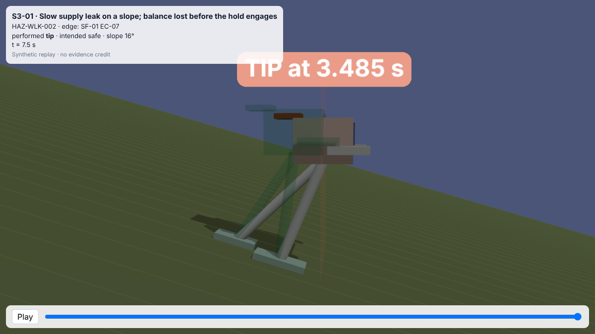
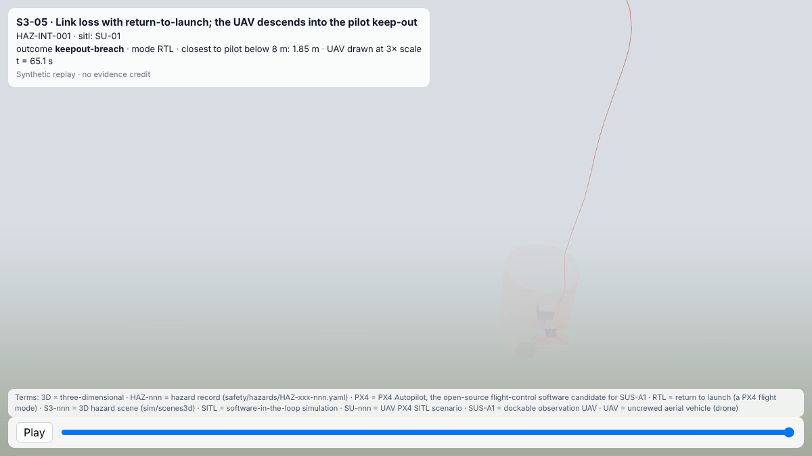

<!-- GENERATED by tools/previews/build_previews.py from docs/previews.yaml; do not edit. Edit the entry there and re-run. -->

# 3D scene library

Environments and conditions (lighting, weather) that the 3D scenes are composed from.

<!-- terms:start (generated by tools/terms/terms.py; do not edit by hand) -->

<b>Terms on this page (3)</b>: abbreviations and codes explained

| Term | Meaning |
|---|---|
| 3D | three-dimensional |
| S3-nnn | 3D hazard scene (sim/scenes3d) |
| SITL | software-in-the-loop simulation |

All terms: [abbreviations and record codes](https://github.com/jherrodthomas/Project-Susanoo/blob/main/docs/terms.md).

<!-- terms:end -->

<!-- preview:start (generated by tools/previews/build_previews.py from docs/previews.yaml; do not edit by hand) -->

S3-01 at dusk

<table>
<tr><td width="33%" valign="top"> S3-05 in fog</td></tr>
</table>

<!-- preview:end -->

## Folder contents

| Item | Title |
|---|---|
| [`conditions.yaml`](conditions.yaml) | Look-only conditions (lighting, fog). A condition never changes the dynamics: the plant and SITL runs are what they are. |
| [`environments.yaml`](environments.yaml) | Look-only environments for the 3D scenes. Never read by export_scene.py. |
