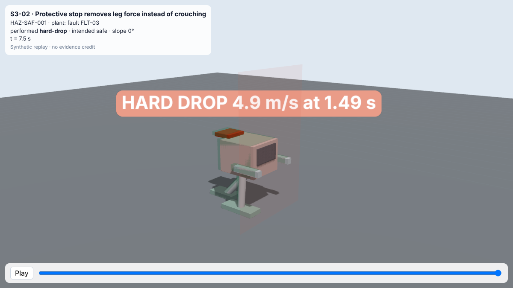
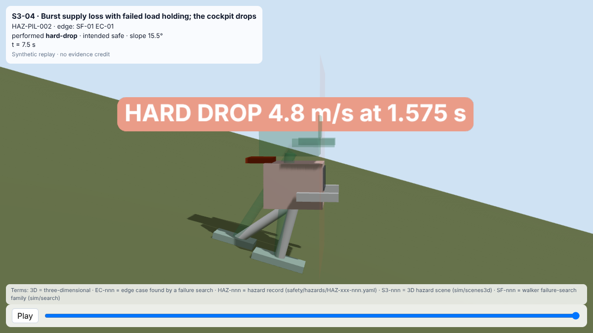

<!-- GENERATED by tools/previews/build_previews.py from docs/previews.yaml; do not edit. Edit the entry there and re-run. -->

# Exported 3D scene data

Scene data exported by `export_scene.py`, one JSON per scene, read by the pages in `docs/3d`. Generated.

<!-- terms:start (generated by tools/terms/terms.py; do not edit by hand) -->

<b>Terms on this page (4)</b>: abbreviations and codes explained

| Term | Meaning |
|---|---|
| 3D | three-dimensional |
| JSON | JavaScript Object Notation, a data file format |
| S3-nnn | 3D hazard scene (sim/scenes3d) |
| UAV | uncrewed aerial vehicle (drone) |

All terms: [abbreviations and record codes](https://github.com/jherrodthomas/Project-Susanoo/blob/main/docs/terms.md).

<!-- terms:end -->

<!-- preview:start (generated by tools/previews/build_previews.py from docs/previews.yaml; do not edit by hand) -->

S3-02

<table>
<tr><td width="33%" valign="top"> S3-04</td></tr>
</table>

<!-- preview:end -->

## Folder contents

| Item | Title |
|---|---|
| [`S3-01.json`](S3-01.json) | Slow supply leak on a slope; balance lost before the hold engages |
| [`S3-02.json`](S3-02.json) | Protective stop removes leg force instead of crouching |
| [`S3-03.json`](S3-03.json) | Frozen posture feedback with no staleness monitor |
| [`S3-04.json`](S3-04.json) | Burst supply loss with failed load holding; the cockpit drops |
| [`S3-05.json`](S3-05.json) | Link loss with return-to-launch; the UAV descends into the pilot keep-out |
| [`S3-06.json`](S3-06.json) | Link loss after the walker moved; the UAV lands at the stale home |
