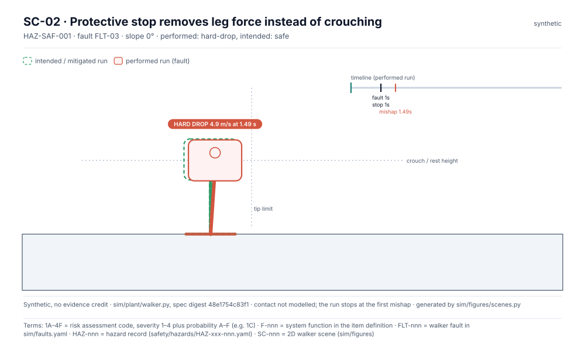

<!-- GENERATED by tools/previews/build_previews.py from docs/previews.yaml; do not edit. Edit the entry there and re-run. -->

# Failure search

The fault families and the search that samples them for edge cases (`families.yaml`, `search.py`). Results are synthetic.

<!-- terms:start (generated by tools/terms/terms.py; do not edit by hand) -->

<b>Terms on this page (4)</b>: abbreviations and codes explained

| Term | Meaning |
|---|---|
| 1A–4F | risk assessment code, severity 1–4 plus probability A–F (e.g. 1C) |
| F-nnn | system function in the item definition |
| SC-nnn | 2D walker scene (sim/figures) |
| SF-nnn | walker failure-search family (sim/search) |

All terms: [abbreviations and record codes](https://github.com/jherrodthomas/Project-Susanoo/blob/main/docs/terms.md).

<!-- terms:end -->

<!-- preview:start (generated by tools/previews/build_previews.py from docs/previews.yaml; do not edit by hand) -->

SC-01, a case the search covers (synthetic)

<table>
<tr><td width="33%" valign="top"> SC-02 (synthetic)</td></tr>
</table>

**Open:** [Search results for SF-01](../results/search-SF-01.md) · [Edge cases](../results/edge-cases.md)

<!-- preview:end -->

## Folder contents

| Item | Title |
|---|---|
| [`families.yaml`](families.yaml) | Failure-search families (layer 4). A family is data: the fault, the parameter space, the search budget, |
| [`search.py`](search.py) |  |
