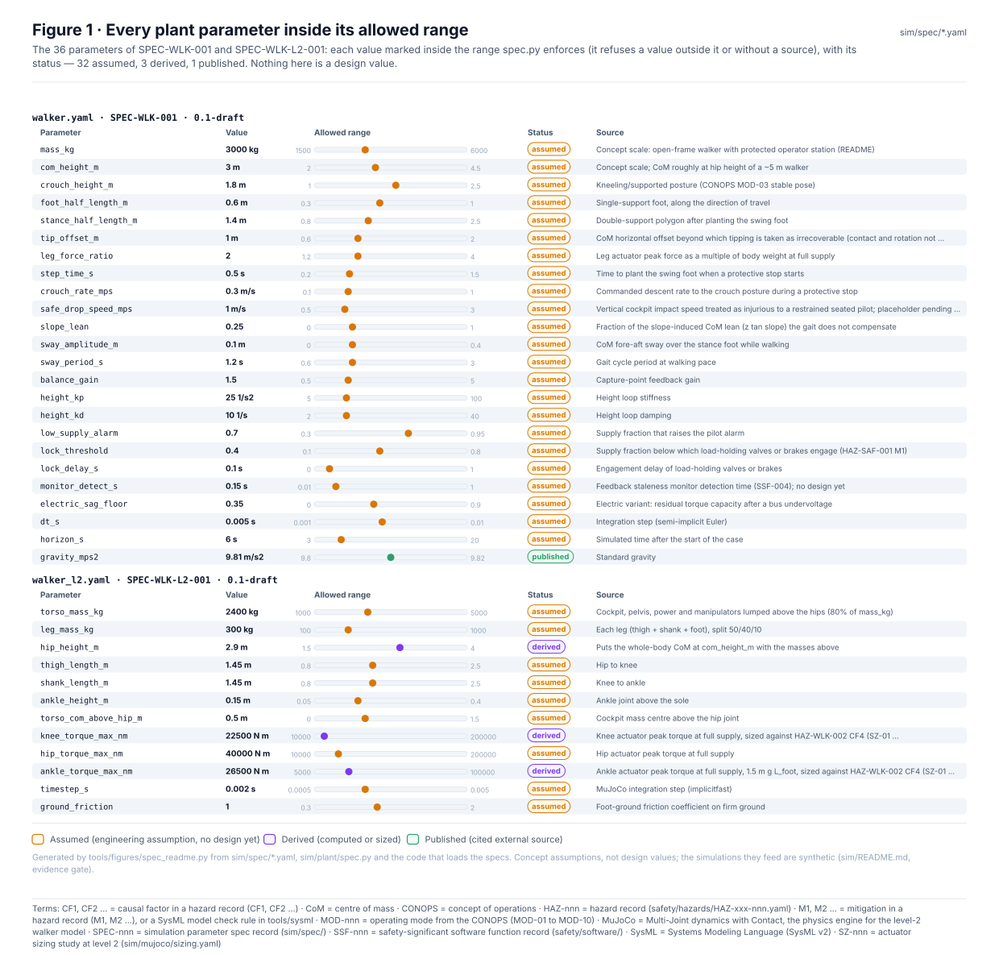
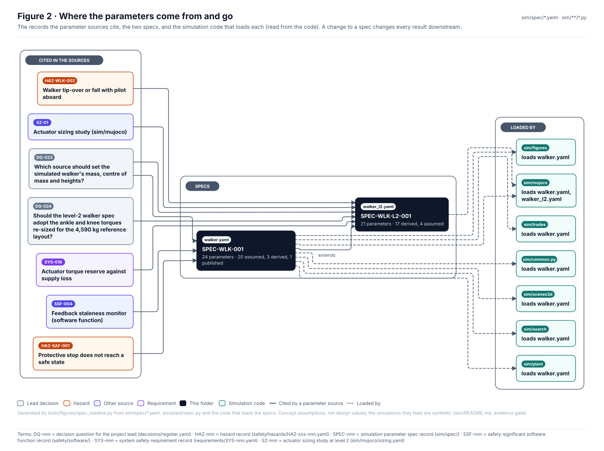
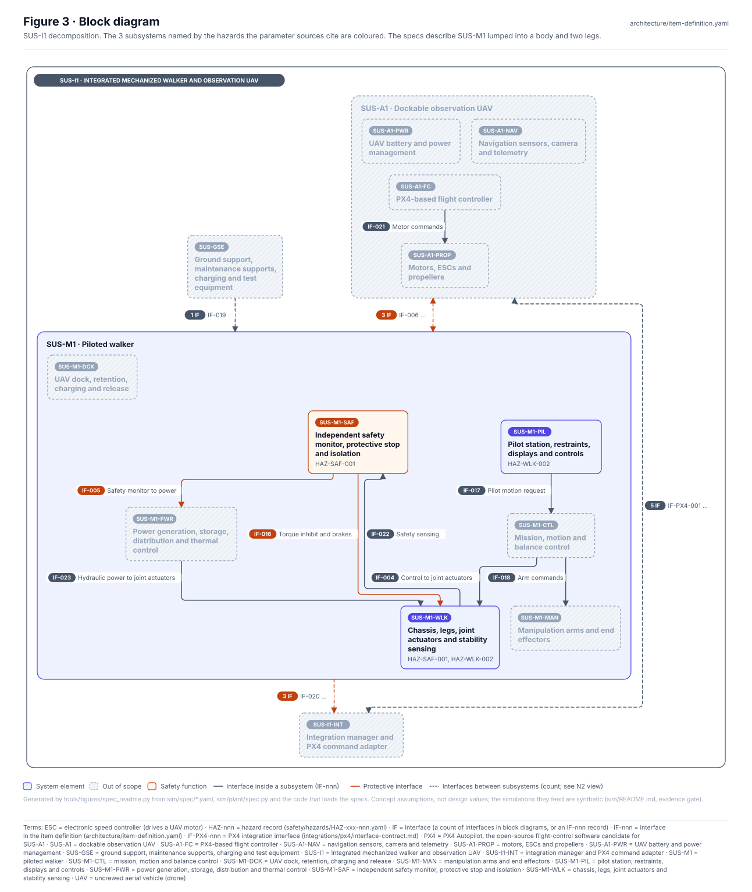
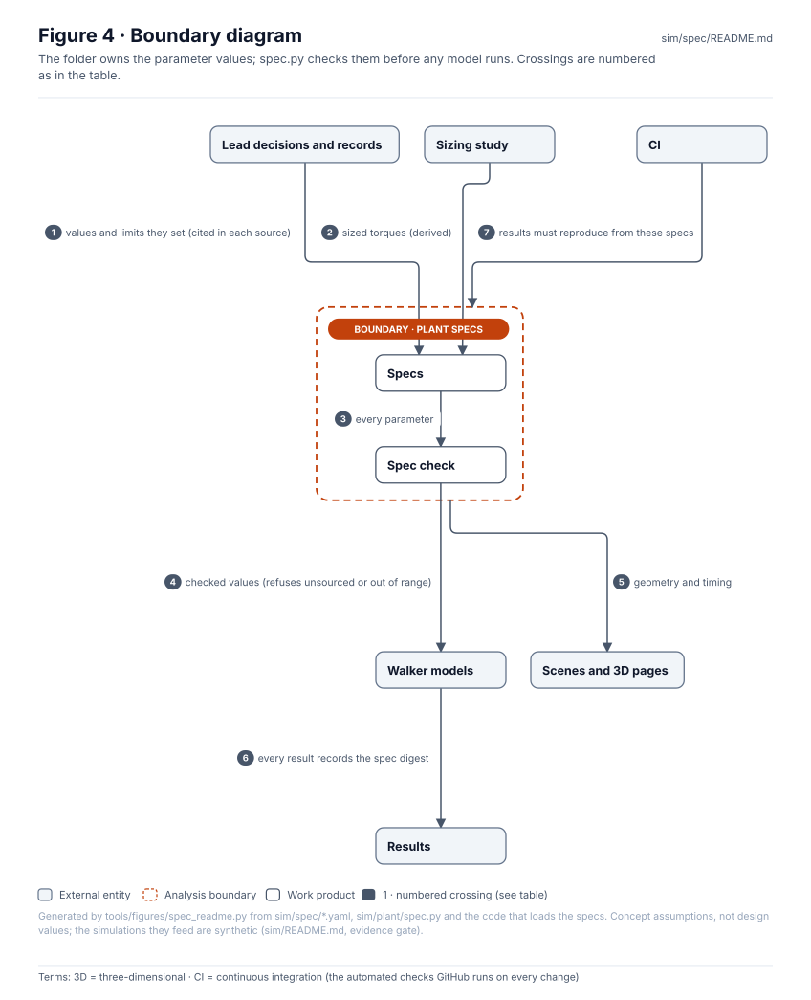
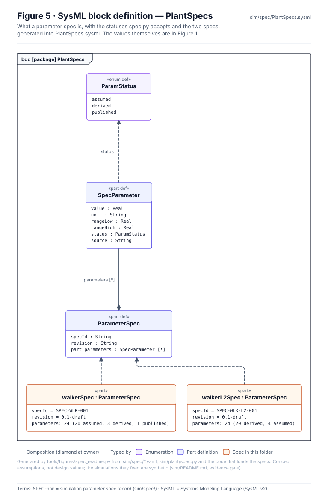
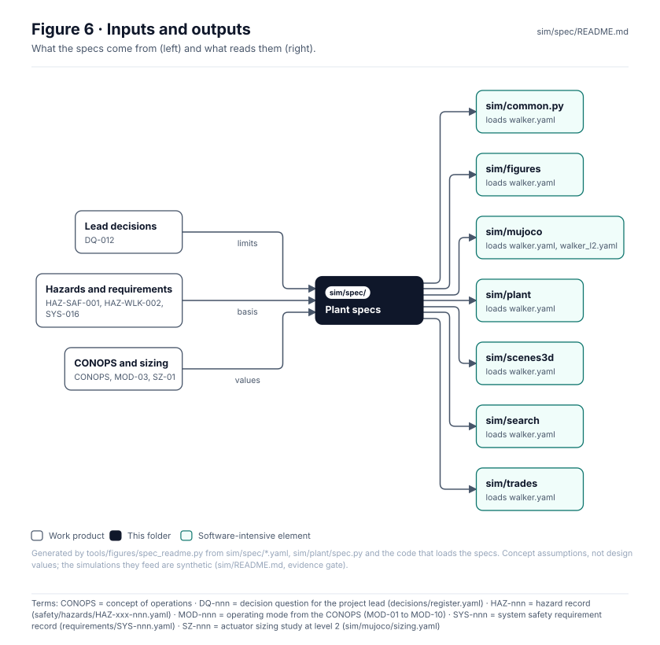

<!-- GENERATED by tools/figures/spec_readme.py from sim/spec/*.yaml, sim/plant/spec.py and the code that loads the specs; edit those and regenerate. -->

# Simulation specifications

> **Status:** 2 specs, 48 parameters (24 assumed, 23 derived, 1 published). Concept assumptions, **not design values**; SUS-M1 has no selected hardware.

<!-- terms:start (generated by tools/terms/terms.py; do not edit by hand) -->

<b>Terms on this page (23)</b>: abbreviations and codes explained

| Term | Meaning |
|---|---|
| 3D | three-dimensional |
| CAD | computer-aided design |
| CF1, CF2 … | causal factor in a hazard record (CF1, CF2 …) |
| CI | continuous integration (the automated checks GitHub runs on every change) |
| CL-nnn | concept layout (cad/params/CL-nn.yaml; CL-01 to CL-05, CL-05 the reference layout) |
| CoM | centre of mass |
| DoD | US Department of Defense |
| DQ-nnn | decision question for the project lead (decisions/register.yaml) |
| HAZ-nnn | hazard record (safety/hazards/HAZ-xxx-nnn.yaml) |
| HHA | health hazard analysis (MIL-STD-882E Task 207) |
| M1, M2 … | mitigation in a hazard record (M1, M2 …), or a SysML model check rule in tools/sysml |
| MIL-STD-882E | US DoD Standard Practice for System Safety (11 May 2012, base edition) |
| MuJoCo | Multi-Joint dynamics with Contact, the physics engine for the level-2 walker model |
| OMG | Object Management Group, publisher of SysML |
| SPEC-nnn | simulation parameter spec record (sim/spec/) |
| SSF-nnn | safety-significant software function record (safety/software/) |
| SUS-M1 | piloted walker |
| SVG | Scalable Vector Graphics, the figure file format |
| SYS-nnn | system safety requirement record (requirements/SYS-nnn.yaml) |
| SysML | Systems Modeling Language (SysML v2) |
| SZ-nnn | actuator sizing study at level 2 (sim/mujoco/sizing.yaml) |
| UAV | uncrewed aerial vehicle (drone) |
| US | United States |

All terms: [abbreviations and record codes](https://github.com/jherrodthomas/Project-Susanoo/blob/main/docs/terms.md).

<!-- terms:end -->

| Field | Value |
|---|---|
| [`walker.yaml`](walker.yaml) | SPEC-WLK-001 0.1-draft · 24 parameters |
| [`walker_l2.yaml`](walker_l2.yaml) | SPEC-WLK-L2-001 0.1-draft · 24 parameters |
| Check | [`sim/plant/spec.py`](../plant/spec.py): every parameter needs value, unit, range, status, source; status one of assumed, derived, published; value inside the range |
| SysML | [`PlantSpecs.sysml`](PlantSpecs.sysml) (generated) |

## Purpose

The one place the walker models take their numbers from. Every parameter carries its unit, the range it may take, whether it is assumed, derived or published, and where it comes from; `spec.py` refuses a value without them or outside its range before any model runs, and every result records the spec's digest. The UAV harness keeps its own spec in [`sim/uav/spec.yaml`](../uav/spec.yaml).

## Parameters

### walker.yaml · SPEC-WLK-001

| Parameter | Value | Unit | Range | Status | Source |
|---|---|---|---|---|---|
| `mass_kg` | 4590 | kg | 1500 to 6000 | derived | Reference layout CL-05 (cad/metrics.json, placeholder_mass_kg), decision DQ-023; placeholder geometry, not a design |
| `com_height_m` | 2.72 | m | 2.0 to 4.5 | derived | Reference layout CL-05 (cad/metrics.json, cg_m height, standing), decision DQ-023; placeholder geometry, not a design |
| `crouch_height_m` | 1.49 | m | 1.0 to 2.5 | derived | Reference layout CL-05 (cad/metrics.json, postures.kneel.cg_m height), decision DQ-023; placeholder geometry, not a design |
| `foot_half_length_m` | 0.6 | m | 0.3 to 1.0 | assumed | Single-support foot, along the direction of travel |
| `stance_half_length_m` | 1.4 | m | 0.8 to 2.5 | assumed | Double-support polygon after planting the swing foot |
| `tip_offset_m` | 1.0 | m | 0.6 to 2.0 | assumed | CoM horizontal offset beyond which tipping is taken as irrecoverable (contact and rotation not modelled) |
| `leg_force_ratio` | 2.0 | - | 1.2 to 4.0 | assumed | Leg actuator peak force as a multiple of body weight at full supply |
| `step_time_s` | 0.5 | s | 0.2 to 1.5 | assumed | Time to plant the swing foot when a protective stop starts |
| `crouch_rate_mps` | 0.3 | m/s | 0.1 to 1.0 | assumed | Commanded descent rate to the crouch posture during a protective stop |
| `safe_drop_speed_mps` | 1.0 | m/s | 0.5 to 3.0 | assumed | Vertical cockpit impact speed treated as injurious to a restrained seated pilot; placeholder pending HHA (Task 207) |
| `slope_lean` | 0.25 | - | 0.0 to 1.0 | assumed | Fraction of the slope-induced CoM lean (z tan slope) the gait does not compensate |
| `sway_amplitude_m` | 0.1 | m | 0.0 to 0.4 | assumed | CoM fore-aft sway over the stance foot while walking |
| `sway_period_s` | 1.2 | s | 0.6 to 3.0 | assumed | Gait cycle period at walking pace |
| `balance_gain` | 1.5 | - | 0.5 to 5.0 | assumed | Capture-point feedback gain |
| `height_kp` | 25.0 | 1/s2 | 5 to 100 | assumed | Height loop stiffness |
| `height_kd` | 10.0 | 1/s | 2 to 40 | assumed | Height loop damping |
| `low_supply_alarm` | 0.7 | - | 0.3 to 0.95 | assumed | Supply fraction that raises the pilot alarm |
| `lock_threshold` | 0.4 | - | 0.1 to 0.8 | assumed | Supply fraction below which load-holding valves or brakes engage (HAZ-SAF-001 M1) |
| `lock_delay_s` | 0.1 | s | 0.0 to 1.0 | assumed | Engagement delay of load-holding valves or brakes |
| `monitor_detect_s` | 0.15 | s | 0.01 to 1.0 | assumed | Feedback staleness monitor detection time (SSF-004); no design yet |
| `electric_sag_floor` | 0.35 | - | 0.0 to 0.9 | assumed | Electric variant: residual torque capacity after a bus undervoltage |
| `dt_s` | 0.005 | s | 0.001 to 0.01 | assumed | Integration step (semi-implicit Euler) |
| `horizon_s` | 6.0 | s | 3 to 20 | assumed | Simulated time after the start of the case |
| `gravity_mps2` | 9.81 | m/s2 | 9.8 to 9.82 | published | Standard gravity |

### walker_l2.yaml · SPEC-WLK-L2-001

| Parameter | Value | Unit | Range | Status | Source |
|---|---|---|---|---|---|
| `torso_mass_kg` | 3473.8 | kg | 1000 to 5000 | derived | mass_kg less both legs; CL-05 link mass properties (cad/links.json, tools/cad/b3d/cl05_links.py) gives 3,470 kg (the 3 kg difference is the rounding of cad/metrics.json) |
| `torso_pitch_inertia_kgm2` | 2452 | kg m^2 | 200 to 10000 | derived | Torso pitch inertia about its centre of mass, CL-05 link mass properties (cad/links.json, tools/cad/b3d/cl05_links.py) |
| `thigh_mass_kg` | 339.3 | kg | 20 to 1000 | derived | CL-05 link mass properties (cad/links.json, tools/cad/b3d/cl05_links.py) |
| `shank_mass_kg` | 167.8 | kg | 20 to 1000 | derived | CL-05 link mass properties (cad/links.json, tools/cad/b3d/cl05_links.py) |
| `foot_mass_kg` | 51.0 | kg | 5 to 500 | derived | CL-05 link mass properties (cad/links.json, tools/cad/b3d/cl05_links.py) |
| `thigh_com_fraction` | 0.175 | - | 0.0 to 1.0 | derived | Thigh centre of mass along hip-knee, from the hip; CL-05 link mass properties (cad/links.json, tools/cad/b3d/cl05_links.py) |
| `shank_com_fraction` | 0.424 | - | 0.0 to 1.0 | derived | Shank centre of mass along knee-ankle, from the knee; CL-05 link mass properties (cad/links.json, tools/cad/b3d/cl05_links.py) |
| `thigh_pitch_inertia_kgm2` | 153 | kg m^2 | 1 to 2000 | derived | About the thigh centre of mass, CL-05 link mass properties (cad/links.json, tools/cad/b3d/cl05_links.py) |
| `shank_pitch_inertia_kgm2` | 39 | kg m^2 | 1 to 2000 | derived | About the shank centre of mass, CL-05 link mass properties (cad/links.json, tools/cad/b3d/cl05_links.py) |
| `foot_pitch_inertia_kgm2` | 5 | kg m^2 | 0.5 to 500 | derived | About the foot centre of mass, CL-05 link mass properties (cad/links.json, tools/cad/b3d/cl05_links.py) |
| `foot_com_above_sole_m` | 0.067 | m | 0.0 to 0.4 | derived | CL-05 link mass properties (cad/links.json, tools/cad/b3d/cl05_links.py) |
| `hip_height_m` | 2.34 | m | 1.5 to 4.0 | derived | Reference layout CL-05 (cad/metrics.json, hip_height_m), decision DQ-023; placeholder geometry, not a design |
| `thigh_length_m` | 1.0 | m | 0.8 to 2.5 | derived | Hip to knee, CL-05 joint positions (cad/links.json joints_m, tools/cad/b3d/cl05_links.py) |
| `shank_length_m` | 1.05 | m | 0.8 to 2.5 | derived | Knee to ankle, CL-05 joint positions (cad/links.json joints_m, tools/cad/b3d/cl05_links.py) |
| `knee_stance_rad` | -1.018 | rad | -2.0 to 1.0 | derived | Knee angle standing (shank relative to thigh; negative bends the knee backwards, reverse-jointed), CL-05 joint positions (cad/links.json joints_m, tools/cad/b3d/cl05_links.py) |
| `ankle_height_m` | 0.55 | m | 0.05 to 0.8 | derived | Ankle joint above the sole (raised ankle on a long link to the foot), CL-05 joint positions (cad/links.json joints_m, tools/cad/b3d/cl05_links.py) |
| `step_lift_m` | 0.22 | m | 0.05 to 0.6 | derived | Peak swing-foot lift of the protective-stop step, from the CL-05 gait (cad/params/CL-05.yaml gait.lift) |
| `stop_step_m` | 0.8 | m | 0.3 to 1.5 | assumed | Protective-stop step length along the ground, inside the CL-05 leg's reach (about 1.0 m ahead of the hip at full extension); the CL-05 walk steps 0.5 m (cad/params/CL-05.yaml walk.stride) |
| `torso_com_above_hip_m` | 0.748 | m | 0.0 to 1.5 | derived | Torso centre of mass above the hip joint, CL-05 link mass properties (cad/links.json, tools/cad/b3d/cl05_links.py); placed over the hip (the CAD has it 0.265 m behind, not modelled) |
| `knee_torque_max_nm` | 26500 | N m | 10000 to 200000 | derived | Knee actuator peak torque at full supply, re-sized against HAZ-WLK-002 CF4 for the 4,590 kg reference layout (SZ-01, sim/results/sizing-cf4.md; SYS-016); adopted by lead decision DQ-024 |
| `hip_torque_max_nm` | 40000 | N m | 10000 to 200000 | assumed | Hip actuator peak torque at full supply |
| `ankle_torque_max_nm` | 40500 | N m | 5000 to 100000 | derived | Ankle actuator peak torque at full supply, 1.5 m g L_foot, re-sized against HAZ-WLK-002 CF4 for the 4,590 kg reference layout (SZ-01, sim/results/sizing-cf4.md; SYS-016); adopted by lead decision DQ-024 |
| `timestep_s` | 0.002 | s | 0.0005 to 0.005 | assumed | MuJoCo integration step (implicitfast) |
| `ground_friction` | 1.0 | - | 0.3 to 2.0 | assumed | Foot-ground friction coefficient on firm ground |

## Where the parameters come from and go

| Spec | Loaded by |
|---|---|
| `walker.yaml` | `sim/common.py`, `sim/figures`, `sim/mujoco`, `sim/plant`, `sim/scenes3d`, `sim/search`, `sim/trades` |
| `walker_l2.yaml` | `sim/mujoco` |

Cited in parameter sources: DQ-023 (walker.yaml, walker_l2.yaml), DQ-024 (walker_l2.yaml), HAZ-SAF-001 (walker.yaml), HAZ-WLK-002 (walker_l2.yaml), SSF-004 (walker.yaml), SYS-016 (walker_l2.yaml), SZ-01 (walker_l2.yaml).

## Block diagram

## Boundary diagram

| # | From | To | Crossing / interaction |
|---|---|---|---|
| 1 | Lead decisions and records | Specs | values and limits they set (cited in each source) |
| 2 | Sizing study | Specs | sized torques (derived) |
| 3 | Specs | Spec check | every parameter |
| 4 | Spec check | Walker models | checked values (refuses unsourced or out of range) |
| 5 | Plant specs | Scenes and 3D pages | geometry and timing |
| 6 | Walker models | Results | every result records the spec digest |
| 7 | CI | Plant specs | results must reproduce from these specs |

**Explicitly excluded:** design values (none exist yet), the UAV harness spec (`sim/uav/spec.yaml`), and fault parameters (`sim/faults.yaml`).

## SysML model

[`PlantSpecs.sysml`](PlantSpecs.sysml) is generated and validated with the project model by the OMG pilot in CI.

## Inputs and outputs

| Input | Source |
|---|---|
| Limits and adopted values | [Decision register](../../decisions/README.md) |
| Hazard and requirement basis | [Safety records](../../safety/README.md), [requirement register](../../requirements/README.md) |
| Sized torques | [`sim/mujoco/`](../mujoco/README.md) (SZ-01) |

| Output | Destination |
|---|---|
| `walker.yaml` | sim/common.py, sim/figures, sim/mujoco, sim/plant, sim/scenes3d, sim/search, sim/trades |
| `walker_l2.yaml` | sim/mujoco |

## Changing a parameter

1. Edit the value and keep its unit, range, status and source; cite the decision, hazard or requirement behind it.
2. A value set by the lead needs the lead's decision first; a sized value names its study.
3. Regenerate every simulation result (the digest changes) and this page, and run the full check list in [`CLAUDE.md`](../../CLAUDE.md).

## Folder contents

| Item | Description | State |
|---|---|---|
| [`walker.yaml`](walker.yaml) | SPEC-WLK-001, 24 parameters | hand-written |
| [`walker_l2.yaml`](walker_l2.yaml) | SPEC-WLK-L2-001, 24 parameters | hand-written |
| [`PlantSpecs.sysml`](PlantSpecs.sysml) | The spec structure as SysML | generated |
| [`figures/`](figures/) | Generated SVG figures (do not edit) | generated |
| `README.md` | This page | generated |

<!-- END GENERATED: content below this line is human-authored and preserved -->
