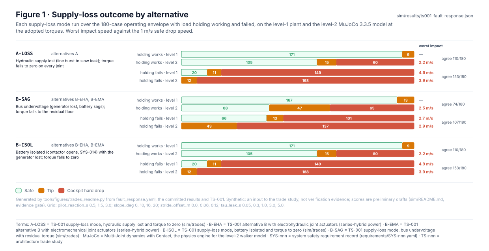
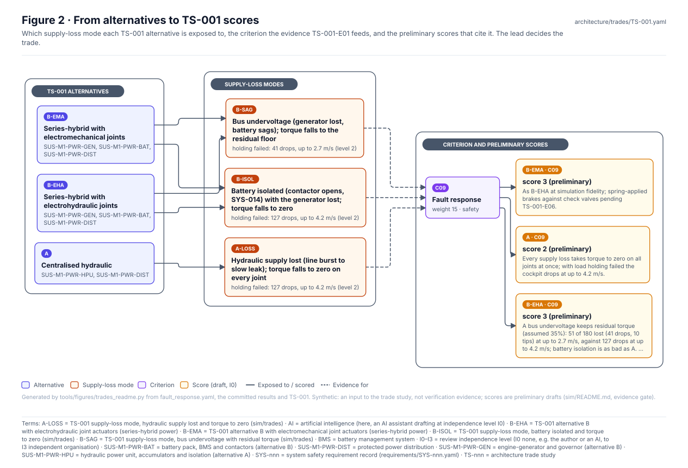
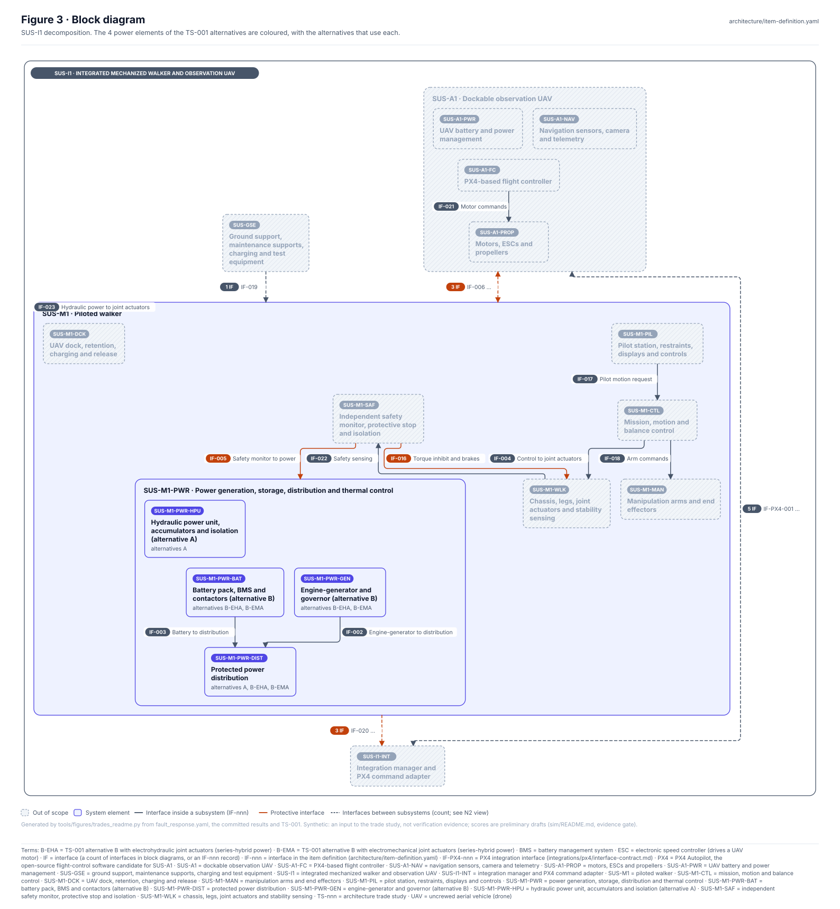
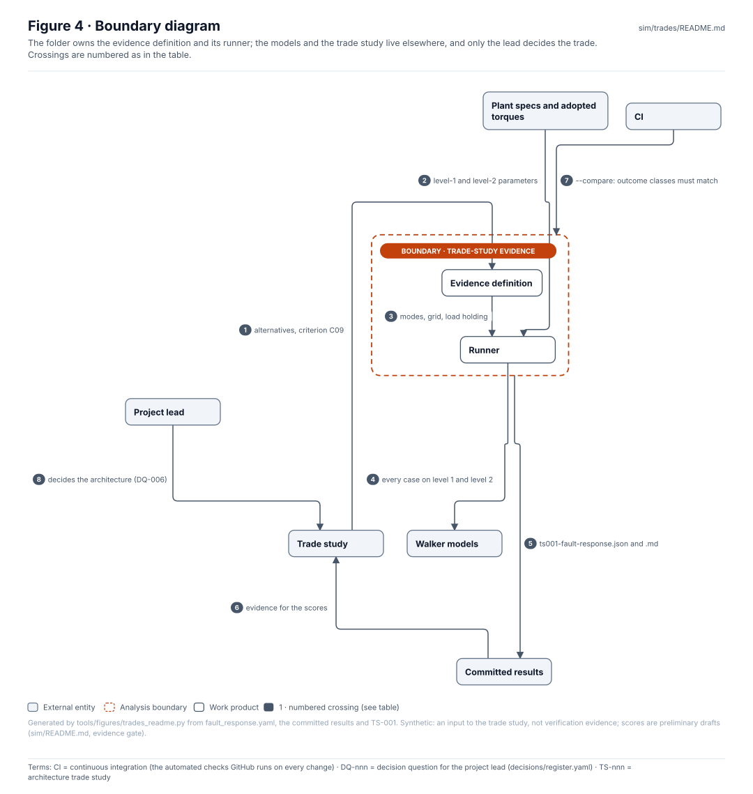
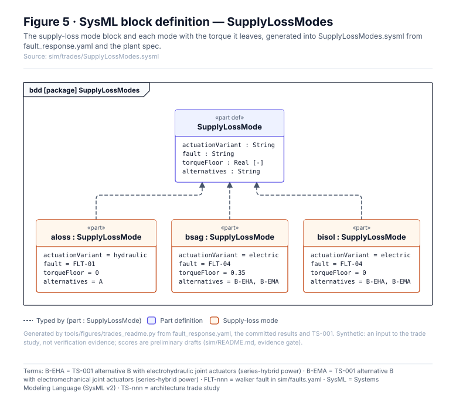
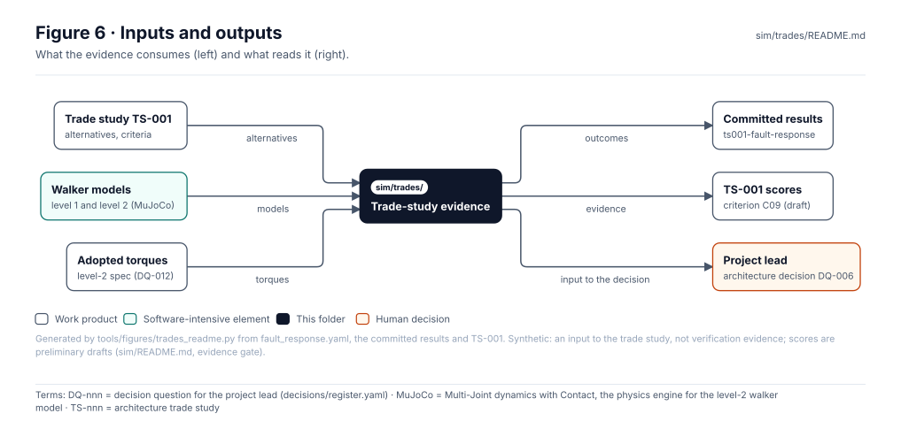

<!-- GENERATED by tools/figures/trades_readme.py from fault_response.yaml, the committed results and TS-001; edit those and regenerate. -->

# Trade-study evidence

> **Status:** 3 supply-loss modes × 2 load-holding cases × 2 levels over 180 envelope cases, feeding TS-001 criterion C09 (done). Synthetic, **no evidence credit**: an input to the trade study, which the lead decides.

<!-- terms:start (generated by tools/terms/terms.py; do not edit by hand) -->

<b>Terms on this page (14)</b>: abbreviations and codes explained

| Term | Meaning |
|---|---|
| A-LOSS | TS-001 supply-loss mode, hydraulic supply lost and torque to zero (sim/trades) |
| A01–A04 | item-definition validator rule (A01–A04) |
| B-EHA | TS-001 alternative B with electrohydraulic joint actuators (series-hybrid power) |
| B-EMA | TS-001 alternative B with electromechanical joint actuators (series-hybrid power) |
| B-ISOL | TS-001 supply-loss mode, battery isolated and torque to zero (sim/trades) |
| B-SAG | TS-001 supply-loss mode, bus undervoltage with residual torque (sim/trades) |
| CI | continuous integration (the automated checks GitHub runs on every change) |
| DQ-nnn | decision question for the project lead (decisions/register.yaml) |
| L00 | link-resolution validator rule (L00) |
| OMG | Object Management Group, publisher of SysML |
| SVG | Scalable Vector Graphics, the figure file format |
| SYS-nnn | system safety requirement record (requirements/SYS-nnn.yaml) |
| SysML | Systems Modeling Language (SysML v2) |
| TS-nnn | architecture trade study |

All terms: [abbreviations and record codes](https://github.com/jherrodthomas/Project-Susanoo/blob/main/docs/terms.md).

<!-- terms:end -->

| Field | Value |
|---|---|
| Evidence | TS-001-E01 · Supply-loss response by actuation and power alternative |
| Trade study | [`TS-001`](../../architecture/trades/TS-001.yaml) · Actuation and power architecture (in-work) |
| Run | `python -m sim.trades.fault_response` (about 1 minute); `--compare` in CI |
| Results | [`ts001-fault-response.md`](../results/ts001-fault-response.md) |
| SysML | [`SupplyLossModes.sysml`](SupplyLossModes.sysml) (generated) |

## Purpose

Runs the simulations the architecture trade studies need. For TS-001 (actuation and power architecture), the alternatives differ at simulation fidelity only in how joint torque falls when supply is lost, so each loss mode is run over the operating envelope with load holding working and failed, on both walker models. The result is evidence for one criterion; it scores nothing and decides nothing.

## Outcomes

| Mode | Alternatives | Load holding | Level 1 (safe / tip / drop) | Level 2 (safe / tip / drop) | Worst impact L2 | Agree |
|---|---|---|---|---|---|---|
| A-LOSS | A | works | 171 / 9 / 0 | 180 / 0 / 0 | 0.0 m/s | 171/180 |
| A-LOSS | A | fails | 20 / 11 / 149 | 51 / 0 / 129 | 4.2 m/s | 142/180 |
| B-SAG | B-EHA, B-EMA | works | 167 / 13 / 0 | 180 / 0 / 0 | 0.0 m/s | 167/180 |
| B-SAG | B-EHA, B-EMA | fails | 66 / 13 / 101 | 130 / 9 / 41 | 3.0 m/s | 109/180 |
| B-ISOL | B-EHA, B-EMA | works | 171 / 9 / 0 | 180 / 0 / 0 | 0.0 m/s | 171/180 |
| B-ISOL | B-EHA, B-EMA | fails | 20 / 11 / 149 | 51 / 0 / 129 | 4.2 m/s | 142/180 |

Summary recorded in TS-001: On the 4,590 kg reference layout (DQ-023, link masses and inertias from cad/links.json) with the re-sized torques (ankle 40.5, knee 26.5 kN m, DQ-024), every supply-loss mode is safe across the envelope at level 2 while load holding works (level 1 tips 9-13 of 180 through its unsized centre-of-pressure limit, A3). With load holding failed, a hydraulic supply loss (A) and an isolated battery (B, SYS-014) are identical: torque goes to zero and the cockpit drops in 129 of 180 cases at up to 4.2 m/s (level 2). A bus undervoltage that keeps 35% of torque (B, assumed floor) drops it in 41 and tips it in 9 at up to 2.9 m/s, still above the 1.0 m/s safe drop speed. The alternatives differ by the torque left after the fault, not by the technology.

## Where the evidence goes

| Alternative | Criterion | Score | Note |
|---|---|---|---|
| A | C09 | 2 (preliminary) | Every supply loss takes torque to zero on all joints at once; with load holding failed the cockpit drops at up to 4.2 m/s. |
| B-EHA | C09 | 3 (preliminary) | A bus undervoltage keeps residual torque (assumed 35%): 50 of 180 lost (41 drops, 9 tips) at up to 2.9 m/s, against 129 drops at up to 4.2 m/s; battery isolation is as bad as A. Local actuator leaks pending TS-001-E06. |
| B-EMA | C09 | 3 (preliminary) | As B-EHA at simulation fidelity; spring-applied brakes against check valves pending TS-001-E06. |

## Block diagram

## Boundary diagram

| # | From | To | Crossing / interaction |
|---|---|---|---|
| 1 | Trade study | Evidence definition | alternatives, criterion C09 |
| 2 | Plant specs and adopted torques | Runner | level-1 and level-2 parameters |
| 3 | Evidence definition | Runner | modes, grid, load holding |
| 4 | Runner | Walker models | every case on level 1 and level 2 |
| 5 | Trade-study evidence | Committed results | ts001-fault-response.json and .md |
| 6 | Committed results | Trade study | evidence for the scores |
| 7 | CI | Trade-study evidence | --compare: outcome classes must match |
| 8 | Project lead | Trade study | decides the architecture (DQ-006) |

**Explicitly excluded:** actuator dynamics and faults local to one joint (not modelled at this fidelity), the other criteria, and the trade decision itself.

## SysML model

[`SupplyLossModes.sysml`](SupplyLossModes.sysml) is generated from the evidence definition and validated with the project model by the OMG pilot in CI.

## Inputs and outputs

| Input | Source |
|---|---|
| Alternatives and criteria | [`TS-001`](../../architecture/trades/TS-001.yaml) |
| Walker models | [`sim/plant/`](../plant/README.md), [`sim/mujoco/`](../mujoco/README.md) |
| Adopted torques | [`sim/spec/walker_l2.yaml`](../spec/walker_l2.yaml) |

| Output | Destination |
|---|---|
| Results | [`sim/results/`](../results/) |
| Evidence TS-001-E01 | [`TS-001`](../../architecture/trades/TS-001.yaml) criterion C09; the lead decides the trade |

## Folder contents

| Item | Description | State |
|---|---|---|
| [`fault_response.yaml`](fault_response.yaml) | The supply-loss evidence definition | hand-written |
| [`fault_response.py`](fault_response.py) | Runs it on both levels and writes the results | code |
| [`SupplyLossModes.sysml`](SupplyLossModes.sysml) | The modes as SysML | generated |
| [`figures/`](figures/) | Generated SVG figures (do not edit) | generated |
| `README.md` | This page | generated |

<!-- END GENERATED: content below this line is human-authored and preserved -->
