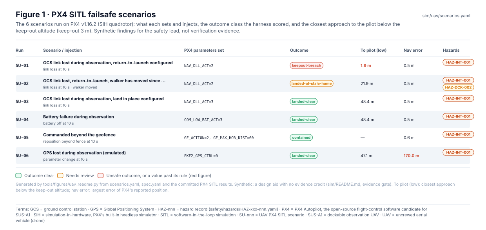
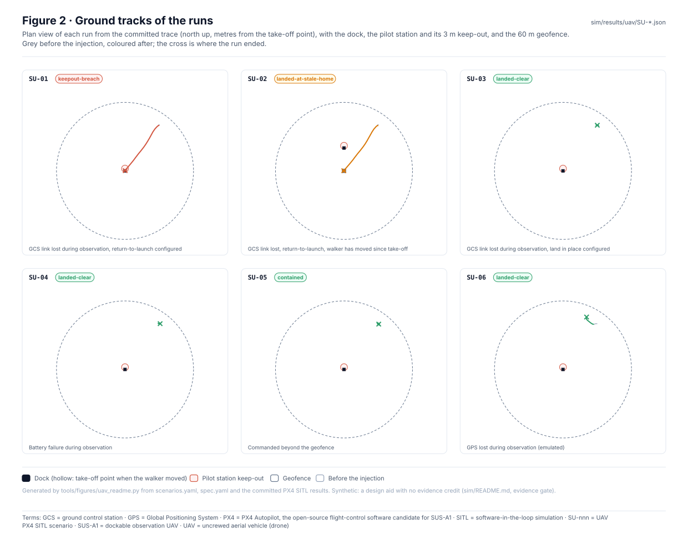
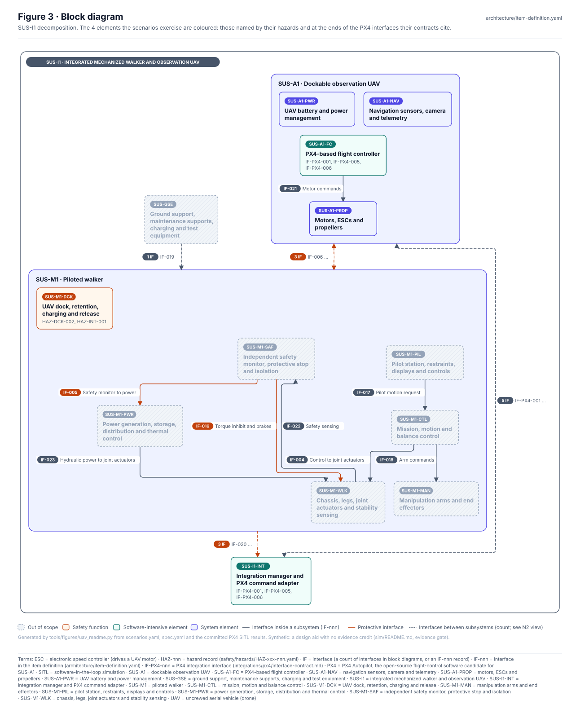
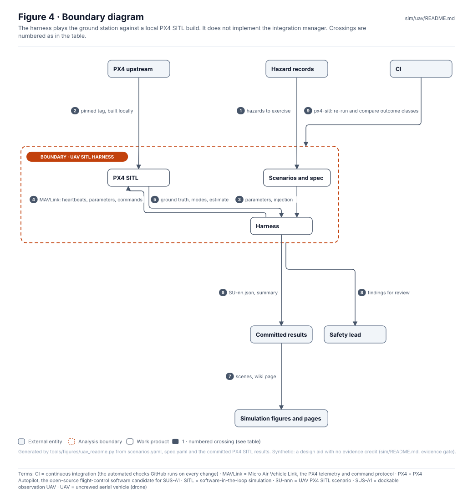
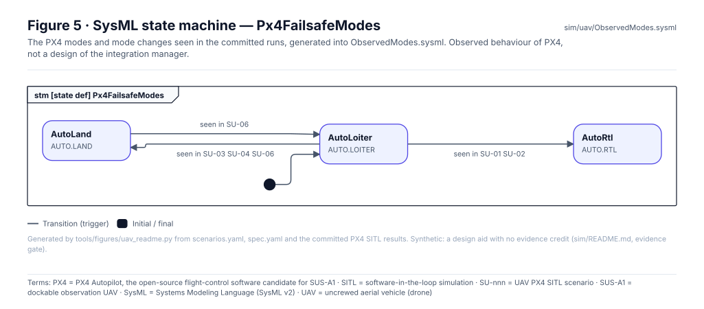
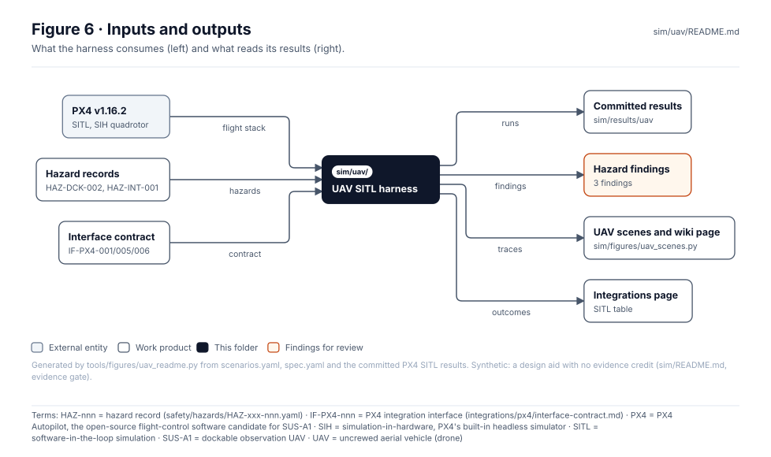

<!-- GENERATED by tools/figures/uav_readme.py from scenarios.yaml, spec.yaml and the committed PX4 SITL results; edit those and regenerate. -->

# UAV simulation harness (PX4 SITL)

> **Status:** 6 scenarios on PX4 v1.16.2, 6 committed runs, 3 findings for the safety lead. Synthetic, **no evidence credit**: the runs inform hazards and the interface contract; they verify nothing.

<!-- terms:start (generated by tools/terms/terms.py; do not edit by hand) -->

<b>Terms on this page (20)</b>: abbreviations and codes explained

| Term | Meaning |
|---|---|
| CF1, CF2 … | causal factor in a hazard record (CF1, CF2 …) |
| CI | continuous integration (the automated checks GitHub runs on every change) |
| EXT-AIRSPACE | external element: airspace, people and property under the UAV |
| GCS | ground control station |
| GPS | Global Positioning System |
| HAZ-nnn | hazard record (safety/hazards/HAZ-xxx-nnn.yaml) |
| IF-PX4-nnn | PX4 integration interface (integrations/px4/interface-contract.md) |
| M1, M2 … | mitigation in a hazard record (M1, M2 …), or a SysML model check rule in tools/sysml |
| MAVLink | Micro Air Vehicle Link, the PX4 telemetry and command protocol |
| OMG | Object Management Group, publisher of SysML |
| PX4 | PX4 Autopilot, the open-source flight-control software candidate for SUS-A1 |
| SIH | simulation-in-hardware, PX4's built-in headless simulator |
| SITL | software-in-the-loop simulation |
| SPEC-nnn | simulation parameter spec record (sim/spec/) |
| SSF-nnn | safety-significant software function record (safety/software/) |
| SU-nnn | UAV PX4 SITL scenario |
| SUS-A1 | dockable observation UAV |
| SVG | Scalable Vector Graphics, the figure file format |
| SysML | Systems Modeling Language (SysML v2) |
| UAV | uncrewed aerial vehicle (drone) |

All terms: [abbreviations and record codes](https://github.com/jherrodthomas/Project-Susanoo/blob/main/docs/terms.md).

<!-- terms:end -->

| Field | Value |
|---|---|
| PX4 | `v1.16.2`, SITL SIH quadrotor, headless lockstep ([`fetch_px4.sh`](fetch_px4.sh)) |
| Run | `python -m sim.uav.harness --px4 PX4_DIR` ([`harness.py`](harness.py)); re-running: [`sim/README.md`](../README.md) |
| Results | [`sim/results/uav/`](../results/uav/) · [UAV simulation (wiki)](../../docs/wiki/UAV-Simulation.md) |
| SysML | [`ObservedModes.sysml`](ObservedModes.sysml) (generated) |

## Purpose

Runs the SUS-A1 failsafe scenarios on PX4's own software-in-the-loop simulator and records what PX4 does when no integration manager permit exists (IF-PX4-005/006 are not implemented). The harness is the ground station: it sends heartbeats, sets the scenario's parameters, takes off, flies to the observation point and injects the fault. A scoring rule turns each run into an outcome class and, where a rule says so, a finding for the safety lead.

## Scenarios

| Run | Scenario | Parameters | Injection | Outcome | To pilot (low) | Contract |
|---|---|---|---|---|---|---|
| SU-01 | GCS link lost during observation, return-to-launch configured | `NAV_DLL_ACT=2` | link loss at 10 s | keepout-breach | 1.9 m | Loss of the integration link must invoke a defined, analysed contingency; recovery needs an explicit permit (IF-PX4-005/006) |
| SU-02 | GCS link lost, return-to-launch, walker has moved since take-off | `NAV_DLL_ACT=2` | link loss at 10 s | landed-at-stale-home | 21.9 m | PX4 home is the take-off point; the dock has moved with the walker |
| SU-03 | GCS link lost during observation, land in place configured | `NAV_DLL_ACT=3` | link loss at 10 s | landed-clear | 48.4 m | Alternative contingency: land away from the walker |
| SU-04 | Battery failure during observation | `COM_LOW_BAT_ACT=3` | battery off at 10 s | landed-clear | 48.4 m | Battery contingency must not bring the aircraft into the pilot keep-out without a permit |
| SU-05 | Commanded beyond the geofence | `GF_ACTION=2, GF_MAX_HOR_DIST=60` | reposition beyond fence at 10 s | contained | — | Operations stay inside the defined volume (EXT-AIRSPACE) |
| SU-06 | GPS lost during observation (emulated) | `EKF2_GPS_CTRL=0` | parameter change at 10 s | landed-clear | 47.1 m | Navigation loss contingency; drift towards people or the walker |

Findings (from the outcome and metric rules in [`scenarios.yaml`](scenarios.yaml)):

| Run | Rule | Hazard | Finding |
|---|---|---|---|
| SU-01 | keepout-breach | HAZ-INT-001 | PX4 return-to-launch brings the aircraft to the dock, inside the pilot keep-out, with no integration manager recovery permit (IF-PX4-005/006 are bypassed). Recorded as HAZ-INT-001 CF4, mitigation M5, SSF-008 |
| SU-02 | landed-at-stale-home | HAZ-INT-001 | PX4 home is the take-off point; after the walker moves, a return lands where the dock used to be, possibly among the ground crew. Recorded as HAZ-INT-001 CF5, mitigation M6 |
| SU-06 | max_estimate_error_m 170.02 | HAZ-INT-001 | PX4's reported position (IF-PX4-001) was wrong by more than 10 m; the integration manager must not trust it without validity checks. Recorded as HAZ-INT-001 CF6, mitigation M7 |

## Ground tracks

| Assumption (SPEC-UAV-001) | Value |
|---|---|
| `pilot_station_n_m` | 2 |
| `pilot_station_e_m` | 0 |
| `pilot_keepout_m` | 3 |
| `keepout_alt_m` | 8 |
| `observe_n_m` | 40 |
| `observe_e_m` | 30 |
| `observe_alt_m` | 25 |
| `walker_moved_n_m` | 20 |
| `geofence_radius_m` | 60 |
| `link_loss_timeout_s` | 5 |
| `sim_speed_factor` | 4 |

## Block diagram

## Boundary diagram

| # | From | To | Crossing / interaction |
|---|---|---|---|
| 1 | Hazard records | Scenarios and spec | hazards to exercise |
| 2 | PX4 upstream | PX4 SITL | pinned tag, built locally |
| 3 | Scenarios and spec | Harness | parameters, injection |
| 4 | Harness | PX4 SITL | MAVLink: heartbeats, parameters, commands |
| 5 | PX4 SITL | Harness | ground truth, modes, estimate |
| 6 | Harness | Committed results | SU-nn.json, summary |
| 7 | Committed results | Simulation figures and pages | scenes, wiki page |
| 8 | UAV SITL harness | Safety lead | findings for review |
| 9 | CI | UAV SITL harness | px4-sitl: re-run and compare outcome classes |

**Explicitly excluded:** the integration manager and its launch and recovery permits, the walker's motion, real radio links, and any hardware.

## SysML model

[`ObservedModes.sysml`](ObservedModes.sysml) is generated from the committed runs and validated with the project model by the OMG pilot in CI.

## Inputs and outputs

| Input | Source |
|---|---|
| PX4 flight stack | upstream PX4, tag `v1.16.2` (built locally, not committed) |
| Hazards (HAZ-DCK-002, HAZ-INT-001) | [Safety records](../../safety/README.md) |
| Interface contract | [`integrations/px4/interface-contract.md`](../../integrations/px4/interface-contract.md) |

| Output | Destination |
|---|---|
| Runs | [`sim/results/uav/`](../results/uav/) |
| Findings | hazard causal factors and mitigations (for review by the safety lead) |
| Scenes and wiki page | `sim/figures/uav_scenes.py`, [Integrations](../../integrations/README.md) |

## Folder contents

| Item | Description | State |
|---|---|---|
| [`scenarios.yaml`](scenarios.yaml) | Scenarios, outcome and metric rules | hand-written |
| [`spec.yaml`](spec.yaml) | Geometry and PX4 configuration assumptions (SPEC-UAV-001) | hand-written |
| [`harness.py`](harness.py) | The ground-station harness and scoring | code |
| [`fetch_px4.sh`](fetch_px4.sh) | Fetch and build PX4 at the pinned tag | code |
| [`requirements.txt`](requirements.txt), [`requirements-px4-build.txt`](requirements-px4-build.txt) | Python packages for the harness and the PX4 build | hand-written |
| [`ObservedModes.sysml`](ObservedModes.sysml) | Observed PX4 modes as a SysML state machine | generated |
| [`figures/`](figures/) | Generated SVG figures (do not edit) | generated |
| `README.md` | This page | generated |

<!-- END GENERATED: content below this line is human-authored and preserved -->
