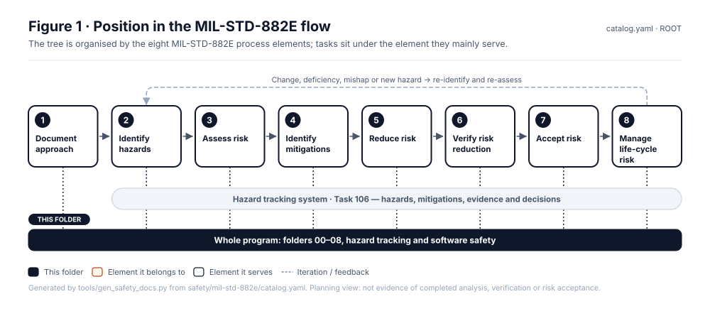

<!-- GENERATED by tools/previews/build_previews.py from docs/previews.yaml; do not edit. Edit the entry there and re-run. -->

# Standards and tailoring

The machine-readable MIL-STD-882E model (`mil-std-882e/`) and the project's tailoring of it (`tailoring/`).

<!-- terms:start (generated by tools/terms/terms.py; do not edit by hand) -->

<b>Terms on this page (3)</b>: abbreviations and codes explained

| Term | Meaning |
|---|---|
| DoD | US Department of Defense |
| MIL-STD-882E | US DoD Standard Practice for System Safety (11 May 2012, base edition) |
| US | United States |

All terms: [abbreviations and record codes](https://github.com/jherrodthomas/Project-Susanoo/blob/main/docs/terms.md).

<!-- terms:end -->

<!-- preview:start (generated by tools/previews/build_previews.py from docs/previews.yaml; do not edit by hand) -->

Safety lifecycle process map (illustrative)

<table>
<tr><td width="33%" valign="top"> The eight-element MIL-STD-882E process</td><td width="33%" valign="top"> Analysis dependencies (illustrative)</td></tr>
</table>

<!-- preview:end -->

## Folder contents

| Item | Title |
|---|---|
| [`mil-std-882e/`](mil-std-882e/) | MIL-STD-882E model |
| [`tailoring/`](tailoring/) | Project tailoring |
