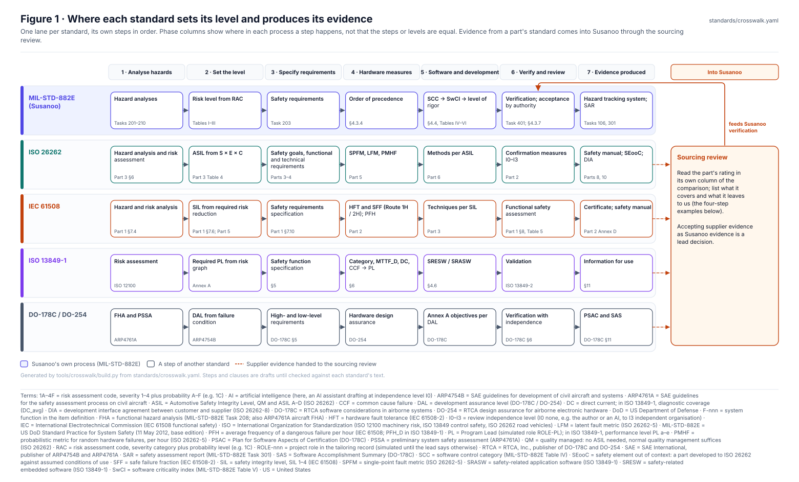

<!-- GENERATED by tools/crosswalk/build.py from standards/crosswalk.yaml. Do not edit; edit the record and re-run. -->

# Standards comparison

**SUS-XWALK-001** · status draft · **0 of 65 cells verified** against the text of their standard.

<!-- terms:start (generated by tools/terms/terms.py; do not edit by hand) -->

<b>Terms on this page (56)</b>: abbreviations and codes explained

| Term | Meaning |
|---|---|
| 1A–4F | risk assessment code, severity 1–4 plus probability A–F (e.g. 1C) |
| 3D | three-dimensional |
| AI | artificial intelligence (here, an AI assistant drafting at independence level I0) |
| ARP4754B | SAE guidelines for development of civil aircraft and systems |
| ARP4761A | SAE guidelines for the safety assessment process on civil aircraft |
| ASIL | Automotive Safety Integrity Level, QM and ASIL A–D (ISO 26262) |
| BMS | battery management system |
| CCF | common cause failure |
| DAL | development assurance level (DO-178C / DO-254) |
| DC | direct current; in ISO 13849-1, diagnostic coverage (DC_avg) |
| DO-178C | RTCA software considerations in airborne systems |
| DO-254 | RTCA design assurance for airborne electronic hardware |
| DoD | US Department of Defense |
| DQ-nnn | decision question for the project lead (decisions/register.yaml) |
| F-nnn | system function in the item definition |
| HAZ-nnn | hazard record (safety/hazards/HAZ-xxx-nnn.yaml) |
| HFT | hardware fault tolerance (IEC 61508-2) |
| HTS | hazard tracking system (MIL-STD-882E Task 106; here safety/hazards/) |
| I0–I3 | review independence level (I0 none, e.g. the author or an AI, to I3 independent organisation) |
| IEC | International Electrotechnical Commission (IEC 61508 functional safety) |
| ISO | International Organization for Standardization (ISO 12100 machinery risk, ISO 13849 control safety, ISO 26262 road vehicles) |
| LFM | latent fault metric (ISO 26262-5) |
| M1, M2 … | mitigation in a hazard record (M1, M2 …), or a SysML model check rule in tools/sysml |
| MC | modified condition, as in MC/DC: modified condition/decision coverage (DO-178C structural coverage at DAL A) |
| MIL-STD-882E | US DoD Standard Practice for System Safety (11 May 2012, base edition) |
| P0–P6 | PX4 integration phase (P0 SITL to P6 physical test readiness) |
| PFH | average frequency of a dangerous failure per hour (IEC 61508; PFH_D in ISO 13849-1) |
| PHA | preliminary hazard analysis (MIL-STD-882E Task 202) |
| PL | Program Lead (simulated role ROLE-PL); in ISO 13849-1, performance level PL a–e |
| PLC | programmable logic controller |
| PMHF | probabilistic metric for random hardware failures, per hour (ISO 26262-5) |
| PSAC | Plan for Software Aspects of Certification (DO-178C) |
| PX4 | PX4 Autopilot, the open-source flight-control software candidate for SUS-A1 |
| QM | quality managed: no ASIL needed, normal quality management suffices (ISO 26262) |
| ROLE-nnn | project role in the tailoring record (simulated until the lead says otherwise) |
| RTCA | RTCA, Inc., publisher of DO-178C and DO-254 |
| S3-nnn | 3D hazard scene (sim/scenes3d) |
| SAE | SAE International, publisher of ARP4754B and ARP4761A |
| SCC | software control category (MIL-STD-882E Table IV) |
| SEooC | safety element out of context: a part developed to ISO 26262 against assumed conditions of use |
| SFF | safe failure fraction (IEC 61508-2) |
| SIL | safety integrity level, SIL 1–4 (IEC 61508) |
| SITL | software-in-the-loop simulation |
| SPFM | single-point fault metric (ISO 26262-5) |
| SRASW | safety-related application software (ISO 13849-1) |
| SRESW | safety-related embedded software (ISO 13849-1) |
| SSF-nnn | safety-significant software function record (safety/software/) |
| SUS-A1 | dockable observation UAV |
| SUS-RISKDEF-001 | the project's tailored risk definitions (standards/tailoring) |
| SUS-XWALK-001 | the standards comparison record (standards/crosswalk.yaml) |
| SwCI | software criticality index (MIL-STD-882E Table V) |
| SYS-nnn | system safety requirement record (requirements/SYS-nnn.yaml) |
| SysML | Systems Modeling Language (SysML v2) |
| TS-nnn | architecture trade study |
| UAV | uncrewed aerial vehicle (drone) |
| US | United States |

All terms: [abbreviations and record codes](https://github.com/jherrodthomas/Project-Susanoo/blob/main/docs/terms.md).

<!-- terms:end -->

Show each standard's integrity levels as that standard defines them, side by side, so a part rated to another standard (ASIL, SIL, PL, DAL) can be read in its own terms and judged against Susanoo's own requirement. Columns are not aligned across standards and no level is equivalent to another.

> **Not an equivalence table.** Each column is a level of one standard (MIL-STD-882E, ISO 26262, IEC 61508, ISO 13849-1, DO-178C / DO-254), described only in that standard's own terms. Read a part's rating in its own column; never read across the columns as if they lined up. Cells are drafts until verified: Drafted at independence level I0 from the structure of each standard. Every cell must be checked against the controlled text of its standard and marked verified (with who and against which edition) before it is relied on.

## How to read it

- **Columns** are the levels of each standard, grouped under the standard. Their order follows each standard's own scale, lowest to highest integrity; nothing is implied between standards.
- **Rows** are the parameters that set or qualify a level. A cell spanning several levels means the parameter is the same for all of them. *Not defined* means that standard has no such parameter: nothing is borrowed from another standard.
- **Sources** under each cell name the clause or table. ✓ marks a cell checked against the standard's text.

## Where each standard sets its level

Each lane is one standard's own process, step by step. The phase columns show where in that process a step happens, not that steps or levels are equal. A part's evidence (safety manual, certificate, information for use, accomplishment summary) comes into Susanoo only through the sourcing review.

## The matrix

<table>
<thead>
<tr><th rowspan="2">Parameter</th>
<th colspan="4">MIL-STD-882E</th>
<th colspan="5">ISO 26262 (road vehicles)</th>
<th colspan="4">IEC 61508 (E/E/PE, generic)</th>
<th colspan="5">ISO 13849-1 (machinery control)</th>
<th colspan="5">DO-178C / DO-254 (airborne)</th>
</tr>
<tr>
<th>High</th>
<th>Serious</th>
<th>Medium</th>
<th>Low</th>
<th>QM</th>
<th>ASIL A</th>
<th>ASIL B</th>
<th>ASIL C</th>
<th>ASIL D</th>
<th>SIL 1</th>
<th>SIL 2</th>
<th>SIL 3</th>
<th>SIL 4</th>
<th>PL a</th>
<th>PL b</th>
<th>PL c</th>
<th>PL d</th>
<th>PL e</th>
<th>DAL E</th>
<th>DAL D</th>
<th>DAL C</th>
<th>DAL B</th>
<th>DAL A</th>
</tr>
</thead>
<tbody>
<tr><th>What sets the level</th><td colspan="4">Risk assessment code from severity (Table I) × probability (Table II), mapped to a risk level by Table III 882E §4.3.3, Tables I–III</td><td colspan="5">Severity S0–S3 × exposure E0–E4 × controllability C0–C3 of the hazardous event 26262-3 §6.4.3, Table 4</td><td colspan="4">Risk reduction needed to reach the tolerable risk; risk graph or hazardous-event matrix (informative methods) 61508-5 Annexes C–E</td><td colspan="5">Required PL from severity S1–S2, frequency/exposure F1–F2, possibility of avoidance P1–P2 (risk graph) 13849-1 §4.3, Annex A</td><td colspan="5">Failure condition classification of the function (Catastrophic → No effect), from the system safety assessment DO-178C §2.3; ARP4754B / ARP4761A</td></tr>
<tr><th>Quantitative failure target</th><td colspan="4">Probability levels A–F (qualitative, with project-defined quantitative bands); no hardware failure-rate target 882E Table II, Appendix A</td><td><i>No target</i> 26262-5 §9</td><td><i>No target</i> 26262-5 §9</td><td>PMHF &lt; 10⁻⁷ /h (recommended) 26262-5 Table 6</td><td>PMHF &lt; 10⁻⁷ /h (recommended) 26262-5 Table 6</td><td>PMHF &lt; 10⁻⁸ /h (recommended) 26262-5 Table 6</td><td>PFH 10⁻⁶ to &lt; 10⁻⁵ /h 61508-1 Table 3</td><td>PFH 10⁻⁷ to &lt; 10⁻⁶ /h 61508-1 Table 3</td><td>PFH 10⁻⁸ to &lt; 10⁻⁷ /h 61508-1 Table 3</td><td>PFH 10⁻⁹ to &lt; 10⁻⁸ /h 61508-1 Table 3</td><td>PFH_D 10⁻⁵ to &lt; 10⁻⁴ /h 13849-1 Table 2</td><td>3×10⁻⁶ to &lt; 10⁻⁵</td><td>10⁻⁶ to &lt; 3×10⁻⁶</td><td>10⁻⁷ to &lt; 10⁻⁶</td><td>10⁻⁸ to &lt; 10⁻⁷</td><td colspan="5"><i>Not defined in DO-178C or DO-254 (process assurance only); probability targets live in the system safety assessment</i> DO-178C §2.3</td></tr>
<tr><th>Architecture and fault tolerance</th><td colspan="4"><i>Not defined; design order of precedence (eliminate → engineer → warn → procedures)</i> 882E §4.3.4</td><td><i>—</i></td><td><i>No hardware metric</i></td><td>SPFM ≥ 90 % · LFM ≥ 60 % 26262-5 Tables 4–5</td><td>SPFM ≥ 97 % · LFM ≥ 80 %</td><td>SPFM ≥ 99 % · LFM ≥ 90 %</td><td colspan="4">Hardware fault tolerance and safe failure fraction per Route 1H (Tables 2–3), or Route 2H from field data 61508-2 §7.4.4</td><td colspan="5">Designated architecture Category B, 1, 2, 3 or 4, combined with MTTF_D, DC_avg and CCF to reach the PL 13849-1 §6, Figure 12</td><td colspan="5">Not graded by DAL; architecture handled at system level (ARP4754B) ARP4754B §5</td></tr>
<tr><th>Diagnostic coverage</th><td colspan="4"><i>Not defined</i></td><td colspan="5">Through the SPFM and LFM metrics above 26262-5 Annex D</td><td colspan="4">Through safe failure fraction; diagnostic coverage tables for techniques 61508-2 Annex A</td><td colspan="5">DC_avg: none &lt; 60 % · low 60–90 % · medium 90–99 % · high ≥ 99 % 13849-1 Table 6</td><td colspan="5"><i>Not defined</i></td></tr>
<tr><th>Software and development rigour</th><td colspan="4">Level of rigor from the software criticality index SwCI 1–5 (SCC × severity), not from the risk level 882E Tables IV–V, §4.4</td><td colspan="5">Methods recommended (+) or highly recommended (++) per ASIL in Part 6 tables; QM: normal quality management 26262-6 Tables 1–17</td><td colspan="4">Techniques and measures per SIL (Annex A/B tables) 61508-3 Annexes A–B</td><td colspan="5">SRESW / SRASW measures, increasing from PL a–c to PL d–e 13849-1 §4.6</td><td><i>No objectives</i></td><td>26 objectives DO-178C Annex A</td><td>62 objectives · statement coverage</td><td>69 objectives · decision coverage</td><td>71 objectives · MC/DC</td></tr>
<tr><th>Independence of review</th><td colspan="4">Not graded by risk level; acceptance authority rises with risk level (High → senior authority) 882E §4.3.7</td><td><i>—</i></td><td>Assessment: not required 26262-2 Table 1</td><td>I1</td><td>I2</td><td>I3</td><td>Independent person 61508-1 Table 5</td><td>Independent person</td><td>Independent department</td><td>Independent organisation</td><td colspan="5">Validation by persons independent of the design (not graded by PL) 13849-2 §4</td><td><i>—</i></td><td>2 objectives with independence DO-178C Annex A</td><td>5 with independence</td><td>18 with independence</td><td>30 with independence</td></tr>
<tr><th>What a supplier gives you</th><td colspan="4"><i>No part certification scheme; hazard and risk data feed the HTS</i></td><td colspan="5">Safety manual, ASIL capability, development interface agreement; SEooC assumptions 26262-8 §5; 26262-10 §9</td><td colspan="4">Certificate with SIL capability, safety manual (Annex D), failure rates / SFF 61508-2 Annex D</td><td colspan="5">PL, category, PFH_D, MTTF_D, DC, mission time, conditions of use 13849-1 §11</td><td colspan="5">Accomplishment summary (PSAC/SAS) for the software level; DO-254 equivalent for hardware DO-178C §11</td></tr>
</tbody>
</table>

## How to use it

Start from what the Susanoo records require, read the candidate part's rating in its own column, and list what the rating covers and what it leaves to us. The judgement stays in Susanoo's own terms. The parts below are generic illustrations, not selections.

### Example 1 · Protective stop supervisor on a certified safety PLC

**1 · What we need** (from the Susanoo records)

- **SSF-002 Protective stop supervisor**: SCC 1, SwCI 1: all five level-of-rigor activities on the software (882E Table V)
- **HAZ-SAF-001**: Protective stop does not reach a safe state: 1C → target 1E
- **SYS-002, SYS-010**: Defined stop behaviour per mode; stop path independent of the motion control software

**2 · The part's rating:** Safety PLC with an IEC 61508 SIL 3 certificate. Read the column **IEC 61508 · SIL 3**:

- PFH 10⁻⁸ to < 10⁻⁷ /h for the platform
- HFT and safe failure fraction per Route 1H
- Annex A/B techniques at SIL 3 for the vendor's firmware and tools
- Assessed by an independent department
- Certificate and safety manual with conditions of use

**3 · What it covers:** The PLC hardware, its firmware and its programming tool, used as the safety manual says.

**4 · What it leaves to us**

- Our stop logic is application software: the SwCI 1 level-of-rigor activities still apply to it (882E §4.4).
- The safety manual's conditions of use (proof-test interval, response time) become inputs to SYS-011 (stop reaction time).
- The platform failure rate is one input to the probability of HAZ-SAF-001, not the hazard's probability.

*Whether the certificate counts toward the level-of-rigor evidence is a lead decision.*

### Example 2 · Readiness interlock built from a PL d safety relay

**1 · What we need** (from the Susanoo records)

- **HAZ-PIL-001**: Unintended leg motion during ingress or egress: 1C → target 1E
- **SYS-001**: Inhibit leg actuation until restraint, hatch, neutral controls and clear zone are confirmed
- **SUS-RISKDEF-001**: Probability E means < 10⁻⁶ over the item life of 500 walker hours (decision DQ-003)

**2 · The part's rating:** Safety relay and interlock switches rated PL d, Category 3. Read the column **ISO 13849-1 · PL d**:

- PFH_D 10⁻⁷ to < 10⁻⁶ /h
- Category 3: a single fault does not lose the safety function
- DC_avg medium or better
- Validated by persons independent of the design
- PL, category, PFH_D, MTTF_D, DC, mission time and conditions of use

**3 · What it covers:** The interlock channel's dangerous-failure rate and its fault tolerance.

**4 · What it leaves to us**

- Our own arithmetic, with our own definitions: PFH_D just under 10⁻⁶ /h over 500 h gives up to 5 × 10⁻⁴, which is probability D, not E, if the relay alone stood between a fault and the mishap. PL e (< 10⁻⁷ /h) gives up to 5 × 10⁻⁵: still D.
- So the 1E target rests on the other mitigations as well: mechanical supports (M1), the hardware enable chain (M3) and the ingress procedure (M4). The PHA should show that combination.
- This is not a PL-to-882E mapping; it is the part's own figure run through the project's own probability definitions.

*The severity and probability basis is the lead's; the PHA (Task 202) records the analysis.*

### Example 3 · UAV failsafe on an autopilot sold with DAL C evidence

**1 · What we need** (from the Susanoo records)

- **SSF-008 PX4 failsafe contingency**: SCC 1, SwCI 1
- **HAZ-INT-001**: UAV launch or recovery outside the safe envelope: 2C → target 2E
- **SYS-013**: On link loss, hold then land in place; never return to the dock without a permit (DQ-008)

**2 · The part's rating:** Commercial autopilot with DO-178C DAL C accomplishment summary. Read the column **DO-178C · DAL C**:

- 62 objectives, 5 of them with independence
- Statement coverage (no decision or MC/DC coverage)
- No failure-rate target: process assurance only
- Accomplishment summary (PSAC/SAS)

**3 · What it covers:** How the vendor's software was developed and verified, for the failure classification the vendor assumed.

**4 · What it leaves to us**

- The vendor's failure classification came from an aircraft safety assessment, not from HAZ-INT-001: check that the assumed function and effects match ours.
- Our failsafe configuration (link-loss action, keep-out, permit) is ours: SYS-013 needs our own verification on top.
- Whether DAL C evidence satisfies the SwCI 1 level-of-rigor activities is our judgement, activity by activity.

*Accepting supplier evidence as level-of-rigor evidence is a lead decision.*

### Example 4 · Battery isolation from an automotive BMS with ASIL C capability

**1 · What we need** (from the Susanoo records)

- **HAZ-PWR-002**: Battery thermal runaway near the pilot station: 1D → target 1E (power alternative B only)
- **SYS-014**: Isolate the traction battery on over-temperature, over-voltage or over-current, independently of the motion controller

**2 · The part's rating:** Battery management system developed as an ISO 26262 SEooC, ASIL C. Read the column **ISO 26262 · ASIL C**:

- SPFM ≥ 97 %, LFM ≥ 80 %
- PMHF < 10⁻⁷ /h (recommended)
- Part 6 methods at ASIL C; confirmation measures at I2
- Safety manual with SEooC assumptions

**3 · What it covers:** The BMS's random hardware failure metrics and its development process, under the vendor's assumptions.

**4 · What it leaves to us**

- SEooC assumptions are about a road vehicle: check drive cycle, thermal environment, vibration and falls against walker use.
- SYS-014 asks for isolation independent of the motion controller: confirm the BMS contactor path is independent in our architecture.
- The ASIL was set for a car's hazards; HAZ-PWR-002's severity and exposure are ours.

*Retaining power alternative B at all is open in trade study TS-001.*

## Checking a cell

To mark a cell checked, compare it with the controlled text of its standard and add `verified: true`, `verified_by` and `edition` to it in [`crosswalk.yaml`](crosswalk.yaml), then run `python -m tools.crosswalk.build`. A check is a review, not an acceptance: it says the cell matches the standard, not that any part is suitable.
