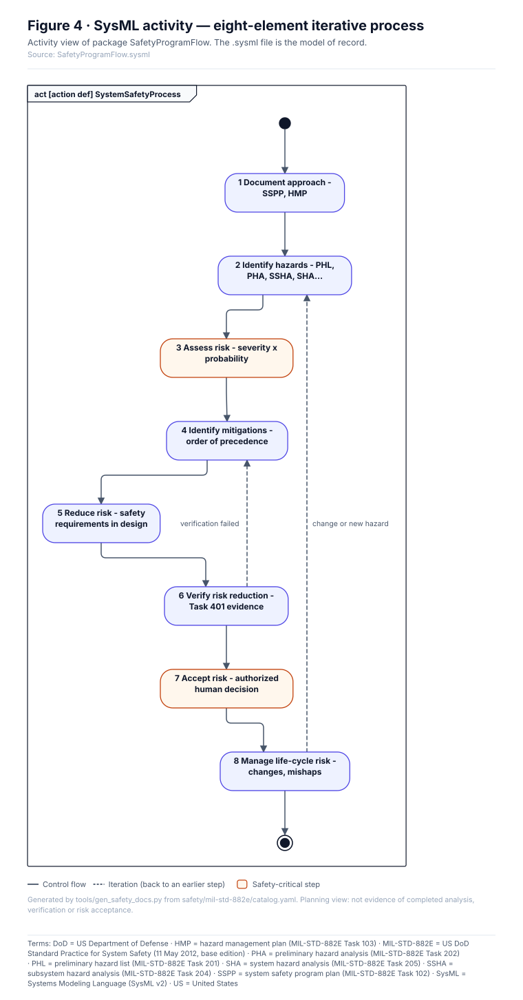

<!-- GENERATED by tools/previews/build_previews.py from docs/previews.yaml; do not edit. Edit the entry there and re-run. -->

# MIL-STD-882E model

MIL-STD-882E (11 May 2012, base edition) as data: process elements, tasks, obligations and tables, used by the validator and the conformance pages.

<!-- terms:start (generated by tools/terms/terms.py; do not edit by hand) -->

<b>Terms on this page (4)</b>: abbreviations and codes explained

| Term | Meaning |
|---|---|
| DoD | US Department of Defense |
| MIL-STD-882E | US DoD Standard Practice for System Safety (11 May 2012, base edition) |
| SysML | Systems Modeling Language (SysML v2) |
| US | United States |

All terms: [abbreviations and record codes](https://github.com/jherrodthomas/Project-Susanoo/blob/main/docs/terms.md).

<!-- terms:end -->

<!-- preview:start (generated by tools/previews/build_previews.py from docs/previews.yaml; do not edit by hand) -->

The eight-element process as a SysML activity

<table>
<tr><td width="33%" valign="top"> Safety lifecycle process map (illustrative)</td><td width="33%" valign="top"> Analysis dependencies (illustrative)</td></tr>
</table>

**Open:** [MIL-STD-882E Conformance (wiki page)](../../docs/wiki/MIL-STD-882E-Conformance.md)

<!-- preview:end -->

## Folder contents

| Item | Title |
|---|---|
| [`model.yaml`](model.yaml) |  |
