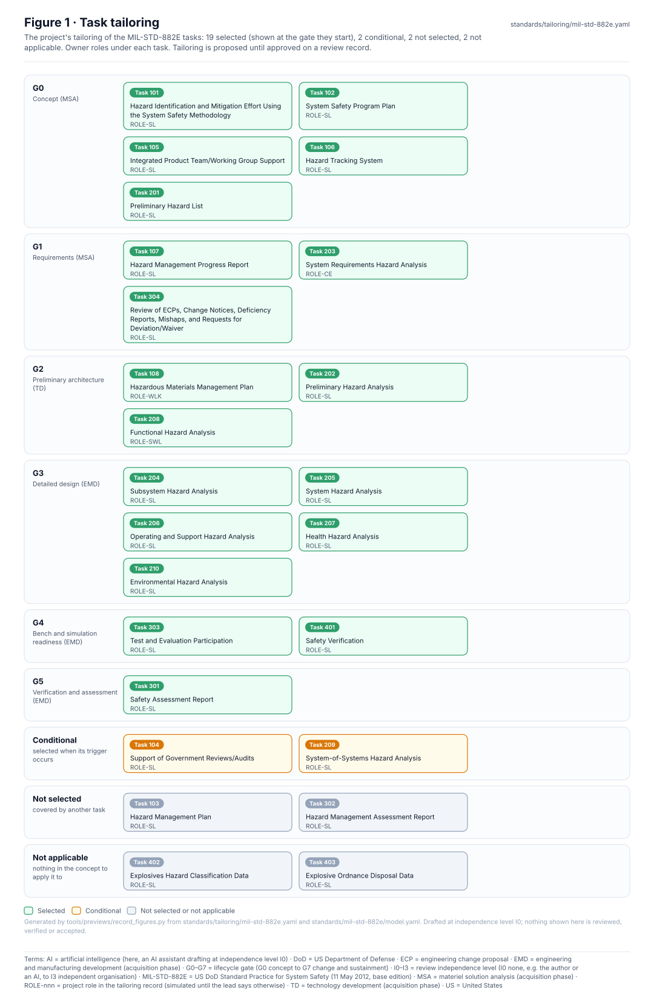
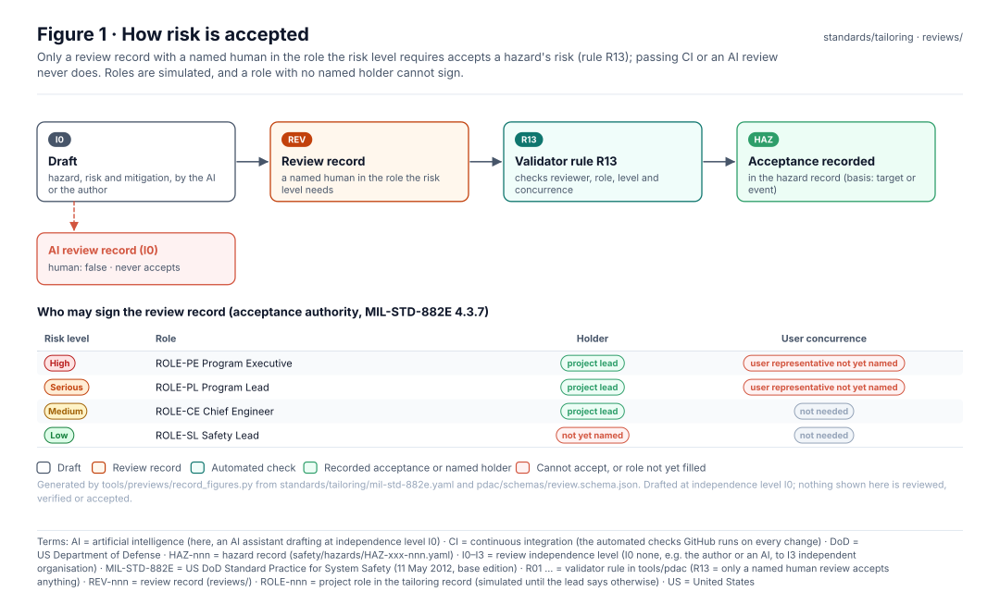
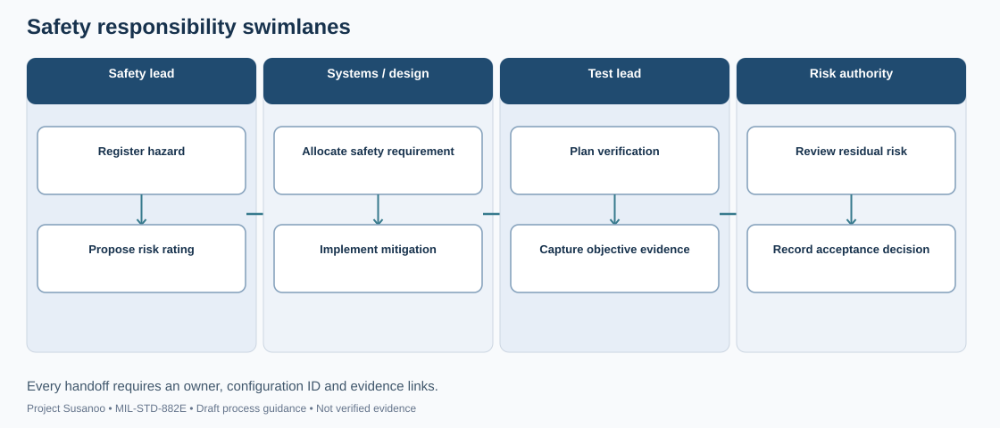
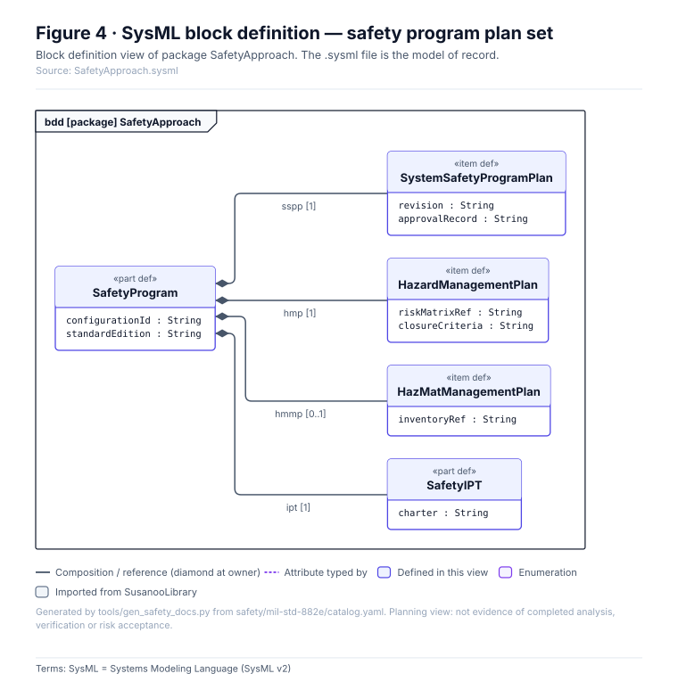

<!-- GENERATED by tools/previews/build_previews.py from docs/previews.yaml; do not edit. Edit the entry there and re-run. -->

# Project tailoring

How the project tailors MIL-STD-882E: risk definitions, roles and acceptance authority, task selection and ID conventions. Proposed until approved on a review record.

<!-- terms:start (generated by tools/terms/terms.py; do not edit by hand) -->

<b>Terms on this page (6)</b>: abbreviations and codes explained

| Term | Meaning |
|---|---|
| DoD | US Department of Defense |
| ID | identifier |
| MIL-STD-882E | US DoD Standard Practice for System Safety (11 May 2012, base edition) |
| SUS-I1 | integrated mechanized walker and observation UAV |
| UAV | uncrewed aerial vehicle (drone) |
| US | United States |

All terms: [abbreviations and record codes](https://github.com/jherrodthomas/Project-Susanoo/blob/main/docs/terms.md).

<!-- terms:end -->

<!-- preview:start (generated by tools/previews/build_previews.py from docs/previews.yaml; do not edit by hand) -->

Task tailoring: every MIL-STD-882E task by gate and disposition

<table>
<tr><td width="33%" valign="top"> Who may accept which risk</td><td width="33%" valign="top"> Responsibility swimlanes (illustrative)</td><td width="33%" valign="top"> Safety approach records</td></tr>
<tr><td width="33%" valign="top"> Risk matrix with the tailored definitions</td></tr>
</table>

**Open:** [Task Applicability (wiki page)](../../docs/wiki/MIL-STD-882E-Applicability.md)

<!-- preview:end -->

## Folder contents

| Item | Title |
|---|---|
| [`mil-std-882e.yaml`](mil-std-882e.yaml) | Project tailoring of MIL-STD-882E (11 May 2012 base edition) for SUS-I1. |
