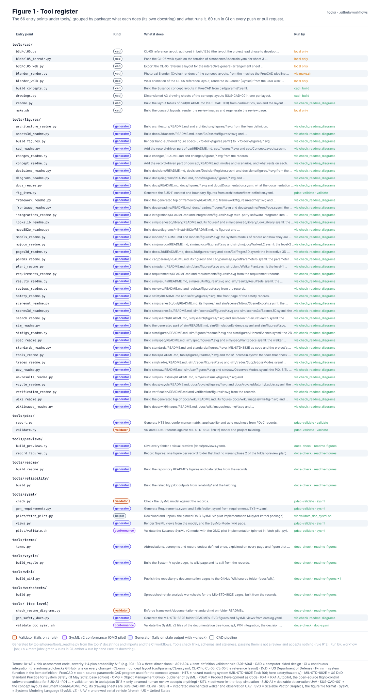
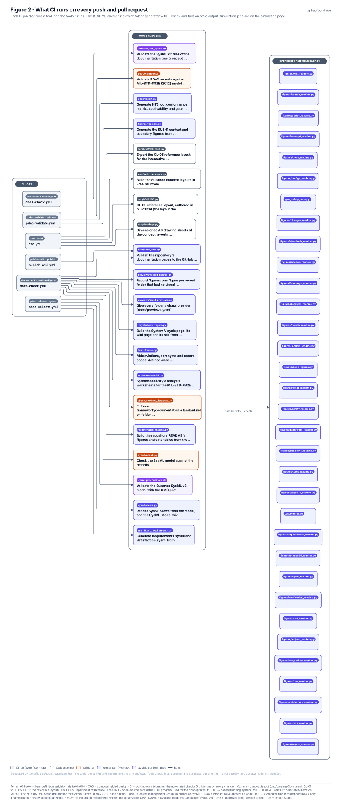
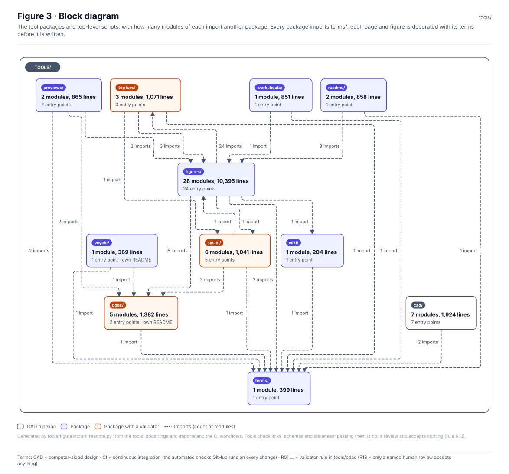
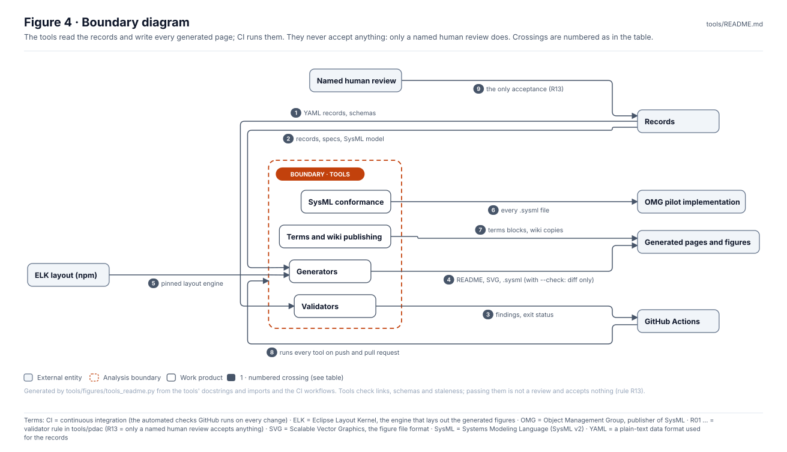
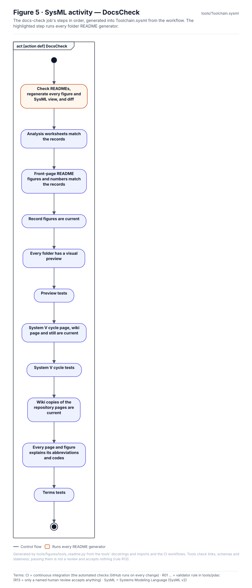
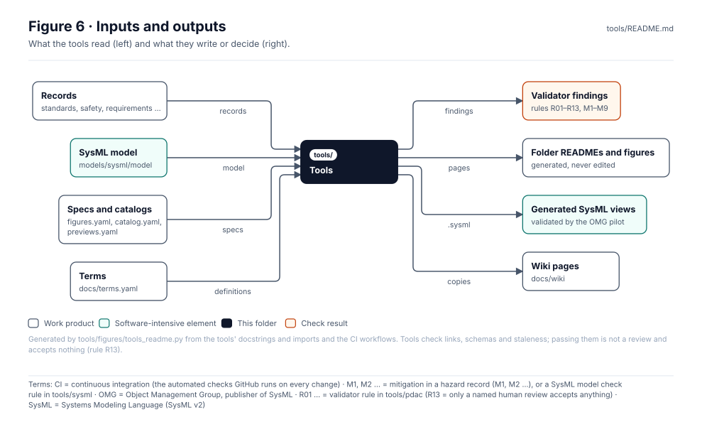

<!-- GENERATED by tools/figures/tools_readme.py from the tools' docstrings and imports and the CI workflows; edit those and regenerate. -->

# Tools

> **Status:** 68 entry points in 11 packages; 62 run in CI across 6 jobs. Tools check and build; they never review or accept (rule R13).

<!-- terms:start (generated by tools/terms/terms.py; do not edit by hand) -->

<b>Terms on this page (31)</b>: abbreviations and codes explained

| Term | Meaning |
|---|---|
| 1A–4F | risk assessment code, severity 1–4 plus probability A–F (e.g. 1C) |
| 3D | three-dimensional |
| A01–A04 | item-definition validator rule (A01–A04) |
| CAD | computer-aided design |
| CI | continuous integration (the automated checks GitHub runs on every change) |
| CL-nnn | concept layout (cad/params/CL-nn.yaml; CL-01 to CL-05, CL-05 the reference layout) |
| CSV | comma-separated values, a plain-text table format any spreadsheet program opens |
| DoD | US Department of Defense |
| ELK | Eclipse Layout Kernel, the engine that lays out the generated figures |
| F-nnn | system function in the item definition |
| FreeCAD | open-source parametric CAD program used for the concept layouts |
| HTS | hazard tracking system (MIL-STD-882E Task 106; here safety/hazards/) |
| L00 | link-resolution validator rule (L00) |
| M1, M2 … | mitigation in a hazard record (M1, M2 …), or a SysML model check rule in tools/sysml |
| MIL-STD-882E | US DoD Standard Practice for System Safety (11 May 2012, base edition) |
| MuJoCo | Multi-Joint dynamics with Contact, the physics engine for the level-2 walker model |
| OMG | Object Management Group, publisher of SysML |
| PDaC | Product Development as Code |
| PDF | Portable Document Format |
| PX4 | PX4 Autopilot, the open-source flight-control software candidate for SUS-A1 |
| R01 … | validator rule in tools/pdac (R13 = only a named human review accepts anything) |
| SITL | software-in-the-loop simulation |
| SSF-nnn | safety-significant software function record (safety/software/) |
| SUS-A1 | dockable observation UAV |
| SUS-CAD-001 | the concept layouts document (cad/README.md); its drawing sheets are SUS-CAD-001-CL-nn |
| SUS-I1 | integrated mechanized walker and observation UAV |
| SVG | Scalable Vector Graphics, the figure file format |
| SysML | Systems Modeling Language (SysML v2) |
| UAV | uncrewed aerial vehicle (drone) |
| US | United States |
| YAML | a plain-text data format used for the records |

All terms: [abbreviations and record codes](https://github.com/jherrodthomas/Project-Susanoo/blob/main/docs/terms.md).

<!-- terms:end -->

| Field | Value |
|---|---|
| Run before handing over | the check list in [`CLAUDE.md`](../CLAUDE.md) |
| CI | [`.github/workflows/`](../.github/workflows/) |
| Validator rules | [`pdac/README.md`](pdac/README.md) |
| SysML | [`Toolchain.sysml`](Toolchain.sysml) (generated) |

## Purpose

The code that keeps the repository honest: validators that check the records against MIL-STD-882E, the tailoring and the SysML model; generators that build every README, figure, SysML view and wiki page from the records; and the CAD pipeline. Every generator has `--check`, which CI runs and which fails on stale output, so a page can never say something its records do not.

## Tool register

| Entry point | Kind | What it does | Run by |
|---|---|---|---|
| [`cad/b3d/cl05.py`](cad/b3d/cl05.py) | cad | CL-05 reference layout, authored in build123d (the layout the project lead chose to develop, 2026-11-11). | local only |
| [`cad/b3d/cl05_terrain.py`](cad/b3d/cl05_terrain.py) | cad | Pose the CL-05 walk cycle on the terrains of sim/scenes3d/terrain.yaml for sheet 3 (docs/3d/SUS-M1-terrain.html). | local only |
| [`cad/b3d/cl05_web.py`](cad/b3d/cl05_web.py) | cad | Export the CL-05 reference layout for the interactive general-arrangement sheet (docs/3d/SUS-M1.html). | local only |
| [`cad/blender_render.py`](cad/blender_render.py) | cad | Photoreal Blender (Cycles) renders of the concept layouts, from the meshes the FreeCAD pipeline exports. | via make.sh |
| [`cad/blender_walk.py`](cad/blender_walk.py) | cad | Walk animation of the CL-05 reference layout, rendered in Blender (Cycles) from the CAD walk frames. | local only |
| [`cad/build_concepts.py`](cad/build_concepts.py) | cad | Build the Susanoo concept layouts in FreeCAD from cad/params/*.yaml. | cad · build |
| [`cad/drawings.py`](cad/drawings.py) | cad | Dimensioned A3 drawing sheets of the concept layouts (SUS-CAD-001), one per layout. | cad · build |
| [`cad/readme.py`](cad/readme.py) | cad | Build the layout tables of cad/README.md (SUS-CAD-001) from cad/metrics.json and the layout parameters. | via check_readme_diagrams |
| [`check_readme_diagrams.py`](check_readme_diagrams.py) | validator | Enforce framework/documentation-standard.md on folder READMEs. | docs-check · readme-figures |
| [`figures/architecture_readme.py`](figures/architecture_readme.py) | generator | Build architecture/README.md and architecture/figures/*.svg from the item definition. | via check_readme_diagrams |
| [`figures/assets3d_readme.py`](figures/assets3d_readme.py) | generator | Build docs/3d/assets/README.md, docs/3d/assets/figures/*.svg and docs/3d/assets/CL05Geometry.sysml: the geometry the general-arrangement sheets load. | via check_readme_diagrams |
| [`figures/build_figures.py`](figures/build_figures.py) | generator | Render hand-authored figure specs (`<folder>/figures.yaml`) to `<folder>/figures/*.svg`. | via check_readme_diagrams |
| [`figures/cad_readme.py`](figures/cad_readme.py) | generator | Add the record-driven part of cad/README.md, cad/figures/*.svg and cad/ConceptLayouts.sysml. | via check_readme_diagrams |
| [`figures/changes_readme.py`](figures/changes_readme.py) | generator | Build changes/README.md and changes/figures/*.svg from the records. | via check_readme_diagrams |
| [`figures/concept_readme.py`](figures/concept_readme.py) | generator | Add the record-driven part of concept/README.md: modes and scenarios, and what rests on each. | via check_readme_diagrams |
| [`figures/decisions_readme.py`](figures/decisions_readme.py) | generator | Build decisions/README.md, decisions/DecisionRegister.sysml and decisions/figures/*.svg from the register. | via check_readme_diagrams |
| [`figures/diagrams_readme.py`](figures/diagrams_readme.py) | generator | Build docs/diagrams/README.md, docs/diagrams/figures/*.svg and docs/diagrams/ProcessMaps.sysml: the process-map sources. | via check_readme_diagrams |
| [`figures/docs_readme.py`](figures/docs_readme.py) | generator | Build docs/README.md, docs/figures/*.svg and docs/Documentation.sysml: what the documentation folder holds. | via check_readme_diagrams |
| [`figures/drawings_readme.py`](figures/drawings_readme.py) | generator | Build cad/drawings/README.md, its figures/ and cad/drawings/DrawingSheets.sysml: the dimensioned A3 sheets of the concept layouts (SUS-CAD-001-CL-nn) and the PDF that collects them. | via check_readme_diagrams |
| [`figures/fig_item.py`](figures/fig_item.py) | generator | Generate the SUS-I1 context and boundary figures from architecture/item-definition.yaml. | pdac-validate · validate |
| [`figures/framework_readme.py`](figures/framework_readme.py) | generator | Build the generated top of framework/README.md, framework/figures/readme/*.svg and framework/Lifecycle.sysml. | via check_readme_diagrams |
| [`figures/frontpage_readme.py`](figures/frontpage_readme.py) | generator | Build docs/readme/README.md, docs/readme/figures/*.svg and docs/readme/FrontPage.sysml: the front-page figures. | via check_readme_diagrams |
| [`figures/integrations_readme.py`](figures/integrations_readme.py) | generator | Build integrations/README.md and integrations/figures/*.svg: third-party software integrated into SUS-I1. | via check_readme_diagrams |
| [`figures/lookslib_readme.py`](figures/lookslib_readme.py) | generator | Build sim/scenes3d/library/README.md, its figures/ and sim/scenes3d/library/LookLibrary.sysml: the look-only library the 3D scenes are composed from. | via check_readme_diagrams |
| [`figures/maps882e_readme.py`](figures/maps882e_readme.py) | generator | Build docs/diagrams/mil-std-882e/README.md, its figures/ and docs/diagrams/mil-std-882e/MapActivities.sysml: the MIL-STD-882E process-map sources. | via check_readme_diagrams |
| [`figures/models_readme.py`](figures/models_readme.py) | generator | Build models/README.md and models/figures/*.svg: the system models of record and how they are checked. | via check_readme_diagrams |
| [`figures/mujoco_readme.py`](figures/mujoco_readme.py) | generator | Build sim/mujoco/README.md, sim/mujoco/figures/*.svg and sim/mujoco/WalkerL2.sysml: the level-2 MuJoCo model. | via check_readme_diagrams |
| [`figures/pages3d_readme.py`](figures/pages3d_readme.py) | generator | Build docs/3d/README.md, docs/3d/figures/*.svg and docs/3d/Pages3D.sysml: the interactive 3D pages. | via check_readme_diagrams |
| [`figures/params_readme.py`](figures/params_readme.py) | generator | Build cad/params/README.md, its figures/ and cad/params/LayoutParameters.sysml: the parameter files every concept layout is built from. | via check_readme_diagrams |
| [`figures/plant_readme.py`](figures/plant_readme.py) | generator | Build sim/plant/README.md, sim/plant/figures/*.svg and sim/plant/WalkerPlant.sysml: the level-1 walker plant. | via check_readme_diagrams |
| [`figures/renders_readme.py`](figures/renders_readme.py) | generator | Build cad/renders/README.md, its figures/ and cad/renders/ReviewRenders.sysml: the review images of the concept layouts and the Blender renders and walk clips of CL-05. | via check_readme_diagrams |
| [`figures/requirements_readme.py`](figures/requirements_readme.py) | generator | Build requirements/README.md and requirements/figures/*.svg from the requirement records. | via check_readme_diagrams |
| [`figures/results_readme.py`](figures/results_readme.py) | generator | Build sim/results/README.md, sim/results/figures/*.svg and sim/results/ResultSets.sysml: the committed results. | via check_readme_diagrams |
| [`figures/reviews_readme.py`](figures/reviews_readme.py) | generator | Build reviews/README.md and reviews/figures/*.svg from the records. | via check_readme_diagrams |
| [`figures/safety_readme.py`](figures/safety_readme.py) | generator | Build safety/README.md and safety/figures/*.svg: the front page of the safety records. | via check_readme_diagrams |
| [`figures/sceneout_readme.py`](figures/sceneout_readme.py) | generator | Build sim/scenes3d/out/README.md, its figures/ and sim/scenes3d/out/SceneExports.sysml: the exported analysis of every 3D scene, the data the 3D pages replay. | via check_readme_diagrams |
| [`figures/scenes3d_readme.py`](figures/scenes3d_readme.py) | generator | Build sim/scenes3d/README.md, sim/scenes3d/figures/*.svg and sim/scenes3d/Scenes3D.sysml: the 3D scene builder. | via check_readme_diagrams |
| [`figures/search_readme.py`](figures/search_readme.py) | generator | Build sim/search/README.md, sim/search/figures/*.svg and sim/search/FailureSearch.sysml: the failure search. | via check_readme_diagrams |
| [`figures/sim_readme.py`](figures/sim_readme.py) | generator | Build the generated part of sim/README.md, sim/SimulationEvidence.sysml and sim/figures/*.svg. | via check_readme_diagrams |
| [`figures/simfigs_readme.py`](figures/simfigs_readme.py) | generator | Build sim/figures/README.md, sim/figures/readme/*.svg and sim/figures/HazardScenes.sysml: the 2D hazard scenes. | via check_readme_diagrams |
| [`figures/spec_readme.py`](figures/spec_readme.py) | generator | Build sim/spec/README.md, sim/spec/figures/*.svg and sim/spec/PlantSpecs.sysml: the walker parameter specs. | via check_readme_diagrams |
| [`figures/standards_readme.py`](figures/standards_readme.py) | generator | Build standards/README.md and standards/figures/*.svg: MIL-STD-882E as code and the project's tailoring. | via check_readme_diagrams |
| [`figures/tools_readme.py`](figures/tools_readme.py) | generator | Build tools/README.md, tools/figures/readme/*.svg and tools/Toolchain.sysml: the tools that check and build the repo. | via check_readme_diagrams |
| [`figures/trades_readme.py`](figures/trades_readme.py) | generator | Build sim/trades/README.md, sim/trades/figures/*.svg and sim/trades/SupplyLossModes.sysml: trade-study evidence. | via check_readme_diagrams |
| [`figures/uav_readme.py`](figures/uav_readme.py) | generator | Build sim/uav/README.md, sim/uav/figures/*.svg and sim/uav/ObservedModes.sysml: the PX4 SITL failsafe harness. | via check_readme_diagrams |
| [`figures/uavresults_readme.py`](figures/uavresults_readme.py) | generator | Build sim/results/uav/README.md, sim/results/uav/figures/*.svg and sim/results/uav/SitlResults.sysml: the PX4 SITL result files. | via check_readme_diagrams |
| [`figures/vcycle_readme.py`](figures/vcycle_readme.py) | generator | Build docs/vcycle/README.md, docs/vcycle/figures/*.svg and docs/vcycle/MaturityLadder.sysml: the System V cycle page. | via check_readme_diagrams |
| [`figures/verification_readme.py`](figures/verification_readme.py) | generator | Build verification/README.md and verification/figures/*.svg from the records. | via check_readme_diagrams |
| [`figures/wiki_readme.py`](figures/wiki_readme.py) | generator | Build the generated top of docs/wiki/README.md, its figures docs/wiki/images/wiki-fig-*.svg and docs/wiki/WikiPublication.sysml: the wiki source. | via check_readme_diagrams |
| [`figures/wikiimages_readme.py`](figures/wikiimages_readme.py) | generator | Build docs/wiki/images/README.md, docs/wiki/images/readme/*.svg and docs/wiki/images/WikiImages.sysml: the figures the wiki shows directly. | via check_readme_diagrams |
| [`gen_safety_docs.py`](gen_safety_docs.py) | generator | Generate the MIL-STD-882E folder READMEs, SVG figures and SysML views from catalog.yaml. | via check_readme_diagrams |
| [`pdac/report.py`](pdac/report.py) | generator | Generate HTS log, conformance matrix, applicability and gate readiness from PDaC records. | pdac-validate · validate |
| [`pdac/validate.py`](pdac/validate.py) | validator | Validate PDaC records against MIL-STD-882E (2012) model and project tailoring. | pdac-validate · validate |
| [`previews/build_previews.py`](previews/build_previews.py) | generator | Give every folder a visual preview (docs/previews.yaml). | docs-check · readme-figures |
| [`previews/record_figures.py`](previews/record_figures.py) | generator | Record figures: one figure per record folder that had no visual (phase 2 of the folder-preview plan). | docs-check · readme-figures |
| [`readme/build_readme.py`](readme/build_readme.py) | generator | Build the repository README's figures and data tables from the records. | docs-check · readme-figures |
| [`reliability/build.py`](reliability/build.py) | generator | Build the reliability pilot outputs from reliability/ and the tailoring. | docs-check · readme-figures |
| [`sysml/check.py`](sysml/check.py) | validator | Check the SysML model against the records. | pdac-validate · sysml |
| [`sysml/gen_requirements.py`](sysml/gen_requirements.py) | generator | Generate Requirements.sysml and Satisfaction.sysml from requirements/SYS-*.yaml. | pdac-validate · sysml |
| [`sysml/pilot/fetch_pilot.py`](sysml/pilot/fetch_pilot.py) | helper | Download and unpack the pinned OMG SysML v2 pilot implementation (Jupyter kernel package). | via validate_doc_sysml.sh |
| [`sysml/views.py`](sysml/views.py) | generator | Render SysML views from the model, and the SysML-Model wiki page. | pdac-validate · sysml |
| [`terms/terms.py`](terms/terms.py) | generator | Abbreviations, acronyms and record codes: defined once, explained on every page and figure that uses them. | docs-check · readme-figures |
| [`vcycle/build_vcycle.py`](vcycle/build_vcycle.py) | generator | Build the System V cycle page, its wiki page and its still from the records. | docs-check · readme-figures |
| [`wiki/build_wiki.py`](wiki/build_wiki.py) | generator | Publish the repository's documentation pages to the GitHub Wiki source folder (docs/wiki). | docs-check · readme-figures, publish-wiki · publish |
| [`worksheets/build.py`](worksheets/build.py) | generator | Spreadsheet-style analysis worksheets for the MIL-STD-882E pages, built from the records. | docs-check · readme-figures |
| [`validate_doc_sysml.sh`](validate_doc_sysml.sh) | conformance | Validate the SysML v2 files of the documentation tree (concept, PX4 integration, the decision register, the simulation evidence gate and every generated folder view under safety/mil-std-882e), together with the project model they import (models/sysml/model), with the OMG pilot implementation pinned by tools/sysml/pilot. | docs-check · doc-sysml |
| [`sysml/pilot/validate.sh`](sysml/pilot/validate.sh) | conformance | Validate the Susanoo SysML v2 model with the OMG pilot implementation (pinned in fetch_pilot.py). | pdac-validate · sysml |
| [`cad/make.sh`](cad/make.sh) | cad | Build the concept layouts, render the review images and regenerate the review page. | local only |

## What CI runs

| Workflow · job | Step | Tool |
|---|---|---|
| cad · build | Build geometry and metrics | `tools/cad/build_concepts.py` |
| cad · build | Drawing sheets | `tools/cad/drawings.py` |
| docs-check · readme-figures | Check READMEs, regenerate every figure and SysML view, and diff | `tools/check_readme_diagrams.py` |
| docs-check · readme-figures | Analysis worksheets (images, CSV, Excel workbook) match the records | `tools/worksheets/build.py` |
| docs-check · readme-figures | Front-page README figures and numbers match the records | `tools/readme/build_readme.py` |
| docs-check · readme-figures | Record figures are current (decisions, traceability, mitigations, SSFs, events, tailoring, record model, L1/L2, acceptance) | `tools/previews/record_figures.py` |
| docs-check · readme-figures | Every folder has a visual preview (docs/previews.yaml) | `tools/previews/build_previews.py` |
| docs-check · readme-figures | System V cycle page, wiki page and still are current (tools/vcycle) | `tools/vcycle/build_vcycle.py` |
| docs-check · readme-figures | Reliability pilot page, figures and numbers are current (tools/reliability) | `tools/reliability/build.py` |
| docs-check · readme-figures | Wiki copies of the repository pages are current (docs/wiki, assets.txt) | `tools/wiki/build_wiki.py` |
| docs-check · readme-figures | Every page and figure explains its abbreviations and codes (docs/terms.yaml) | `tools/terms/terms.py` |
| docs-check · doc-sysml | Validate canonical models, concept, PX4 and every folder SysML view | `tools/validate_doc_sysml.sh` |
| pdac-validate · validate | Validate records against MIL-STD-882E model and tailoring | `tools/pdac/validate.py` |
| pdac-validate · validate | Check generated HTS, conformance, gate, item and decision pages are current | `tools/pdac/report.py` |
| pdac-validate · validate | Check item-definition figures match their record and layout | `tools/figures/fig_item.py` |
| pdac-validate · sysml | Generated model files match the requirement records | `tools/sysml/gen_requirements.py` |
| pdac-validate · sysml | Model matches the item definition and records (M1 M2 M4 M9 R1 R2 R3) | `tools/sysml/check.py` |
| pdac-validate · sysml | Views and SysML page are current | `tools/sysml/views.py` |
| pdac-validate · sysml | SysML v2 conformance (OMG pilot implementation 0.62.0) | `tools/sysml/pilot/validate.sh` |
| publish-wiki · publish | Publish pages to the separate Wiki repository | `tools/wiki/build_wiki.py` |

## Block diagram

| Package | Imports from |
|---|---|
| cad | terms (2) |
| figures | (top level) (41), pdac (6), sysml (1), terms (3), vcycle (1), wiki (2) |
| pdac | terms (1) |
| previews | figures (2), pdac (2), terms (2) |
| readme | figures (3), terms (1) |
| reliability | terms (1) |
| sysml | figures (1), pdac (3), terms (1) |
| terms | — |
| vcycle | pdac (1), terms (1) |
| wiki | terms (1) |
| worksheets | figures (1), terms (1) |
| (top level) | figures (3), sysml (1), terms (1) |

## Boundary diagram

| # | From | To | Crossing / interaction |
|---|---|---|---|
| 1 | Records | Validators | YAML records, schemas |
| 2 | Records | Generators | records, specs, SysML model |
| 3 | Validators | GitHub Actions | findings, exit status |
| 4 | Generators | Generated pages and figures | README, SVG, .sysml (with --check: diff only) |
| 5 | ELK layout (npm) | Generators | pinned layout engine |
| 6 | SysML conformance | OMG pilot implementation | every .sysml file |
| 7 | Terms and wiki publishing | Generated pages and figures | terms blocks, wiki copies |
| 8 | GitHub Actions | Tools | runs every tool on push and pull request |
| 9 | Named human review | Records | the only acceptance (R13) |

**Explicitly excluded:** simulation code (`sim/`, its own page), review and acceptance (people, through review records), and anything that edits a record on its own.

## SysML model

[`Toolchain.sysml`](Toolchain.sysml) is generated from the docs-check workflow and validated with the project model by the OMG pilot in CI.

## Inputs and outputs

| Input | Source |
|---|---|
| Records | `standards/`, `architecture/`, `safety/`, `requirements/`, `verification/`, `changes/`, `reviews/`, `decisions/` |
| SysML model | [`models/sysml/model/`](../models/sysml/model/) |
| Figure specs and catalogs | `figures.yaml` files, `safety/mil-std-882e/catalog.yaml`, `docs/previews.yaml` |
| Terms | [`docs/terms.yaml`](../docs/terms.yaml) |

| Output | Destination |
|---|---|
| Findings | CI status on every push and pull request |
| READMEs, figures, SysML views | every folder (generated parts only) |
| Wiki pages | [`docs/wiki/`](../docs/wiki/) |

## Adding a tool

1. Give the module a docstring whose first line says what it does; this page reads it.
2. Pass every page and figure through `tools.terms.terms.decorate` before writing, and give it `--check`.
3. Add a CI step (or an entry in `ENFORCED` of `check_readme_diagrams.py` for a README generator) and add the command to the check list in `CLAUDE.md`.
4. Regenerate with `python3 tools/figures/tools_readme.py` and run the full check list.

## Folder contents

| Item | Description | State |
|---|---|---|
| [`cad/`](cad/) | 9 modules | code |
| [`figures/`](figures/) | 45 modules | code |
| [`pdac/`](pdac/) | 5 modules · has its own README | code |
| [`previews/`](previews/) | 2 modules | code |
| [`readme/`](readme/) | 2 modules | code |
| [`reliability/`](reliability/) | 2 modules · has its own README | code |
| [`sysml/`](sysml/) | 6 modules | code |
| [`terms/`](terms/) | 1 module | code |
| [`vcycle/`](vcycle/) | 1 module · has its own README | code |
| [`wiki/`](wiki/) | 1 module | code |
| [`worksheets/`](worksheets/) | 1 module | code |
| [`check_readme_diagrams.py`](check_readme_diagrams.py) | Enforce framework/documentation-standard.md on folder READMEs. | code |
| [`gen_safety_docs.py`](gen_safety_docs.py) | Generate the MIL-STD-882E folder READMEs, SVG figures and SysML views from catalog.yaml. | code |
| [`validate_doc_sysml.sh`](validate_doc_sysml.sh) | Validate the SysML v2 files of the documentation tree (concept, PX4 integration, the decision register, the simulation evidence gate and every generated folder view under safety/mil-std-882e), together with the project model they import (models/sysml/model), with the OMG pilot implementation pinned by tools/sysml/pilot. | code |
| [`Toolchain.sysml`](Toolchain.sysml) | The docs-check job as a SysML activity | generated |
| `README.md` | This page | generated |

<!-- END GENERATED: content below this line is human-authored and preserved -->
