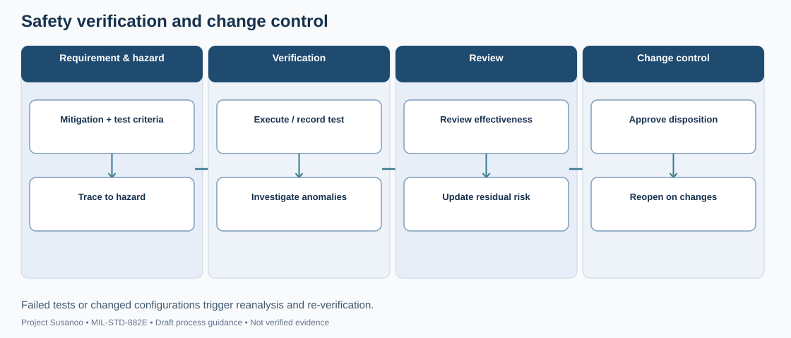
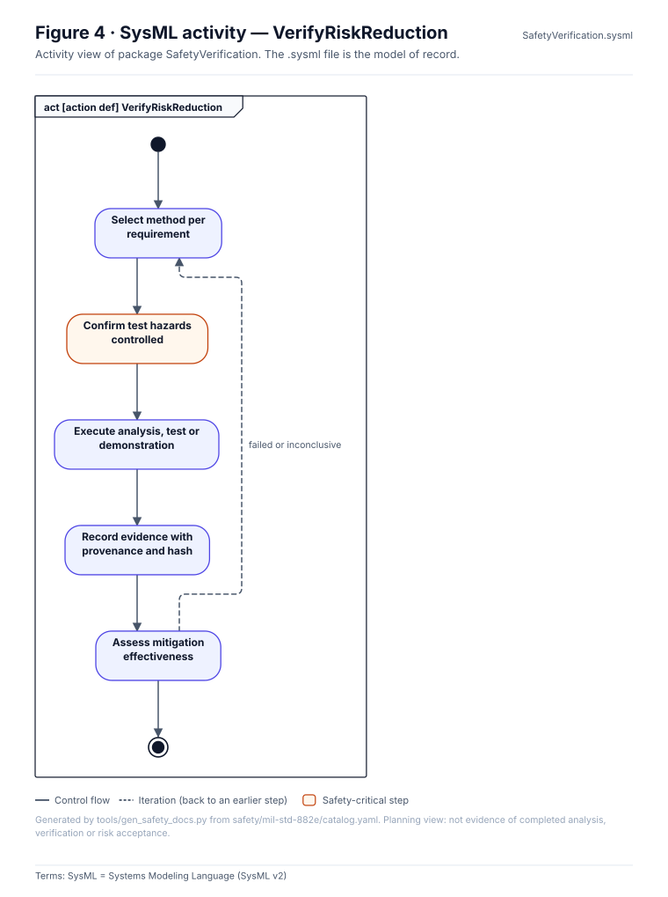

# Verification records (MIL-STD-882E 4.3.6, Task 401)

One `VER-NNN.yaml` per verification activity (schema `pdac/schemas/verification.schema.json`). Mitigations cite these by `evidence_ids`. A hazard can only move to `verified` when every selected mitigation is implemented and has passed evidence (rule R04). Set `simulated: true` for simulation-only results; they never stand in for hardware verification.

<!-- terms:start (generated by tools/terms/terms.py; do not edit by hand) -->

<b>Terms on this page (4)</b>: abbreviations and codes explained

| Term | Meaning |
|---|---|
| DoD | US Department of Defense |
| MIL-STD-882E | US DoD Standard Practice for System Safety (11 May 2012, base edition) |
| R01 … | validator rule in tools/pdac (R13 = only a named human review accepts anything) |
| US | United States |

All terms: [abbreviations and record codes](https://github.com/jherrodthomas/Project-Susanoo/blob/main/docs/terms.md).

<!-- terms:end -->

<!-- preview:start (generated by tools/previews/build_previews.py from docs/previews.yaml; do not edit by hand) -->

Verification and change process map (illustrative)

<table>
<tr><td width="33%" valign="top"> Element 6: verification activity</td></tr>
</table>

<!-- preview:end -->

